# Capítulo IV: Strategic-Level Software Design
## 4.1. Strategic-Level Attribute-Driven Design
Aquí se explica el proceso de diseño Attribute-Driven Design aplicado a Intiva, detallando su propósito, los inputs considerados, los drivers arquitectónicos, las decisiones de diseño tomadas, los escenarios de atributos de calidad y las primeras vistas de la arquitectura de solución a alto nivel.
### 4.1.1. Design Purpose
El propósito del diseño de Intiva es establecer una arquitectura de software que soporte la gestión financiera personal y familiar de forma centralizada, asegurando mantenibilidad, seguridad y facilidad de uso para usuarios con poca experiencia en herramientas financieras. Se trata de un sistema greenfield desarrollado por una startup en etapa inicial, cuyo diseño debe habilitar tres frontends (landing page estática, aplicación web y aplicación móvil nativa Android) consumiendo APIs RESTful propias. Esas APIs las exponen microservicios, uno por bounded context, a los que se accede a través de un API Gateway.

La solución busca reemplazar los métodos manuales identificados en la etapa de needfinding (hojas de cálculo en Excel, notas del celular y revisión de billeteras digitales) por una plataforma que registre ingresos y gastos, los clasifique por categorías, controle límites de presupuesto, gestione metas de ahorro y envíe recordatorios automáticos de pagos. Adicionalmente, el diseño debe soportar un modelo colaborativo de grupo familiar que permita compartir información financiera entre miembros, respetando la privacidad de los gastos personales de cada integrante, requisito levantado explícitamente durante las entrevistas.

La plataforma también incorpora IA agéntica. Un agente proyecta los gastos del próximo mes, compara la proyección con los límites y las metas del usuario y le propone un plan con ajustes. El agente puede consultar datos y preparar acciones por su cuenta, pero solo aplica la versión del plan que el usuario revisa y aprueba. Además, sugiere una categoría al registrar un gasto y responde consultas en un chat que solo recomienda, sin registrar ni modificar datos. Estas funciones estarán disponibles para toda persona que inicie sesión; el plan premium se definirá en una etapa posterior.
### 4.1.2. Attribute-Driven Design Inputs
Esta sección contiene las secciones para los tres tipos de input para el proceso de diseño con Attribute-Driven Design.
#### 4.1.2.1. Primary Functionality (Primary User Stories)
A continuación se presentan las historias de usuario arquitectónicamente significativas, es decir, aquellas que son críticas para la propuesta de valor del negocio, que presentan mayor riesgo técnico o que atraviesan más de un bounded context del sistema.

| Epic / User Story ID | Título | Descripción | Criterios de Aceptación | Relacionado con (Epic ID) |
|---|---|---|---|---|
| EP 002 / US 003 | Registro de usuario | Como visitante quiero registrarme para utilizar las funcionalidades de la aplicación. | Dado que el visitante no posee una cuenta, cuando complete su registro ingresando nombre completo, correo y contraseña, entonces el sistema crea una cuenta para dicho visitante. | EP 002 |
| EP 002 / US 005 | Inicio de sesión | Como usuario no autenticado quiero iniciar sesión para acceder de forma segura a mi cuenta. | Dado que el usuario tenga una cuenta registrada, cuando ingresa su correo y contraseña, entonces accede a su cuenta mediante un token de sesión válido. | EP 002 |
| EP 005 / US 014 | Registrar gasto | Como usuario quiero registrar un gasto para poseer un registro detallado de los gastos que hago con mi dinero. | Dado que el usuario tenga una cuenta financiera o efectivo disponible, cuando registra un gasto e ingresa origen, monto, fecha y frecuencia, entonces se guarda el gasto y se actualiza el saldo según el origen seleccionado. | EP 005 |
| EP 005 / US 018 | Definir límites de gasto | Como usuario quiero establecer un límite de gasto para no exceder mi presupuesto. | Dado que el usuario tenga categorías o cuentas registradas, cuando establece un límite para un periodo determinado (diario, semanal o mensual), entonces se guarda el límite configurado y se aplica durante ese periodo. | EP 005 |
| EP 006 / US 019 | Crear una meta de ahorro | Como usuario quiero crear una meta de ahorro para establecer un objetivo financiero, ya sea personal o compartido con mi familia. | Dado que el usuario ingrese el nombre, monto objetivo y fecha límite, cuando confirme la creación, entonces se registra la meta en su cuenta o para todo el grupo familiar según corresponda. | EP 006 |
| EP 007 / US 023 | Gestionar un grupo familiar | Como responsable de la economía familiar quiero gestionar un grupo familiar en la plataforma para manejar ingresos, gastos y ahorros compartidos con mi familia. | Dado que un responsable de familia quiera compartir sus finanzas, cuando ingrese el nombre del grupo y envíe invitaciones mediante enlace o código QR, entonces se crea el grupo familiar y queda asignado como administrador. | EP 007 |
| EP 008 / US 030 | Recibir recordatorios sobre el vencimiento del pago | Como usuario quiero ser notificado sobre la fecha de pago para no olvidar la fecha de pago. | Dado que el usuario configuró una fecha de pago a un gasto, cuando dicha fecha se encuentra cerca de su vencimiento, entonces se envía una notificación al usuario indicando qué pago está próximo a vencer. | EP 008 |
| EP 008 / US 029 | Notificación por eventos relacionados a grupos familiares | Como usuario quiero que se me notifique cuando se realice una transacción en mi grupo familiar para estar al tanto de los movimientos que realiza mi familia. | Dado que un usuario pertenece a un grupo, cuando otro integrante realiza una transacción, entonces se le envía una notificación sobre la acción realizada. | EP 008 |
| EP 009 / US 031 | Visualizar gráficos estadísticos con datos de gastos, ingresos y ahorro | Como responsable de la economía familiar quiero visualizar los ingresos, gastos y ahorros mediante un dashboard y gráficos estadísticos para identificar patrones de gasto y tendencias de ahorro. | Dado que el usuario quiera visualizar sus datos financieros, cuando acceda al dashboard, entonces se muestran gráficos según categoría, cuentas, límites de gasto y metas de ahorro, filtrables por periodo. | EP 009 |
| EP 011 / US 032 | Proyectar, revisar y aprobar el plan mensual | Como usuario quiero que el agente de IA me proponga un plan para el próximo mes que yo pueda editar y aprobar para anticipar riesgos y organizar mi presupuesto. | Dado que el usuario revisó la versión vigente del borrador, cuando la aprueba, entonces se aplican los límites y recordatorios del plan, los aportes previstos quedan registrados sin mover dinero y el plan pasa a activo. | EP 011 |
| EP 010 / US 033 | Sugerencia automática de categoría (IA) | Como usuario quiero que el sistema me sugiera una categoría al registrar un gasto para clasificar mis gastos sin esfuerzo manual. | Dado que el usuario ingresa un gasto, cuando solicita una sugerencia, entonces el sistema propone una categoría de su catálogo, que el usuario acepta o cambia antes de guardar. | EP 010 |
#### 4.1.2.2. Quality Attribute Scenarios
En esta sección se detallan los escenarios de atributos de calidad que tienen mayor impacto sobre las decisiones arquitectónicas de Intiva. Estos escenarios derivan directamente de los requisitos no funcionales identificados previamente y representan situaciones clave que el sistema debe ser capaz de manejar con eficacia.

| Atributo | Fuente | Estímulo | Artefacto | Entorno | Respuesta | Medida |
|---|---|---|---|---|---|---|
| **Usabilidad** | Usuario sin experiencia previa en apps financieras | Intenta registrar un gasto por primera vez | Aplicación móvil (Jetpack Compose) | Producción, uso diario | El sistema guía el registro con terminología intuitiva y campos mínimos | Registro completado en menos de 5 pasos |
| **Rendimiento** | Usuario | Registra una transacción de ingreso o gasto | API REST de transacciones | Producción bajo condiciones normales | El sistema persiste la operación y actualiza el saldo | Tiempo de respuesta menor a 1.5 s en operaciones de escritura y 2 s en consultas |
| **Seguridad** | Usuario no autorizado | Intenta acceder con credenciales inválidas o con un token manipulado | Servicio de autenticación (IAM) | Producción | El sistema rechaza el acceso con estado 401 sin exponer detalles internos | 100% de intentos inválidos bloqueados; contraseñas almacenadas con hash BCrypt |
| **Privacidad** | Integrante de un grupo familiar | Intenta consultar los gastos personales de otro miembro del grupo | Microservicio Household | Producción, entorno compartido | El sistema restringe la visualización según el rol y la marca de privacidad del registro | 0 accesos no autorizados a gastos marcados como personales |
| **Disponibilidad** | Usuario | Solicita acceso a su información financiera en cualquier momento | Backend desplegado en Azure | Producción | El sistema responde sin interrupciones del servicio | Uptime mensual no menor al 95% |
| **Interoperabilidad** | Servicio externo (Firebase Cloud Messaging, Cloudinary, Google OAuth2, Gemini API) | Devuelve un error, un token inválido o no está disponible | Adaptadores de integración de cada microservicio | Producción | El sistema maneja la excepción sin interrumpir el flujo principal de la aplicación | 100% de fallos de terceros manejados sin caída del servicio |
| **Disponibilidad** | Microservicio consumidor de eventos (por ejemplo, Communications) | Se detiene mientras otros servicios siguen publicando eventos | Message broker (RabbitMQ) y colas de cada servicio | Producción | Los eventos se conservan en la cola del servicio caído y se procesan cuando vuelve a estar disponible | 0 eventos perdidos; el resto de servicios sigue respondiendo |
| **Modificabilidad** | Equipo de desarrollo | Necesita añadir un nuevo tipo de cuenta financiera o una nueva categoría de análisis | Microservicios del backend | Desarrollo | El cambio se realiza dentro de un solo microservicio sin afectar a los demás | Modificación localizada en un único microservicio, que se redespliega sin detener a los demás |
| **Precisión funcional** | Usuario | Registra un gasto cuyo comercio es reconocible | Microservicio AI Agent (sugerencia de categoría con Gemini) | Producción | El sistema sugiere una categoría junto con un nivel de confianza, permitiendo al usuario corregirla | ≥ 80% de aciertos en comercios frecuentes; el usuario siempre puede corregir la sugerencia |
| **Privacidad** | Usuario autenticado | Solicita un análisis con IA | Microservicio AI Agent | Producción | Solo comparte movimientos autorizados y datos mínimos; no envía credenciales | 0 registros de otros grupos expuestos |
#### 4.1.2.3. Constraints
En esta sección reunimos aquellas condiciones que no son opcionales y son restricciones establecidas por necesidades propias del negocio y del contexto académico del proyecto, las cuales debemos respetar para asegurar que la solución propuesta sea viable y cumpla con las expectativas. A continuación, se presentan los principales constraints en forma de Technical Stories, sirviendo como guía concreta para el desarrollo del sistema.

| ID | Título | Descripción | Criterios de Aceptación | Relacionado con |
|---|---|---|---|---|
| C-01 | Stack tecnológico del backend | El backend debe implementarse con Java 21 (LTS) y Spring Boot, empleando Spring Web, Spring Data JPA, Hibernate, Spring Security y Lombok, además de Spring Cloud Gateway para el API Gateway y Spring AI para la integración con Gemini. | Dado que se requiere estabilidad y soporte a largo plazo, cuando se inicie el desarrollo del backend, entonces el stack debe quedar documentado con sus versiones mínimas requeridas. | TS 005, TS 016, TS 024 |
| C-02 | Stack tecnológico del frontend web | La aplicación web debe desarrollarse en Vue con PrimeVue, Pinia para gestión de estados, Axios para peticiones HTTP y Vue-i18n para internacionalización. | Dado que se define el stack de la aplicación web, cuando se compile el proyecto, entonces la aplicación debe renderizarse correctamente en Chrome, Firefox y Edge en sus versiones actuales. | TS 006 |
| C-03 | Stack tecnológico de la aplicación móvil | La aplicación móvil debe ser nativa Android en Kotlin, usando Jetpack Compose, Compose Navigation, Retrofit y Hilt. | Dado que el usuario tiene un dispositivo Android, cuando instala la aplicación, entonces esta es compatible con Android 8.0 o superior, cubriendo al segmento objetivo identificado. | TS 007 |
| C-04 | Stack del sitio web estático | La landing page debe construirse con Astro.js para garantizar generación estática y rendimiento optimizado. | Dado el stack seleccionado, cuando se revisen los requisitos del proyecto, entonces debe cumplir con generación estática (SSG) y rendimiento optimizado. | TS 004 |
| C-05 | Arquitectura RESTful obligatoria | La comunicación entre los frontends y el backend debe realizarse mediante APIs RESTful propias, con rutas versionadas y nomenclatura consistente. | Dado que se diseña un nuevo endpoint, cuando se define su ruta, entonces sigue el patrón `/api/{versión}/{recurso}` en plural, minúsculas y usando sustantivos. | TS 008 |
| C-06 | Persistencia y caché | La persistencia principal debe realizarse en PostgreSQL mediante JPA, con una base de datos propia para cada microservicio, Redis desplegado en Redis Cloud para caché y tokens temporales, y Room para persistencia local en la app móvil. | Dado que se requiere reducir tiempos de respuesta en consultas frecuentes, cuando se consulten datos del dashboard, entonces el sistema los obtiene desde Redis sin consultar directamente la base de datos. | TS 014, TS 015, TS 022, TS 026 |
| C-07 | Dependencia de servicios externos | La solución depende de Firebase Cloud Messaging para notificaciones push, Google OAuth 2.0 para autenticación federada, Cloudinary para almacenamiento de imágenes, Gemini API (Google AI Studio) para las funciones de IA y, cuando se implementen las suscripciones en una etapa posterior, Google Play Billing. | Dado que un servicio externo no esté disponible, cuando el sistema intente consumirlo, entonces informa del error sin afectar al resto de funcionalidades de la aplicación. | TS 011, TS 017, TS 018, TS 019, TS 024 |
| C-08 | Despliegue en la nube con planes gratuitos | Los microservicios deben desplegarse en Microsoft Azure como imágenes Docker (Azure Container Apps), y la infraestructura debe apoyarse en planes gratuitos o de bajo costo, dada la condición de startup sin financiamiento. | Dado que existe una imagen lista para producción de cada microservicio, cuando se despliega en Azure, entonces el servicio queda accesible a través del API Gateway y responde con estado 200 al health check definido. | TS 020 |
| C-09 | Cifrado de comunicaciones y datos sensibles | Toda comunicación cliente-servidor debe realizarse mediante HTTPS con TLS, y las contraseñas deben almacenarse únicamente como hash. | Dado que un cliente intenta conectarse mediante HTTP, cuando el servidor recibe la solicitud, entonces redirige automáticamente a HTTPS o rechaza la conexión. | TS 001, TS 003 |
| C-10 | Alcance y plazos académicos | El desarrollo debe ejecutarse por un equipo de estudiantes dentro de los plazos de los hitos TB1, TP1, TB2 y TF1, entregando obligatoriamente landing page, aplicación web, aplicación móvil y APIs propias. | Dado que el proyecto es académico, cuando se planifique cada sprint, entonces el alcance comprometido debe ser alcanzable dentro del hito correspondiente. | — |
### 4.1.3. Architectural Drivers Backlog
En esta sección identificamos y priorizamos los principales drivers que deben guiar nuestra arquitectura, junto con las restricciones impuestas. A continuación, presentamos el Architectural Drivers Backlog, organizado para resaltar aquellos elementos que tienen mayor relevancia para los stakeholders y que representan mayor impacto en la complejidad técnica de la arquitectura.

| Driver ID | Título de Driver | Descripción | Importancia para Stakeholders (High, Medium, Low) | Impacto en Architecture Technical Complexity (High, Medium, Low) |
|---|---|---|---|---|
| D-01 | Registro centralizado de ingresos y gastos | Unificar el registro y consulta de transacciones financieras en una sola plataforma, eliminando el uso de Excel y notas manuales. | High | Medium |
| D-02 | Gestión financiera familiar compartida | Permitir la creación de grupos familiares con roles, invitaciones y visibilidad compartida de ingresos, gastos y metas. | High | High |
| D-03 | Privacidad dentro del entorno compartido | Garantizar que un integrante pueda mantener en reserva sus gastos personales aun perteneciendo a un grupo familiar. | High | High |
| D-04 | Alertas y recordatorios automáticos | Notificar vencimientos de pago, excesos de límites de gasto y eventos del grupo familiar mediante notificaciones push. | High | Medium |
| D-05 | Visualización de datos financieros | Ofrecer un dashboard con gráficos estadísticos por categoría, cuenta, límite y periodo, con opción de descarga. | High | Medium |
| D-06 | Facilidad de uso y lenguaje intuitivo | Mantener una interfaz simple, con terminología no técnica, dirigida a usuarios sin experiencia previa en finanzas. | High | Low |
| D-07 | Seguridad de las cuentas y los datos | Proteger credenciales y datos financieros mediante hashing, JWT, HTTPS/TLS y autenticación federada con Google. | High | Medium |
| D-08 | Multiplataforma (web, móvil y landing) | Soportar tres clientes distintos consumiendo el mismo conjunto de APIs RESTful. | Medium | High |
| D-09 | Rendimiento en consultas frecuentes | Mantener tiempos de respuesta bajos en el registro de transacciones y en la carga del dashboard mediante caché. | Medium | Medium |
| D-10 | Monetización freemium | Definir planes gratuito y premium, con validación de suscripciones a través del proveedor de pagos. Se posterga a una etapa posterior: por ahora la IA está disponible para toda persona con sesión iniciada. | Low | Medium |
| D-11 | Metas de ahorro personales y compartidas | Registrar, modificar y hacer seguimiento de metas con aportes individuales y grupales. | Medium | Medium |
| D-12 | Disponibilidad del servicio | Mantener la plataforma accesible con un uptime mensual no menor al 95% sobre infraestructura en planes gratuitos. | Medium | Low |
| D-13 | Categorización y asistencia financiera con IA | Sugerir categorías, identificar gastos hormiga y orientar metas, manteniendo la confirmación del usuario. | High | High |
| D-14 | Plan mensual bajo control del usuario | Proyectar gastos y aplicar solo la versión editada y aprobada por su titular. | High | High |
| D-15 | Evolución y despliegue independiente | Permitir que cada bounded context se desarrolle, pruebe y despliegue por separado, con sus propios datos, sin detener al resto del sistema. | Medium | High |

En la primera iteración se abordan D-02 y D-03, junto con D-15. D-02 y D-03 son el principal diferenciador del producto y a la vez el mayor desafío técnico, porque exigen un modelo de permisos y visibilidad granular dentro de un entorno compartido. D-15 define cómo se separan los contextos y, por eso, condiciona todas las decisiones que vienen después. Los drivers de IA (D-13 y D-14) también son (High, High), pero dependen de esa estructura, así que se tratan en las iteraciones 5 y 6.
### 4.1.4. Architectural Design Decisions

Una vez armado el Architectural Drivers Backlog, tomamos las decisiones de arquitectura siguiendo las etapas del Quality Attribute Workshop. Lo hicimos en seis iteraciones, cada una con un grupo pequeño de drivers. Resolver todos los drivers a la vez nos habría llevado a decidir apresuradamente; al trabajarlos por grupos, cada iteración partió de lo que ya se había decidido en la anterior.

En todas las iteraciones seguimos los mismos pasos. Primero escogimos los drivers pendientes con mayor prioridad en el backlog. Luego buscamos los patrones y tácticas que podían resolverlos y nos quedamos con los tres más relevantes, como recomienda el método cuando hay muchas alternativas. Después comparamos cada uno en la Candidate Pattern Evaluation Matrix, anotando sus ventajas y desventajas para cada driver. Por último, tomamos la decisión y registramos sus consecuencias.

Varias de estas decisiones son las mejores dentro de las restricciones del proyecto, aunque no necesariamente las mejores en general. Las constraints C-08 (despliegue sobre planes gratuitos) y C-10 (plazos académicos) pesaron en todas las iteraciones, y por ellas descartamos o dejamos para después algunas alternativas técnicamente mejores. En esos casos indicamos en qué situación convendría retomarlas.

#### Iteración 1: estructura general del sistema

**Drivers considerados:** D-02 (Gestión financiera familiar compartida), D-03 (Privacidad dentro del entorno compartido), D-07 (Seguridad de las cuentas y los datos) y D-15 (Evolución y despliegue independiente).

Empezamos por D-02 y D-03, porque en ellos está la propuesta de valor del producto y también la parte más difícil de la arquitectura. En las entrevistas del Capítulo II los usuarios pidieron poder compartir su economía con la familia sin perder el control de lo que prefieren mantener en privado. Para cumplirlo, la regla de visibilidad no puede depender solo de la interfaz, ya que cualquier consulta directa a la API la saltaría.

Evaluamos tácticas de seguridad y de modificabilidad. En seguridad consideramos *limit access* y *authorize actors*, porque lo que puede ver cada integrante se debe decidir en el modelo de dominio y no en la capa de presentación. En modificabilidad consideramos *encapsulate* y *restrict dependencies*, ya que las reglas de visibilidad irán creciendo y es mejor que estén en un solo lugar.

**Candidate Pattern Evaluation Matrix: estructura general del sistema**

| Driver ID | Título de Driver | Patrón 1: Monolito en capas técnicas | | Patrón 2: Monolito modular por Bounded Context | | Patrón 3: Microservicios |  |
|---|---|---|---|---|---|---|---|
| | | **Pro** | **Con** | **Pro** | **Con** | **Pro** | **Con** |
| D-02 | Gestión financiera familiar compartida | Permite compartir entidades entre funcionalidades sin ningún costo de integración, ya que todo el dominio vive en un mismo conjunto de servicios. | Las reglas del grupo familiar quedarían mezcladas con las del registro de transacciones, sin un lugar claro donde localizarlas ni un responsable único de mantenerlas. | Concentra el modelo de grupo, roles e invitaciones en un módulo con frontera propia, que el resto del sistema consulta a través de una interfaz publicada. | Obliga al equipo a sostener la disciplina de no cruzar la frontera, porque el lenguaje no impide técnicamente un acceso indebido entre módulos. | Aísla físicamente el servicio de grupos familiares y permite evolucionarlo y escalarlo con independencia del resto. | Introduce consistencia eventual en operaciones que hoy son atómicas y exige coordinación distribuida para algo que ocurre dentro de una misma solicitud. |
| D-03 | Privacidad dentro del entorno compartido | Facilita aplicar filtros de consulta rápidos sobre un mismo modelo de datos. | Dispersa la regla de privacidad en cada servicio que consulte transacciones, con alto riesgo de que alguna consulta nueva la omita por descuido. | Permite que la titularidad del registro forme parte del modelo de dominio y que la verificación de pertenencia se delegue en un único módulo consultable. | El aislamiento es lógico y no físico, de modo que un error de programación aún podría sortear la frontera sin ser detectado por el compilador. | Ofrece aislamiento real, y cada servicio solo expone lo que decide exponer. | El costo operativo y de infraestructura resulta desproporcionado frente al beneficio en el estado actual del producto. |
| D-07 | Seguridad de las cuentas y los datos | Ofrece un único punto de configuración para la cadena de filtros de seguridad. | Sin fronteras internas, cualquier componente termina con acceso potencial a toda la información persistida. | Mantiene la identidad y la emisión de credenciales en un contexto propio, separado del dominio financiero que las consume. | El contexto de identidad comparte proceso con el resto, de modo que una falla grave lo afecta todo por igual. | Permite endurecer y auditar el servicio de identidad de forma independiente al resto del sistema. | Multiplica los puntos de entrada a proteger y la superficie de ataque asociada al tránsito entre servicios. |
| D-15 | Evolución y despliegue independiente | Hay un solo artefacto que compilar y desplegar. | Cualquier cambio, por pequeño que sea, obliga a redesplegar todo el sistema. | Las fronteras entre módulos facilitarían separar uno más adelante. | Sigue siendo un único despliegue: si un módulo falla al arrancar, se detiene toda la plataforma. | Cada servicio se construye, prueba y despliega por separado, con su propia base de datos. | Exige un API Gateway, un broker de mensajería y una imagen por servicio, además de monitorear varios procesos. |

**Decisión adoptada.** Escogimos microservicios, uno por bounded context. Las fronteras ya estaban definidas por el análisis de Domain-Driven Design de la sección 4.2, así que cada contexto pasa a ser un servicio Spring Boot con su propia base de datos. Esto da el aislamiento real que piden D-02, D-03 y D-07: cada servicio solo expone lo que publica en su API, y ninguno puede leer los datos de otro. También permite que cada integrante trabaje y despliegue su servicio sin esperar a los demás (D-15).

Asumimos los costos que aparecen en la matriz: más piezas que desplegar y consistencia eventual en operaciones que antes eran atómicas. Para mantenernos dentro de C-08 y C-10, las bases de datos de todos los servicios viven en un mismo servidor PostgreSQL (cada servicio con la suya), el entorno completo se levanta con Docker Compose y solo se agregan dos piezas de infraestructura: Spring Cloud Gateway como API Gateway y RabbitMQ como message broker.

Las decisiones que salieron de esta iteración son las siguientes:

| ID | Decisión | Fundamento |
|---|---|---|
| AD-01 | Estructurar el backend en microservicios Spring Boot, uno por bounded context (IAM, Profiles, Categories & Financial Accounts, Finances, Savings, Household, Communications, Analytics y AI Agent), cada uno empaquetado como una imagen Docker independiente. | Da aislamiento físico a las reglas de D-02 y D-03 y permite desplegar cada contexto por separado, como pide D-15. |
| AD-02 | Organizar internamente cada contexto en capas orientadas al dominio (`domain.model`, `domain.services`, `application.internal`, `infrastructure`, `interfaces.rest`), con las dependencias apuntando hacia el dominio. | Evita que las reglas financieras queden atadas a JPA o a Spring Web, lo que permitiría sustituir persistencia o transporte sin tocar el núcleo. |
| AD-03 | Representar la titularidad de todo registro financiero mediante el value object compartido `OwnerTypes`, con los valores INDIVIDUAL y FAMILY, en lugar de duplicar entidades para el caso personal y el familiar. | Traslada la decisión de privacidad al modelo: la marca viaja con el dato, de modo que ninguna consulta puede ignorarla sin que sea evidente. |
| AD-04 | Concentrar en el microservicio Household la verificación de pertenencia y rol dentro de un grupo, expuesta mediante un endpoint REST que consultan los demás servicios. | Impide que la regla de D-03 se reimplemente de forma divergente en cada servicio que necesite aplicarla. |
| AD-05 | Asignar a cada microservicio su propia base de datos PostgreSQL (*database per service*). Las bases se alojan en un mismo servidor para respetar C-08, y ningún servicio consulta la base de datos de otro. | Elimina el acoplamiento por datos. A cambio, las operaciones que cruzan servicios dejan de ser atómicas y se resuelven con llamadas síncronas o eventos, como se decide en la Iteración 2. |

#### Iteración 2: colaboración entre bounded contexts

**Drivers considerados:** D-01 (Registro centralizado de ingresos y gastos), D-04 (Alertas y recordatorios automáticos) y D-11 (Metas de ahorro personales y compartidas).

Con la estructura definida, faltaba decidir cómo se comunican los microservicios sin romper sus fronteras. El ejemplo que usamos fue el registro de un gasto familiar, que involucra a cuatro servicios: se valida el saldo de la cuenta, se guarda la transacción, se revisan los límites de gasto afectados y se avisa al resto del grupo. No todos esos pasos pesan igual, porque solo el primero decide si la operación se acepta o no.

Evaluamos *use an intermediary* para el desacoplamiento estructural e *introduce concurrency* para el temporal. Separar ambos casos fue importante, porque algunas colaboraciones tienen que terminar antes de responder al usuario y otras pueden ocurrir después sin problema.

**Candidate Pattern Evaluation Matrix: mecanismo de colaboración entre contextos**

| Driver ID | Título de Driver | Patrón 1: Acceso directo a la base de datos de otro servicio | | Patrón 2: API REST síncrona con Anti-Corruption Layer | | Patrón 3: Eventos de integración mediante message broker | |
|---|---|---|---|---|---|---|---|
| | | **Pro** | **Con** | **Pro** | **Con** | **Pro** | **Con** |
| D-01 | Registro centralizado de ingresos y gastos | Consulta el saldo disponible con la menor latencia posible, sin capas intermedias. | Acopla el contexto consumidor al esquema de tablas del proveedor, de modo que un cambio de columna rompe un módulo ajeno sin previo aviso. | Expresa la validación de saldo como una pregunta al contexto dueño de esa información, que responde según sus propias reglas. | Agrega una llamada HTTP y mantiene el acoplamiento temporal: si el proveedor no responde, la operación no puede completarse. | No aplica, porque la validación de saldo debe resolverse antes de aceptar la transacción y no admite tratamiento diferido. | Un evento no puede condicionar la aceptación de la operación que lo origina. |
| D-04 | Alertas y recordatorios automáticos | Permitiría consultar directamente las tablas de notificaciones desde el contexto financiero. | Convierte a Finances en responsable de cómo se persiste una notificación, que es una decisión ajena a su dominio. | Deja explícito que Finances solicita una alerta y que Communications decide cómo entregarla. | Mantiene a Finances esperando el resultado del envío, aunque ese resultado no cambie nada de la operación principal. | Permite que la evaluación de límites y el aviso al grupo ocurran fuera del tiempo de respuesta de la transacción. | Agrega un broker que desplegar y no garantiza el orden de los mensajes. Para no perder eventos se necesita un outbox y consumidores idempotentes. |
| D-11 | Metas de ahorro personales y compartidas | Facilitaría leer aportes y transacciones desde un mismo lugar. | Impide que la regla de cierre de una meta quede bajo el control del agregado que la representa. | Permite consultar la información de la meta sin exponer su modelo interno al resto del sistema. | Añade un paso de traducción en colaboraciones que son poco frecuentes. | Habilita que el cumplimiento de una meta dispare la felicitación sin que quien registra el aporte deba esperarla. | Dificulta seguir la traza completa de la operación durante la depuración. |

**Decisión adoptada.** Decidimos usar los patrones 2 y 3 juntos y descartar el primero como forma general de comunicación. Las colaboraciones que afectan el resultado de una operación se resuelven de forma síncrona, llamando a la API REST del servicio proveedor mediante un adaptador propio del consumidor. Lo que pasa después se publica como evento en RabbitMQ. La regla que usamos fue: si la colaboración puede cambiar la decisión de aceptar o rechazar la operación, es síncrona; si solo indica algo que debe pasar después, es asíncrona. Dicho de forma corta: REST para consultas y validaciones, y RabbitMQ para avisos. Por ejemplo, la preparación inicial de una persona nueva (categoría, cuenta y perfil por defecto) es un aviso: IAM publica el evento de registro y los servicios interesados lo procesan por su cuenta.

El primer patrón no es solo una mala práctica en esta arquitectura: con una base de datos por servicio (AD-05), ni siquiera es posible. En el backend anterior, Analytics leía directamente los repositorios de Finances y Savings. Ahora arma su propio modelo de lectura a partir de los eventos que publican esos servicios, como se explica en la sección 4.2.5.

| ID | Decisión | Fundamento |
|---|---|---|
| AD-06 | Resolver toda colaboración síncrona mediante la API REST que publica el servicio proveedor (Open Host Service), consumida a través de un adaptador propio del consumidor (Anti-Corruption Layer). | Hace visible cada dependencia entre servicios y permite cambiar la implementación del proveedor sin propagar el cambio. |
| AD-07 | Propagar los efectos posteriores a una operación como eventos de integración en RabbitMQ, mediante un exchange de tipo *topic* (`intiva.events`). Cada servicio publica sus eventos con el patrón outbox y los procesa con consumidores idempotentes. | El registro de un gasto no espera el envío de notificaciones. Si un servicio está caído, sus mensajes quedan en la cola hasta que vuelva, y un mensaje repetido no genera efectos duplicados. |
| AD-08 | Separar comandos y consultas en la capa de aplicación de cada contexto, manteniendo las invariantes dentro del agregado correspondiente. | Sitúa cada regla de negocio junto al elemento que la hace cumplir, lo que localiza los cambios futuros. |
| AD-09 | Mantener un Shared Kernel acotado como librería versionada (`intiva-shared-kernel`), con los tipos `Money`, `UserId`, `OwnerTypes`, `PeriodTypes`, `CurrencyCodes` y la clase base de agregados auditables. Los eventos de integración se definen en JSON como Published Language. | Evita que cada servicio construya su propia noción de dinero o de titular, divergencia especialmente riesgosa en un dominio financiero. Como la librería tiene versión, cada servicio puede adoptar un cambio cuando le corresponda. |
| AD-10 | Exponer la funcionalidad mediante rutas REST versionadas bajo `/api/v1/{recurso}`, con recursos y ensambladores propios de cada servicio. El API Gateway envía cada ruta al microservicio dueño del recurso. | Da cumplimiento a C-05 y permite que los tres clientes consuman una sola dirección, sin conocer cuántos servicios hay detrás. |

#### Iteración 3: rendimiento de las consultas y disponibilidad

**Drivers considerados:** D-05 (Visualización de datos financieros), D-09 (Rendimiento en consultas frecuentes) y D-12 (Disponibilidad del servicio).

La tercera iteración trató el comportamiento del sistema en tiempo de ejecución. El punto más delicado fue el panel de analíticas, que junta información de tres contextos y la agrupa por periodo. Registrar una transacción trabaja con un solo dato, pero el resumen recorre todo el historial del usuario, así que mientras más tiempo use una familia la plataforma, más pesado se vuelve recalcular sus métricas.

Evaluamos tácticas de rendimiento, en especial *maintain multiple copies of computations* y *bound execution times*, y también *state resynchronization* para el caso de pérdida de conexión de D-12.

**Candidate Pattern Evaluation Matrix: estrategia de cálculo de métricas**

| Driver ID | Título de Driver | Patrón 1: Cálculo bajo demanda sin caché | | Patrón 2: Caché cache-aside en Redis con TTL | | Patrón 3: Vista materializada en PostgreSQL | |
|---|---|---|---|---|---|---|---|
| | | **Pro** | **Con** | **Pro** | **Con** | **Pro** | **Con** |
| D-05 | Visualización de datos financieros | Garantiza que el gráfico refleje siempre el último movimiento registrado. | El tiempo de respuesta se degrada de forma sostenida a medida que crece el histórico del usuario. | Responde de inmediato a la consulta repetida del mismo periodo, que es el caso más frecuente en el uso real. | Introduce una ventana durante la cual el panel puede no reflejar una transacción recién registrada. | Precalcula el resultado sin depender de un servicio adicional al gestor de base de datos. | Pierde flexibilidad frente a filtros por periodos arbitrarios, que es justamente lo que el panel ofrece. |
| D-09 | Rendimiento en consultas frecuentes | No requiere gestionar invalidación ni coherencia entre copias. | Cada apertura del panel repite un cálculo idéntico al anterior sin ninguna ganancia. | Reduce la consulta recurrente a una lectura en memoria y el proveedor ofrece un plan gratuito compatible con C-08. | Obliga a definir una política de invalidación por titular y periodo, que agrega lógica a mantener. | Traslada el costo del cálculo a un momento distinto del de la consulta. | El refresco compite por los mismos recursos que la carga transaccional, en la misma instancia. |
| D-12 | Disponibilidad del servicio | Ninguna: ante indisponibilidad del backend no hay respuesta posible. | Concentra toda la capacidad de respuesta en un único componente. | Permite seguir sirviendo el último resumen disponible aunque el cálculo momentáneamente falle. | Agrega una dependencia externa cuya caída también debe contemplarse. | Mantiene el resultado disponible mientras la base de datos lo esté. | Comparte destino con la base de datos: si ella no responde, la vista tampoco. |

**Decisión adoptada.** Escogimos la caché cache-aside sobre Redis. Que los datos estén un poco desactualizados durante el TTL es aceptable para métricas de un periodo, ya que muestran tendencias y no valores exactos al segundo. Un usuario que revisa cuánto gastó en el mes no necesita ver el gasto que registró hace treinta segundos, pero sí necesita que el panel cargue rápido. Descartamos la vista materializada porque el panel permite filtrar por cualquier periodo y no tenía sentido precalcular todas las combinaciones.

| ID | Decisión | Fundamento |
|---|---|---|
| AD-11 | Almacenar el resumen analítico en Redis bajo estrategia cache-aside con tiempo de vida acotado, recalculándolo solo cuando no exista una entrada vigente. | Resuelve D-05 y D-09 asumiendo una desactualización tolerable para el tipo de información presentada. |
| AD-12 | Incorporar persistencia local mediante Room y SQLite en la aplicación móvil, con sincronización diferida al recuperar la conexión. | Responde al hallazgo de las entrevistas sobre registro de gastos en movilidad y aporta disponibilidad percibida frente a D-12. |
| AD-13 | Ejecutar la detección de vencimientos mediante procesos programados dentro del propio microservicio Finances, en lugar de un orquestador externo. | Mantiene la regla del vencimiento junto al agregado que la define y evita infraestructura adicional. |

#### Iteración 4: seguridad, clientes y despliegue

**Drivers considerados:** D-06 (Facilidad de uso y lenguaje intuitivo), D-07 (Seguridad de las cuentas y los datos), D-08 (Multiplataforma) y D-10 (Monetización freemium).

La cuarta iteración definió la parte externa del sistema. Faltaba decidir cómo se autentican los usuarios y cómo se conectan los tres clientes que piden las constraints con un solo backend. Las constraints obligan a tener tres frontends, pero no dicen qué debe hacer cada uno, y darles a todos las mismas funciones no aprovechaba lo que cada uno hace mejor. El User Task Matrix del Capítulo II mostraba que registrar gastos es una tarea frecuente que se hace desde el celular, mientras que revisar gráficos es menos frecuente y se ve mejor en una pantalla grande.

**Candidate Pattern Evaluation Matrix: autenticación y gestión de sesión**

| Driver ID | Título de Driver | Patrón 1: Sesión en servidor | | Patrón 2: Token JWT firmado sin estado | | Patrón 3: Delegación total a proveedor externo | |
|---|---|---|---|---|---|---|---|
| | | **Pro** | **Con** | **Pro** | **Con** | **Pro** | **Con** |
| D-07 | Seguridad de las cuentas y los datos | Permite revocar una sesión de forma inmediata desde el servidor. | Obliga a mantener estado compartido entre instancias, lo que penaliza cualquier crecimiento horizontal. | Valida cada petición sin consultar la base de datos y funciona igual para los tres clientes. | La revocación anticipada requiere una lista de bloqueo, que reintroduce estado. | Traslada la custodia de credenciales a un tercero especializado. | Deja al sistema sin acceso para quien no posea una cuenta del proveedor, lo que excluye parte del segmento objetivo. |
| D-08 | Multiplataforma | Funciona con normalidad en navegadores mediante cookies de sesión. | Encaja mal con un cliente móvil nativo, que no comparte el modelo de cookies del navegador. | Se transporta igual en web y en móvil, sin tratamiento diferenciado por cliente. | Exige manejar con cuidado el vencimiento y la renovación en cada cliente. | Uniformiza el acceso entre plataformas. | Introduce dependencia de la disponibilidad del proveedor para toda operación de acceso. |

**Candidate Pattern Evaluation Matrix: estrategia de clientes**

| Driver ID | Título de Driver | Patrón 1: Cliente único multiplataforma | | Patrón 2: Tres clientes especializados sobre una API común | | Patrón 3: Backend for Frontend por cliente | |
|---|---|---|---|---|---|---|---|
| | | **Pro** | **Con** | **Pro** | **Con** | **Pro** | **Con** |
| D-06 | Facilidad de uso y lenguaje intuitivo | Asegura una experiencia idéntica en todas las plataformas. | Impide adaptar cada interfaz a la tarea que realmente predomina en ese dispositivo. | Permite que la aplicación móvil optimice el registro rápido y que la web optimice la lectura de gráficos. | Obliga a mantener coherencia de lenguaje y de terminología entre tres interfaces distintas. | Facilita ajustar la respuesta del servidor a lo que cada interfaz necesita mostrar. | Agrega una capa intermedia sin beneficio perceptible para el usuario final. |
| D-08 | Multiplataforma | Reduce el esfuerzo de desarrollo a una sola base de código. | Incumple de forma directa las constraints C-02, C-03 y C-04, que imponen tecnologías distintas por cliente. | Da cumplimiento a las tres constraints de stack y mantiene un contrato único de integración. | Triplica el esfuerzo de interfaz y exige coordinar la evolución del contrato. | Permite optimizar el volumen de datos enviado a cada cliente. | Multiplica los despliegues y el costo asociado, incompatible con C-08. |
| D-10 | Monetización freemium | Simplifica la integración con la tienda de aplicaciones. | Limita la posibilidad de ofrecer la contratación por canales distintos al móvil. | Permite que la compra ocurra en el cliente móvil y que la validación se resuelva en el servidor. | Requiere que el backend consulte al proveedor de pagos antes de activar beneficios. | Podría adaptar la presentación de planes por canal. | El costo no se justifica para una funcionalidad de uso esporádico. |

**Decisión adoptada.** Escogimos el token JWT firmado, con contraseñas guardadas como hash y con la opción de iniciar sesión con Google como alternativa. No delegamos todo el acceso a un proveedor externo porque habría dejado fuera a quienes no tienen cuenta de Google, algo que sí ocurre en nuestro segmento objetivo. Para los clientes escogimos tres frontends especializados sobre una misma API, cada uno con responsabilidades distintas.

| ID | Decisión | Fundamento |
|---|---|---|
| AD-14 | Autenticar mediante token JWT firmado por IAM, almacenar contraseñas únicamente como hash y admitir autenticación federada con Google como alternativa equivalente. Cada microservicio valida la firma del token por su cuenta, sin consultar a IAM en cada petición. | Atiende D-07 y D-08 sin excluir a quienes no poseen cuenta del proveedor externo, y evita que IAM se vuelva un cuello de botella. |
| AD-15 | Entregar alertas y recordatorios mediante notificaciones push, disparadas por los eventos de dominio que las originan. | Da cumplimiento a D-04 y a las historias US 026, US 027, US 029 y US 030. |
| AD-16 | Aislar cada servicio externo tras un adaptador propio en la capa de infraestructura, que traduzca su respuesta y absorba sus fallos. | Impide que la caída de un tercero se propague al dominio, según exige C-07. |
| AD-17 | Asignar responsabilidades diferenciadas por cliente: la landing comunica la propuesta de valor, la aplicación móvil concentra el registro cotidiano y la aplicación web concentra la analítica. | Alinea cada cliente con la tarea predominante identificada en el User Task Matrix. |
| AD-18 | Exponer los microservicios detrás de Spring Cloud Gateway como API Gateway. Es el único servicio con acceso desde internet: recibe las peticiones por HTTPS y envía cada ruta al microservicio correspondiente por la red interna. | Cumple C-09 y el objetivo de TS 016 (un punto de entrada frente al backend) sin exponer los puertos de los servicios. Al ser parte del ecosistema Spring, se configura y despliega como un microservicio más. Como Docker en local y Azure Container Apps en la nube resuelven los servicios por su nombre, no se necesita un servidor de descubrimiento como Eureka. |
| AD-19 | Cuando se implementen las suscripciones (etapa posterior), validar toda compra del lado del servidor contra el proveedor de pagos, sin confiar en el resultado que informe el cliente. | Previene la activación fraudulenta de beneficios premium, requisito implícito de D-10 y US 010. |

#### Iteración 5: categorización y asistencia financiera con IA

**Driver considerado:** D-13. El registro inicia con los datos ingresados por el usuario. La aplicación pide la categoría sugerida al microservicio AI Agent a través del API Gateway. AI Agent consulta las categorías del usuario en Categories & Financial Accounts y usa Gemini para escoger una de ellas; es el único servicio que se conecta con el modelo de IA. Para el chat del asistente, AI Agent consulta los resúmenes de Analytics y responde con recomendaciones sobre gastos hormiga y metas, sin registrar ni modificar datos.

| Alternativa | Ventaja | Limitación |
| --- | --- | --- |
| Categorías manuales | Control directo y disponibilidad local. | Mayor esfuerzo de clasificación; no ofrece asistencia contextual. |
| Reglas por comercio | Resultados explicables para casos conocidos. | Cobertura limitada a reglas mantenidas por el equipo. |
| Proveedor de IA mediante adaptador | Permite sugerencias y asistencia contextual. | Requiere validar respuestas, privacidad, costos y disponibilidad. |

**Decisión propuesta:** concentrar la IA en un microservicio propio, AI Agent, que usa la Gemini API de Google AI Studio a través de Spring AI. La precisión y el tiempo de respuesta se validarán durante la implementación.

| ID | Decisión | Fundamento |
| --- | --- | --- |
| AD-20 | Ingresar gastos mediante formulario y solicitar ayuda de IA sobre datos autorizados, con registro manual disponible. | Conserva el control de los movimientos y evita depender de acceso a notificaciones del dispositivo. |
| AD-21 | Encapsular clasificación, asistencia y planificación en el microservicio AI Agent, que se conecta con Gemini mediante Spring AI. Su adaptador valida las respuestas del modelo y restringe los datos que se le envían. | Aísla el proveedor en un solo servicio y evita exponer información de otros grupos. Si se cambia de modelo, solo cambia el adaptador. |
| AD-22 | Exigir aceptación o corrección de categorías antes de guardar. Ante fallo, permitir elección manual. | Una sugerencia no modifica saldos ni constituye una decisión del usuario. |

#### Iteración 6: planificación financiera con IA agéntica

**Driver considerado:** D-14. El microservicio AI Agent coordina el plan mensual (US 032). Pide a Analytics la proyección de gastos por categoría, que se calcula con reglas reproducibles a partir del historial, y consulta los límites y metas vigentes en Finances y Savings. Con esa información, Gemini explica el riesgo y arma un borrador con límites, aportes previstos y recordatorios. Por ejemplo, si la proyección en Comida es S/ 580 y el límite es S/ 500, el agente muestra un riesgo de S/ 80 y propone cómo ajustarlo.

Esto es lo que diferencia al agente de un chatbot: Gemini, mediante Spring AI y *function calling*, decide qué herramientas usar (las APIs de los otros servicios) para reunir datos y preparar acciones. Lo que no puede hacer es aplicarlas sin permiso: el usuario edita el borrador y los límites solo se aplican cuando aprueba la versión. Para la demo se usarán datos sintéticos.

| Decisión | Diseño | Justificación |
| --- | --- | --- |
| AD-23 | Crear un borrador versionado y editable; validar titular y versión al aprobar. | Un borrador no cambia límites, metas ni avisos. |
| AD-24 | Aplicar mediante las APIs autenticadas de Finances, Savings y Communications, con claves idempotentes y estado por acción. | Reintentar solo lo pendiente; activar el plan al confirmar todas las acciones requeridas. |
| AD-25 | Como segunda etapa (US 035), generar el borrador al cierre de mes y evaluar el gasto registrado con reglas a partir de los eventos de Finances; enviar push deduplicado al cruzar un umbral. | El seguimiento no necesita invocar el modelo en cada movimiento y no aplica ajustes sin aprobación. |
| AD-26 | Dar al chat del asistente solo herramientas de lectura: puede consultar movimientos, límites, metas y resúmenes, pero no registra ni modifica datos. Los cambios llegan únicamente por el plan aprobado o por las pantallas habituales de la aplicación. | Evita que una respuesta del modelo, o una instrucción escondida en los datos, termine en un cambio que el usuario no pidió. |
| AD-27 | Ofrecer las funciones de IA a toda persona con sesión iniciada, con una cuota diaria de solicitudes por usuario para no exceder el nivel gratuito de Gemini. | El equipo decidió no condicionar la IA al plan premium por ahora; la cuota protege el servicio mientras se define el modelo de suscripción. |

El agente guarda los borradores, sus versiones y el estado de cada acción en su propia base de datos (`agent_db`). Planificar un aporte no mueve dinero: el aporte queda como parte del plan, no como una transferencia.

#### Deuda de diseño asumida

El proceso dejó algunas decisiones que no son las ideales, pero que decidimos mantener en esta versión. Las registramos aquí junto con la condición para resolver cada una.

| ID | Descripción | Origen | Condición para resolverla |
|---|---|---|---|
| DT-01 | Las bases de datos de todos los microservicios se alojan en un mismo servidor PostgreSQL. | AD-05, por la restricción de costo de C-08. | Si ese servidor falla, todos los servicios pierden su persistencia a la vez. Conviene separar instancias cuando haya presupuesto o aumente la carga. |
| DT-02 | Los eventos de integración no tienen un catálogo formal ni control de versiones de su esquema. | AD-07 y AD-09. | Documentar el catálogo de eventos con sus versiones antes de que crezca el número de consumidores, para que un cambio en un evento no rompa a los servicios que lo escuchan. |
| DT-03 | La IA puede producir sugerencias incorrectas o no estar disponible. | AD-21 y AD-22. | Evaluar respuestas con casos de gastos y metas; mantener elección manual y no presentar precisión sin medición. |
| DT-04 | Aplicación parcial del plan entre servicios. | AD-23 a AD-25. | Probar edición concurrente, fallos parciales y reintentos sin duplicados. |
| DT-05 | No hay trazabilidad distribuida: para seguir una operación que pasa por varios servicios hay que revisar los logs de cada uno por separado. | AD-01 y AD-07. | Propagar un identificador de correlación en las cabeceras HTTP y en los mensajes, y centralizar los logs. |

### 4.1.5. Quality Attribute Scenario Refinements

Al terminar el Quality Attribute Workshop, revisamos los escenarios de la sección 4.1.2.2 y los reescribimos con las decisiones tomadas. Los escenarios iniciales describían el comportamiento que queríamos sin indicar cómo lograrlo. Los refinados, en cambio, indican el artefacto que recibe el estímulo, ponen una medida concreta a la respuesta y registran las preguntas abiertas y los problemas que encontramos durante la discusión.

Las decisiones que más cambiaron los escenarios fueron tres. Con AD-03 y AD-04 la regla de privacidad pasó al modelo de dominio, lo que permitió medirla como cero accesos indebidos. Con AD-07, al separar las colaboraciones síncronas de las asíncronas, tuvimos que distinguir qué parte del tiempo de respuesta corresponde a la operación y qué parte ocurre después. Por último, con la caché de AD-11 dividimos el escenario de rendimiento en dos, porque registrar una transacción y consultar el panel de analíticas tienen artefactos, tácticas y medidas distintas.

Los escenarios se presentan en orden de prioridad, según la importancia que les dieron los stakeholders en el Architectural Drivers Backlog y la frecuencia con que ocurre el estímulo en el uso real del sistema.

**Scenario Refinement for Scenario 1**

| Campo | Contenido |
|---|---|
| **Scenario(s)** | Una persona sin experiencia previa en aplicaciones financieras registra su primer gasto inmediatamente después de crear su cuenta, sin haber configurado categorías ni cuentas, y completa la operación siguiendo instrucciones guiadas. |
| **Business Goals** | Reducir la barrera de entrada al producto para el segmento objetivo, que según las entrevistas abandona las herramientas actuales por la fricción del registro manual, e incrementar la retención temprana de usuarios registrados. |
| **Relevant Quality Attributes** | Usabilidad. |
| **Scenario Components** | |
| Stimulus | Intenta registrar un gasto por primera vez sin configuración previa. |
| Stimulus Source | Persona usuaria recién registrada, sin experiencia en herramientas de gestión financiera. |
| Environment | Producción, durante el primer uso de la aplicación. |
| Artifact (if Known) | Aplicación móvil construida con Jetpack Compose y el flujo de preparación inicial que se dispara al completarse el registro. |
| Response | El sistema presenta un formulario que solicita únicamente monto, fecha y origen, apoyándose en la categoría y la cuenta financiera creadas por defecto durante el registro, con terminología libre de tecnicismos financieros. |
| Response Measure | El registro se completa en cinco pasos o menos, sin que la persona deba configurar nada de forma previa. |
| **Questions** | ¿La categoría creada por defecto resulta comprensible para alguien que nunca ha clasificado un gasto, o conviene nombrarla de forma más descriptiva? ¿Cinco pasos es un límite adecuado o debería ajustarse tras las primeras pruebas con usuarios reales? |
| **Issues** | La preparación inicial depende de que Profiles y Categories & Financial Accounts procesen el evento de registro que publica IAM. Si uno de ellos está caído, el evento espera en su cola y la categoría o la cuenta por defecto se crean unos segundos después. Mientras tanto, la aplicación debe indicar que la cuenta se está preparando, o el escenario no se cumpliría en ese primer uso. |

**Scenario Refinement for Scenario 2**

| Campo | Contenido |
|---|---|
| **Scenario(s)** | Un integrante de un grupo familiar consulta el historial del grupo, donde coexisten transacciones compartidas y gastos personales de otros integrantes, y obtiene únicamente aquello que le corresponde ver. |
| **Business Goals** | Sostener el principal diferenciador del producto frente a la competencia, que consiste en permitir la gestión financiera compartida sin obligar a renunciar a la privacidad individual, requisito levantado de forma explícita durante las entrevistas. |
| **Relevant Quality Attributes** | Privacidad, Seguridad. |
| **Scenario Components** | |
| Stimulus | Solicita el historial de transacciones del grupo familiar al que pertenece. |
| Stimulus Source | Integrante de un grupo familiar activo. |
| Environment | Producción, en un grupo familiar con varios integrantes que registran movimientos de forma simultánea. |
| Artifact (if Known) | Agregado `Transaction` con el value object `OwnerTypes` y el endpoint del microservicio Household para verificar pertenencia y rol. |
| Response | El sistema devuelve exclusivamente las transacciones marcadas como familiares del grupo correspondiente. Los gastos personales de otros integrantes no aparecen en el listado ni contribuyen a los totales del grupo. De forma complementaria, toda transacción familiar genera la notificación correspondiente al resto de integrantes activos. |
| Response Measure | Cero accesos a transacciones marcadas como personales de otro integrante. Totalidad de las transacciones familiares notificadas al resto del grupo. |
| **Questions** | ¿Debe una persona con rol administrador del grupo conservar la misma restricción sobre los gastos personales del resto, o existe algún caso legítimo de excepción? ¿Qué ocurre con las transacciones familiares ya registradas cuando un integrante abandona el grupo? |
| **Issues** | El filtrado depende de que toda consulta nueva respete la marca de titularidad. Al no existir un mecanismo que lo imponga técnicamente, una consulta agregada mal construida podría exponer información personal de forma indirecta a través de un total. Se requiere cobertura de pruebas específica sobre este punto. |

**Scenario Refinement for Scenario 3**

| Campo | Contenido |
|---|---|
| **Scenario(s)** | Una persona usuaria registra un ingreso o un gasto desde cualquiera de los clientes y recibe confirmación de la operación sin que el envío de alertas ni de notificaciones al grupo demore esa respuesta. |
| **Business Goals** | Sustituir de forma efectiva las hojas de cálculo y las notas del teléfono que el segmento objetivo utiliza hoy, lo cual exige que registrar un movimiento resulte al menos tan rápido como anotarlo manualmente. |
| **Relevant Quality Attributes** | Rendimiento. |
| **Scenario Components** | |
| Stimulus | Registra una transacción de ingreso o de gasto, de titularidad individual o familiar. |
| Stimulus Source | Persona usuaria autenticada. |
| Environment | Producción, bajo condiciones normales de carga. |
| Artifact (if Known) | Manejador del comando de registro de transacciones en el microservicio Finances, junto con la validación síncrona de saldo contra la API de Categories & Financial Accounts. |
| Response | El sistema verifica el saldo disponible, persiste la transacción, actualiza el saldo de la cuenta y devuelve la confirmación. La evaluación de los límites de gasto afectados y el aviso al grupo familiar se propagan mediante eventos en RabbitMQ, fuera de la transacción principal. |
| Response Measure | Menos de 1.5 segundos en la operación de escritura. Los efectos posteriores se completan fuera de ese tiempo de respuesta. |
| **Questions** | ¿La validación de saldo debe seguir siendo bloqueante para transacciones asociadas a efectivo, donde el concepto de saldo disponible es menos preciso? ¿Conviene diferenciar la medida según se registre desde el cliente móvil o desde el web? |
| **Issues** | La validación de saldo depende de que Categories & Financial Accounts responda: si ese servicio está caído, no se puede registrar el gasto. Por otro lado, la alerta de límite y el aviso al grupo llegan unos segundos después, no al instante. Si RabbitMQ no está disponible, los eventos esperan en la tabla outbox de Finances hasta que puedan publicarse, así que el aviso se retrasa, pero no se pierde. |

**Scenario Refinement for Scenario 4**

| Campo | Contenido |
|---|---|
| **Scenario(s)** | Un actor no autorizado intenta acceder a un recurso protegido presentando credenciales inválidas, un token vencido o un token cuya firma ha sido alterada, y el sistema rechaza el acceso sin revelar información que facilite un nuevo intento. |
| **Business Goals** | Proteger la información financiera de los usuarios y sostener la confianza en la plataforma, considerando que el producto administra datos sensibles del hogar. |
| **Relevant Quality Attributes** | Seguridad. |
| **Scenario Components** | |
| Stimulus | Solicita un recurso protegido de la API con credenciales o token inválidos. |
| Stimulus Source | Actor no autorizado, incluyendo intentos automatizados. |
| Environment | Producción, con la API expuesta públicamente. |
| Artifact (if Known) | Filtro de autenticación de cada microservicio, que valida el JWT emitido por IAM, sobre comunicación cifrada terminada en el API Gateway. |
| Response | El sistema rechaza la petición con estado 401, sin revelar si el correo consultado existe, sin distinguir entre usuario inexistente y contraseña incorrecta y sin exponer trazas internas en el cuerpo de la respuesta. |
| Response Measure | Totalidad de los intentos con credenciales o token inválidos bloqueados. Ninguna contraseña almacenada fuera de su forma cifrada. Ninguna petición atendida sobre canal sin cifrar. |
| **Questions** | ¿Debe incorporarse limitación de intentos por origen para mitigar ataques de fuerza bruta? ¿Cuál es el tiempo de vigencia adecuado del token, considerando que un valor bajo obliga a renovaciones frecuentes en el cliente móvil? |
| **Issues** | El esquema sin estado no permite revocar un token antes de su vencimiento. Ante la sospecha de que un token haya sido comprometido, la única mitigación disponible hoy es esperar a que expire, lo que constituye una limitación conocida que debería resolverse mediante una lista de bloqueo. |

**Scenario Refinement for Scenario 5**

| Campo | Contenido |
|---|---|
| **Scenario(s)** | La persona responsable de la economía familiar abre el panel de analíticas del grupo y cambia el periodo consultado, obteniendo los gráficos de gastos, ingresos y ahorro sin una espera perceptible. |
| **Business Goals** | Convertir la información registrada en decisiones financieras concretas, que es el beneficio final que el producto promete y el que sostiene la conversión hacia el plan de pago. |
| **Relevant Quality Attributes** | Rendimiento. |
| **Scenario Components** | |
| Stimulus | Solicita el resumen financiero de un periodo determinado. |
| Stimulus Source | Responsable de la economía familiar, desde la aplicación web. |
| Environment | Producción, sobre un histórico acumulado de transacciones, límites de gasto y metas de ahorro. |
| Artifact (if Known) | Manejador de la consulta de resumen analítico en el microservicio Analytics, con caché cache-aside sobre Redis. |
| Response | Si existe un resumen vigente en caché para ese titular y periodo, se devuelve directamente. En caso contrario, Analytics recalcula el resumen a partir de su propio modelo de lectura, lo almacena con tiempo de vida acotado y lo entrega. |
| Response Measure | Menos de 2 segundos en la consulta. La consulta servida desde caché debe ser bastante más rápida que el recálculo completo. |
| **Questions** | ¿Qué tiempo de vida resulta aceptable antes de que la desactualización se vuelva perceptible para el usuario? ¿Debe invalidarse la caché al registrarse una transacción, o basta con esperar el vencimiento natural de la entrada? |
| **Issues** | El modelo de lectura de Analytics se actualiza con los eventos de Finances y Savings, así que un movimiento recién registrado puede tardar unos segundos en reflejarse, a lo que se suma el tiempo de vida de la caché. Si cambia la estructura de uno de esos eventos sin versionarlo, Analytics puede dejar de procesarlo (ver DT-02). |

**Scenario Refinement for Scenario 6**

| Campo | Contenido |
|---|---|
| **Scenario(s)** | Una persona usuaria intenta registrar un movimiento encontrándose sin conexión a internet, y la operación no se pierde: el dato se conserva localmente y se sincroniza al restablecerse la conectividad. |
| **Business Goals** | Sostener el hábito de registro, que es la condición sin la cual ninguna otra funcionalidad del producto aporta valor, considerando que buena parte de los gastos ocurren fuera del hogar. |
| **Relevant Quality Attributes** | Disponibilidad. |
| **Scenario Components** | |
| Stimulus | Registra o consulta información financiera durante una pérdida de conectividad o una indisponibilidad temporal del backend. |
| Stimulus Source | Persona usuaria en movilidad. |
| Environment | Producción, sobre infraestructura contratada en planes gratuitos o de bajo costo. |
| Artifact (if Known) | Persistencia local de la aplicación móvil y microservicios desplegados detrás del API Gateway. |
| Response | La aplicación registra el movimiento en el almacenamiento local y lo sincroniza contra el servidor cuando la conexión se restablece, sin que la persona deba repetir la operación. El servicio responde al mecanismo de verificación de estado definido. |
| Response Measure | Disponibilidad mensual no inferior al 95 por ciento. Ninguna transacción perdida por registro sin conexión. |
| **Questions** | ¿Cómo debe resolverse el conflicto si el mismo movimiento se registra desde dos dispositivos distintos antes de sincronizar? ¿Qué debe mostrarse al usuario mientras un registro permanece pendiente de sincronización? |
| **Issues** | El objetivo de disponibilidad depende de infraestructura en planes gratuitos, cuyos acuerdos de nivel de servicio no garantizan el valor comprometido. Por eso, esta medida es más una meta del equipo que una garantía del proveedor. |

**Scenario Refinement for Scenario 7**

| Campo | Contenido |
|---|---|
| **Scenario(s)** | Un servicio externo del que depende la plataforma devuelve un error o deja de responder, y la funcionalidad asociada se degrada sin arrastrar consigo al resto del sistema. |
| **Business Goals** | Evitar que la dependencia de terceros gratuitos comprometa la percepción de confiabilidad del producto, factor determinante para una startup sin posicionamiento previo. |
| **Relevant Quality Attributes** | Interoperabilidad, Disponibilidad. |
| **Scenario Components** | |
| Stimulus | Un servicio externo devuelve un error, un token inválido o no responde dentro del tiempo esperado. |
| Stimulus Source | Proveedor externo de notificaciones, almacenamiento de imágenes, pagos, autenticación federada o IA (Gemini API). |
| Environment | Producción. |
| Artifact (if Known) | Adaptadores de integración ubicados en la capa de infraestructura de los microservicios que consumen cada servicio externo. |
| Response | El adaptador captura el fallo, lo registra y devuelve un resultado controlado. Si falla el servicio de notificaciones, el aviso queda persistido y consultable dentro de la aplicación aunque no llegue al dispositivo. Si falla el almacenamiento de imágenes, el perfil se guarda conservando la imagen anterior. Si falla la autenticación federada, permanece disponible el acceso con credenciales locales. Si falla Gemini, el usuario elige la categoría manualmente y puede pedir el plan más tarde. En ningún caso la excepción del proveedor alcanza al dominio. |
| Response Measure | Totalidad de los fallos de terceros manejados sin interrupción del servicio. La funcionalidad afectada se degrada mientras el resto de la aplicación permanece operativa. |
| **Questions** | ¿Debe reintentarse el envío de una notificación fallida, y con qué política? ¿Conviene informar al usuario que una notificación no pudo entregarse, o basta con que la encuentre dentro de la aplicación? |
| **Issues** | Si Communications está caído, los eventos que debe procesar esperan en su cola de RabbitMQ. En cambio, si el que falla es Firebase, no hay una política de reintento definida: el aviso queda registrado en la aplicación, pero no llega al dispositivo. |

**Scenario Refinement for Scenario 8**

| Campo | Contenido |
|---|---|
| **Scenario(s)** | El equipo de desarrollo incorpora un nuevo tipo de cuenta financiera o una nueva dimensión de análisis, y el cambio queda confinado a un único contexto sin obligar a modificar los demás. |
| **Business Goals** | Permitir que el producto evolucione dentro de los plazos de cada entrega sin que el costo de cada cambio crezca con el tamaño del sistema. |
| **Relevant Quality Attributes** | Modificabilidad. |
| **Scenario Components** | |
| Stimulus | Se requiere añadir un nuevo tipo de cuenta financiera o una nueva métrica al panel de analíticas. |
| Stimulus Source | Equipo de desarrollo. |
| Environment | Desarrollo, durante un sprint del ciclo académico. |
| Artifact (if Known) | Microservicios Categories & Financial Accounts y Analytics. |
| Response | El cambio se implementa dentro de un solo microservicio. Los servicios consumidores siguen operando a través de la API publicada, sin requerir modificaciones en su capa de dominio. |
| Response Measure | Modificación localizada en un único microservicio, que se redespliega sin detener a los demás. |
| **Questions** | ¿Cómo se verifica de forma automática que una modificación no ha cruzado la frontera del contexto? ¿Conviene incorporar pruebas de arquitectura que fallen ante una dependencia no permitida? |
| **Issues** | Si el cambio altera un evento de integración que otro servicio consume, por ejemplo uno que escucha Analytics, el evento debe versionarse para no romper al consumidor. Mientras no exista un catálogo formal de eventos (DT-02), esa revisión depende del equipo. |

## 4.2. Strategic-Level Domain-Driven Design

### 4.2.1. EventStorming

Antes de dividir el sistema en módulos, necesitábamos que todo el equipo entendiera el dominio de la misma forma. Para eso hicimos una sesión de EventStorming en modalidad Big Picture, de forma remota en Miro, que duró unas dos horas, dentro del rango recomendado para este taller. Empezamos por los eventos del negocio y no por entidades o tablas porque veníamos de escribir treinta y una historias de usuario agrupadas en nueve épicas, y esa organización servía para planificar, pero no mostraba dónde estaban las fronteras del dominio.

Como insumos usamos las historias de usuario del Capítulo III, los mapas To-Be de la sección 3.1 y los hallazgos de las entrevistas de la sección 2.2. Nadie del equipo es experto en finanzas personales, así que el rol de experto del dominio lo fuimos rotando, apoyándonos en lo que recogimos en el needfinding. Cuando aparecía una duda que esa información no resolvía, la marcábamos como punto caliente en vez de decidirla en el momento.

**Notación empleada**

Usamos la convención de colores del método, en la que cada tipo de nota adhesiva tiene un significado fijo. Así el tablero se puede leer sin que alguien tenga que explicarlo.

| Color | Elemento | Qué representa en el lienzo |
|---|---|---|
| Naranja | Evento de dominio | Un hecho que ya ocurrió y que le importa a alguien del negocio, redactado siempre en pasado. |
| Azul | Comando | La intención que provoca el evento, redactada en infinitivo o imperativo. |
| Amarillo | Actor o rol de usuario | Quién ejecuta el comando. |
| Verde | Vista o modelo de lectura | La pantalla o la información que alguien necesita consultar antes de decidir. |
| Lila | Política o regla de negocio | La reacción automática ante un evento, formulada como "cada vez que ocurre X, entonces Y". |
| Rosado | Sistema externo | Un servicio fuera del control del equipo que participa del flujo. |

**Desarrollo de la sesión**

La sesión tuvo cinco etapas.

La primera fue la exploración libre. Durante los primeros veinte minutos, cada participante escribió por su cuenta, sin importar el orden, todos los eventos que se le ocurrían sobre la gestión financiera personal y familiar. Salieron muchos eventos desordenados y algunos repetidos, pero no los corregimos en ese momento, porque la idea de esta etapa es juntar la mayor cantidad de hechos antes de filtrar.

La segunda fue ordenar los eventos en el tiempo, en una sola línea que va desde que un visitante entra a la landing hasta que consulta sus métricas financieras. Aquí tuvimos que ponernos de acuerdo con el lenguaje: "gasto guardado", "movimiento anotado" y "egreso registrado" describían el mismo hecho con tres nombres distintos. Nos quedamos con "Transacción registrada", que es también el término que terminamos usando en el código.

La tercera fue marcar los eventos pivote, es decir, los hechos que cambian el estado del negocio y permiten hacer cosas que antes no se podían. Uno de ellos es el registro de una persona usuaria, porque desde ahí puede hacer cosas que como visitante no podía. Otro es la creación de un grupo familiar, que es donde empieza la parte compartida del producto. Con estos eventos dividimos después la línea de tiempo en tramos.

La cuarta fue agregar comandos, actores y políticas. Para cada evento nos preguntamos qué acción lo provoca y quién la hace, y también qué debería pasar automáticamente después. Esta segunda pregunta fue la que más nos ayudó, porque cada política que une dos tramos distintos de la línea de tiempo muestra una colaboración entre partes del sistema que hasta ese momento parecían separadas.

La quinta fue identificar agregados y puntos calientes. Agrupamos los comandos y eventos alrededor del elemento del dominio que decide si el evento ocurre o no. Las dudas que no pudimos resolver con la información que teníamos las marcamos en rojo y las vimos al final.

**Actualización de noviembre: tramo de planificación con IA**

Cuando el equipo decidió incorporar IA agéntica, hicimos una segunda sesión corta sobre el mismo tablero de Miro. No rehicimos la línea de tiempo: agregamos al final un tramo nuevo, que empieza cuando la persona pide el plan del próximo mes y termina cuando el plan queda activo. También agregamos la sugerencia de categoría junto al registro de un gasto y marcamos los eventos de suscripción como etapa posterior, porque se decidió que la IA estará disponible para toda persona con sesión iniciada. El punto que más discutimos fue quién decide aplicar un cambio: el agente prepara y explica, pero el evento "Plan aprobado" solo lo provoca la persona usuaria.

**Eventos de dominio identificados**

La siguiente tabla muestra los eventos ordenados y sin duplicados. Los eventos con asterisco son los eventos pivote que separan los tramos de la línea de tiempo.

| Evento de dominio | Comando que lo provoca | Actor | Agregado que decide |
|---|---|---|---|
| Persona usuaria registrada (*) | Registrarse | Persona visitante | User |
| Persona usuaria autenticada | Iniciar sesión | Persona usuaria no autenticada | User |
| Recuperación de contraseña solicitada | Solicitar restablecimiento | Persona usuaria no autenticada | User |
| Perfil por defecto creado | Crear perfil | Política P-01 | Profile |
| Onboarding iniciado | Iniciar onboarding | Política P-01 | Onboarding |
| Paso del tutorial avanzado | Avanzar paso del tutorial | Persona usuaria | Onboarding |
| Onboarding omitido | Omitir onboarding | Persona usuaria | Onboarding |
| Categoría por defecto creada | Crear categoría por defecto | Política P-01 | Category |
| Cuenta financiera por defecto creada | Crear cuenta por defecto | Política P-01 | FinancialAccount |
| Categoría creada | Crear categoría | Persona usuaria | Category |
| Cuenta financiera registrada | Registrar cuenta financiera | Persona usuaria | FinancialAccount |
| Cuenta financiera inhabilitada | Inhabilitar cuenta financiera | Persona usuaria | FinancialAccount |
| Saldo de cuenta actualizado | Registrar movimiento en cuenta | Política P-02 | FinancialAccount |
| Transacción registrada (*) | Registrar transacción | Persona usuaria | Transaction |
| Ingreso registrado | Registrar ingreso | Persona usuaria | Transaction |
| Transacción familiar registrada (*) | Registrar transacción de titularidad familiar | Integrante de la familia | Transaction |
| Límite de gasto definido | Definir límite de gasto | Persona usuaria | SpendingLimit |
| Proximidad al límite alcanzada | Política P-03 | Sin actor humano | SpendingLimit |
| Límite de gasto excedido (*) | Política P-03 | Sin actor humano | SpendingLimit |
| Transacción recurrente programada | Programar transacción recurrente | Persona usuaria | RecurringTransaction |
| Pago próximo a vencer (*) | Política programada P-06 | Proceso programado | RecurringTransaction |
| Pago vencido | Política programada P-06 | Proceso programado | RecurringTransaction |
| Meta de ahorro creada | Crear meta de ahorro | Persona usuaria | SavingGoal |
| Meta de ahorro modificada | Modificar meta de ahorro | Persona usuaria | SavingGoal |
| Aporte registrado | Aportar a una meta | Persona usuaria | SavingGoal |
| Meta de ahorro cumplida (*) | Política P-07 | Sin actor humano | SavingGoal |
| Grupo familiar creado (*) | Crear grupo familiar | Responsable de la economía familiar | Family |
| Invitación enviada | Enviar invitación | Responsable de la economía familiar | Invitation |
| Invitación aceptada (*) | Aceptar invitación o reclamar invitación diferida | Persona invitada | Invitation |
| Invitación rechazada | Rechazar invitación | Persona invitada | Invitation |
| Rol de integrante modificado | Cambiar rol de integrante | Responsable de la economía familiar | FamilyMember |
| Integrante retirado del grupo | Retirar integrante | Responsable de la economía familiar | FamilyMember |
| Token de dispositivo registrado | Registrar token de dispositivo | Aplicación móvil | Device |
| Notificación creada | Crear notificación | Políticas P-04 a P-08 | Notification |
| Notificación entregada | Respuesta del proveedor | Servicio de mensajería en la nube | Notification |
| Resumen analítico calculado | Consultar resumen del periodo | Persona usuaria | AnalyticsSummary |
| Categoría sugerida | Pedir sugerencia de categoría | Persona usuaria | CategorySuggestion |
| Recomendación entregada | Consultar al asistente | Persona usuaria | AssistantConversation |
| Plan mensual solicitado (*) | Solicitar plan del próximo mes | Persona usuaria | MonthlyPlan |
| Proyección del mes calculada | Política P-10 | Sin actor humano | MonthlyPlan |
| Borrador del plan editado | Editar borrador | Persona usuaria | MonthlyPlan |
| Plan descartado | Descartar plan | Persona usuaria | MonthlyPlan |
| Plan aprobado (*) | Aprobar versión del plan | Persona usuaria | MonthlyPlan |
| Acción del plan aplicada | Política P-11 | Sin actor humano | MonthlyPlan |
| Plan activado | Política P-11 | Sin actor humano | MonthlyPlan |
| Suscripción adquirida (etapa posterior) | Adquirir suscripción | Persona usuaria | Subscription |
| Suscripción validada (etapa posterior) | Respuesta del proveedor | Proveedor de pagos | Subscription |

**Políticas identificadas**

Las políticas fueron lo que más nos sirvió para el diseño estratégico. Cada una describe algo que pasa automáticamente, sin que nadie lo pida, y por eso conecta dos partes del dominio que podrían estar a cargo de responsables distintos. Al ubicarlas en la línea de tiempo pudimos ver cómo colaboran las partes del sistema, y eso es lo que después formalizamos en el Context Map.

| Política | Formulación | Tramos que conecta |
|---|---|---|
| P-01 | Cada vez que una persona se registra, se le crea una categoría por defecto, una cuenta financiera por defecto, un perfil y un onboarding guiado. | Identidad hacia categorías, cuentas y perfiles |
| P-02 | Cada vez que se registra una transacción, se actualiza el saldo de la cuenta financiera asociada. | Transacciones hacia cuentas |
| P-03 | Cada vez que se registra un gasto, se reevalúan los límites de gasto que pudieran verse afectados. | Transacciones hacia límites |
| P-04 | Cada vez que un límite se aproxima o se supera, se alerta a quien lo definió. | Límites hacia notificaciones |
| P-05 | Cada vez que se registra una transacción familiar, se notifica al resto de integrantes activos del grupo. | Transacciones hacia notificaciones y grupo familiar |
| P-06 | Cada vez que un pago recurrente se aproxima a su vencimiento o ya venció, se envía un recordatorio. | Pagos recurrentes hacia notificaciones |
| P-07 | Cada vez que un aporte completa el monto objetivo, la meta se marca como cumplida y se felicita a quien ahorró. | Metas de ahorro hacia notificaciones |
| P-08 | Cada vez que se envía o se acepta una invitación, se notifica a la persona correspondiente. | Grupo familiar hacia notificaciones |
| P-09 | Cada vez que se consulta el panel con un periodo distinto, se recupera de caché o se recalcula el resumen correspondiente. | Analítica hacia transacciones, límites y metas |
| P-10 | Cada vez que se solicita un plan, se calcula la proyección del mes por categoría y se compara con los límites y metas vigentes. | Plan mensual hacia analítica, límites y metas |
| P-11 | Cada vez que se aprueba una versión del plan, se aplican sus límites, aportes previstos y recordatorios, y el plan se activa cuando todas las acciones se confirman. | Plan mensual hacia límites, metas y notificaciones |
| P-12 | Cada vez que un plan se activa, se notifica a su titular. | Plan mensual hacia notificaciones |

**Modelos de lectura identificados**

También anotamos las vistas que el usuario necesita consultar para tomar decisiones: historial de transacciones, saldo por cuenta financiera, consumo actual de un límite, progreso de una meta de ahorro, lista de integrantes del grupo, bandeja de notificaciones, resumen analítico del periodo y, en el tramo de IA, la proyección del mes con su riesgo por categoría y el estado de cada acción del plan.

**Puntos calientes y su resolución**

Durante la primera sesión quedaron seis dudas marcadas en rojo, y la sesión de noviembre agregó dos más. Las discutimos al final de cada sesión y lo que acordamos influyó en decisiones posteriores del diseño.

| Punto caliente | Resolución acordada |
|---|---|
| ¿Un gasto personal de un integrante debe sumar a los totales del grupo familiar? | No. La titularidad se modela como parte del propio dato mediante `OwnerTypes`, según la decisión AD-03. |
| ¿Puede invitarse a alguien que todavía no tiene cuenta en la plataforma? | Sí, mediante invitaciones diferidas que la persona reclama después de registrarse. |
| ¿Qué ocurre con las transacciones de un integrante que abandona el grupo? | Las transacciones familiares ya registradas permanecen en el histórico del grupo. El integrante pierde el acceso y deja de recibir notificaciones. |
| ¿Puede una meta de ahorro pertenecer a la vez a una persona y a una familia? | No. Una meta tiene una única titularidad, resuelta con el mismo mecanismo del primer punto. |
| ¿Debe bloquearse el registro de un gasto que supera un límite? | No. El límite informa, no restringe. Se registra el gasto y se alerta, lo cual es coherente con el enfoque educativo del producto descrito en la sección 2.1.2. |
| ¿Con qué frecuencia debe recalcularse el resumen analítico? | Mediante caché con tiempo de vida acotado, en lugar de recalcular en cada consulta, según la decisión AD-11. |
| ¿Puede el agente cambiar límites o metas sin que la persona lo apruebe? | No. El agente prepara un borrador que la persona edita; los límites solo se aplican al aprobar una versión (AD-23). El chat del asistente solo recomienda (AD-26). |
| ¿Las funciones de IA forman parte del plan premium? | No por ahora. Están disponibles para toda persona con sesión iniciada, con una cuota diaria (AD-27). El modelo premium se define en una etapa posterior. |

Por último, se presenta el EventStorming desarrollado en Miro:

**Board en Miro**

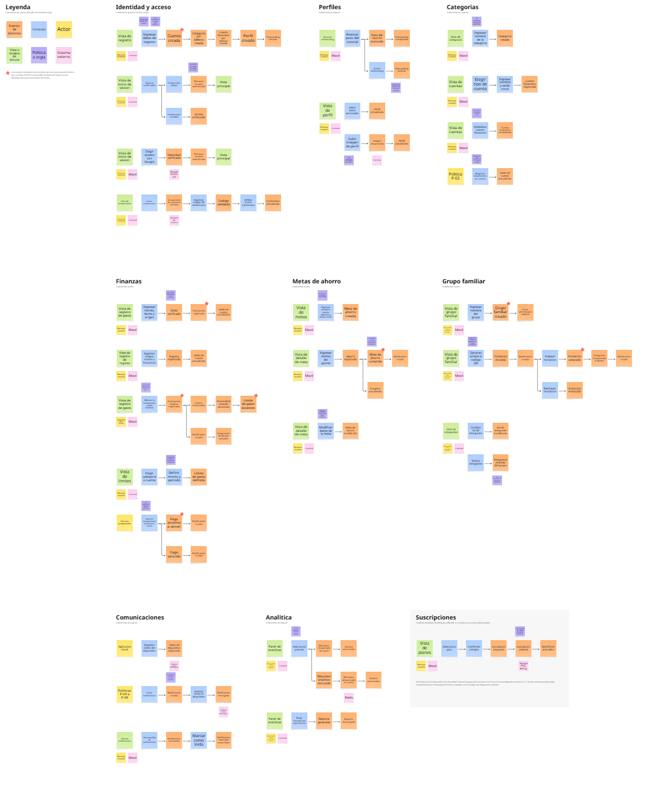

*EventStorming de la primera sesión. Fuente: elaboración propia en Miro.*

**Tramo de planificación con IA (sesión de noviembre)**

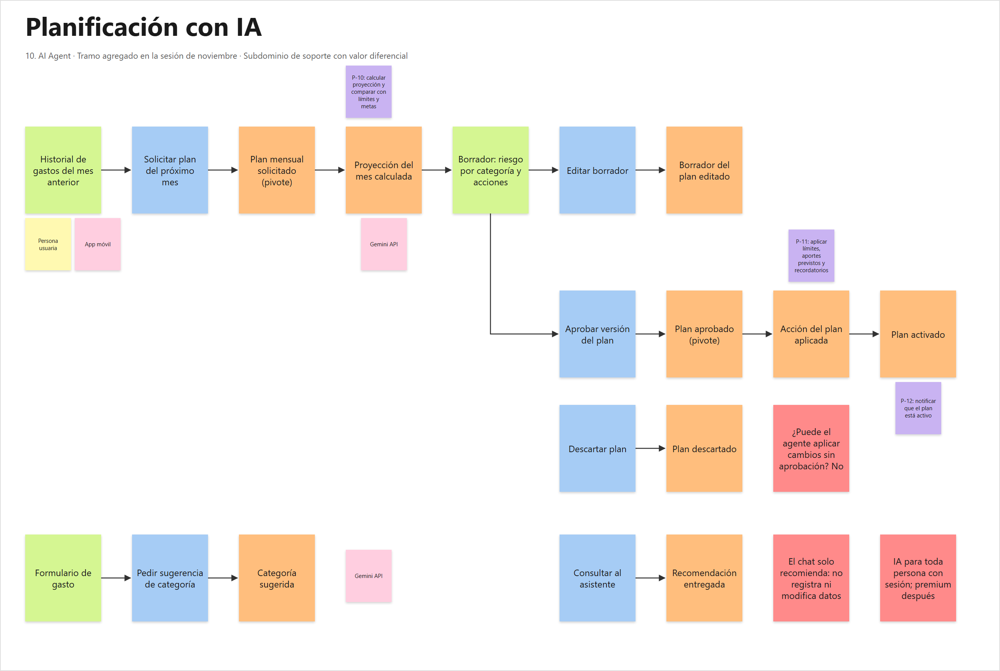

*Marco 10 del mismo tablero, agregado en la sesión de noviembre. Fuente: elaboración propia en Miro ([abrir el tablero](https://miro.com/app/board/uXjVHmdGN18=/)).*

### 4.2.2. Candidate Context Discovery

Con el EventStorming terminado, hicimos una segunda sesión para decidir dónde poner las fronteras del sistema. Duró un poco menos de dos horas y la hicimos en el mismo tablero de Miro, reagrupando las notas que ya teníamos en lugar de crear nuevas.

Al principio quisimos agrupar por entidades compartidas, es decir, juntar en un bloque todo lo que usa la misma tabla. Lo descartamos porque, según Domain-Driven Design, un bounded context se define por el lenguaje y no por los datos: cuando una misma palabra empieza a significar otra cosa, hay una frontera, aunque la información de fondo sea la misma. Este criterio nos ayudó a separar contextos en tres casos que explicamos más abajo.

**Técnicas aplicadas**

Usamos las tres técnicas sugeridas para esta sesión, cada una en un momento distinto.

Primero aplicamos *look for pivotal events*, aprovechando que ya habíamos marcado los eventos pivote en el EventStorming. Estos eventos separan etapas del negocio, y lo que queda entre ellos suele convertirse en un contexto. El registro de una persona usuaria separó la parte de acceso del resto, la creación de un grupo familiar separó la economía compartida y el registro de una transacción separó el núcleo financiero de lo que pasa después.

Luego aplicamos *start with value* para decidir en qué partes poner más esfuerzo de modelado. Nos preguntamos qué partes del dominio sostienen la propuesta de valor frente a los competidores de la sección 2.1, y llegamos a tres: el registro de transacciones con evaluación de límites, la economía familiar compartida que respeta lo personal y las metas de ahorro con aportes individuales y grupales. Estos tres bloques los clasificamos como núcleo del dominio y fueron los que más trabajamos después.

Al final aplicamos *start with simple* para revisar el resultado. Cada agrupación tenía que poder explicarse en una sola frase que entendiera alguien de fuera del equipo. Las que no pasaron esta prueba las revisamos, porque si costaba nombrarlas, normalmente era porque juntaban responsabilidades que no tenían relación.

**Fronteras encontradas por el lenguaje**

Hubo tres casos que no se notaban mirando solo el modelo de datos.

El primero es la palabra "cuenta". En la parte de acceso significa identidad digital con credenciales. En la parte financiera significa un medio de pago con saldo, como una billetera, una tarjeta o el efectivo. Solo comparten el nombre, y por eso separamos el contexto de identidad del de cuentas financieras.

El segundo es la palabra "integrante". En la parte familiar es una persona con un rol y permisos dentro de un grupo. En la parte de perfiles es solo una persona con sus datos y preferencias. Por estos dos significados separamos Household de Profiles.

El tercero es la palabra "transacción". En el núcleo financiero es algo que cambia un saldo y que debe validarse antes de aceptarse. En la parte de analítica es solo un dato para calcular totales por periodo, sin reglas que validar. Aunque usan la misma información, las reglas son distintas, así que separamos Analytics de Finances en vez de poner los reportes dentro de Finances.

También hubo un caso en el que decidimos no separar. Categoría y cuenta financiera son conceptos distintos, pero las dos sirven para clasificar el gasto, se crean juntas al registrarse una persona y todavía no tienen suficientes reglas propias como para separarlas. Las dejamos en un mismo contexto, aunque es el primero que convendría dividir si la parte de medios de pago crece.

**Contextos candidatos resultantes**

Al final de la primera sesión quedaron ocho contextos candidatos, y la sesión de noviembre agregó un noveno, AI Agent. La tabla muestra el vocabulario que los distingue, sus agregados y su clasificación estratégica.

| Bounded Context candidato | Lenguaje que lo distingue | Agregados | Clasificación |
|---|---|---|---|
| Identity and Access Management | User, registro, inicio de sesión, token, hash de contraseña, rol | User, Role | Subdominio genérico de alto riesgo |
| Profiles | Perfil, onboarding, paso del tutorial, avatar | Profile, Onboarding | Subdominio de soporte |
| Categories and Financial Accounts | Categoría, cuenta financiera, saldo, tipo de cuenta | Category, FinancialAccount | Subdominio de soporte |
| Finances | Transacción, límite de gasto, transacción recurrente, periodo | Transaction, SpendingLimit, RecurringTransaction | Subdominio núcleo |
| Financial Goals | Meta de ahorro, aporte, monto objetivo, fecha límite | SavingGoal, Contribution | Subdominio núcleo |
| Household | Familia, integrante, invitación, rol, invitación diferida | Family, FamilyMember, Invitation | Subdominio núcleo |
| Communications | Notificación, dispositivo, token de dispositivo, entrega | Notification, Device | Subdominio de soporte |
| Analytics | Resumen analítico, analítica de límites, analítica de metas, proyección | AnalyticsSummary | Subdominio de soporte |
| AI Agent | Plan mensual, borrador, versión, riesgo, aprobación, categoría sugerida, recomendación | MonthlyPlan, AssistantConversation | Subdominio de soporte con valor diferencial |

**Fundamento de la clasificación estratégica**

Los tres contextos núcleo son los que diferencian a Intiva de otras opciones del mercado: ninguno de los competidores analizados junta el registro con evaluación de límites, la economía familiar que respeta lo personal y las metas de ahorro compartidas. Además, son los contextos con más eventos de dominio y más relaciones entrantes, lo que coincide con su importancia.

Los cuatro contextos de soporte son necesarios para que los núcleo funcionen y el usuario los valora, pero no son una ventaja competitiva por sí solos, ya que cualquier producto del rubro tiene perfiles, categorías, notificaciones y algún tipo de reporte. AI Agent es un caso aparte: no maneja dinero ni guarda transacciones, así que no es núcleo, pero el plan mensual con IA es lo que más distingue a Intiva de los competidores de la sección 2.1, por lo que lo marcamos como soporte con valor diferencial.

El contexto de identidad es genérico porque el registro, la autenticación y la emisión de credenciales son problemas ya resueltos en la industria, y es mejor usar mecanismos estándar que modelarlos desde cero. Lo marcamos como de alto riesgo porque, aunque no diferencia al producto, si falla nadie puede acceder al resto del sistema.

**Contextos agregados después de la primera sesión**

En la sesión de noviembre, el tramo de planificación formó un contexto propio, AI Agent, porque su lenguaje no se cruza con el de los demás: plan mensual, borrador, versión, riesgo, aprobación y categoría sugerida. Este contexto no guarda transacciones ni saldos. Prepara propuestas, y para aplicar lo que la persona aprueba usa las APIs de Finances, Savings y Communications.

También apareció un bloque sobre suscripciones, con su propio vocabulario: plan, suscripción, beneficio y facturación. Corresponde a las historias US 008, US 009 y US 010. Es un contexto válido, pero el equipo decidió postergar el modelo premium y ofrecer la IA a toda persona con sesión iniciada. Por eso no tiene microservicio ni aparece en el diagrama de contenedores, en los Bounded Context Canvases ni en el Context Map. Su restricción principal ya quedó registrada en la decisión AD-19: toda compra se validará del lado del servidor.

Los nueve contextos se detallan uno por uno en la sección 4.2.4. Sus colaboraciones, que aquí se ven en las políticas P-01 a P-12, se modelan como flujos de mensajes en la sección 4.2.3 y como relaciones entre contextos en la sección 4.2.5.

### 4.2.3. Domain Message Flows Modeling

En esta sección se explica y evidencia el proceso seguido para visualizar cómo deben colaborar los bounded contexts al resolver los casos que se presentan en el negocio para las personas usuarias del sistema. Para ello se aplicó la técnica de visualización **Domain Storytelling**.

Las historias se construyeron primero a partir del backend anterior (`intiva-api-platform`) y luego se actualizaron a la arquitectura de microservicios de la sección 4.1.4. En cada historia se distinguen los dos tipos de colaboración: las llamadas REST síncronas, para consultas y validaciones, y los eventos publicados en RabbitMQ, para avisos que otros servicios procesan después.

Se seleccionaron seis historias que cubren los procesos de negocio más representativos: el alta de una persona usuaria, la formación de una economía familiar, el registro de una transacción con evaluación de límite de gasto, el recordatorio de un pago recurrente, la consulta del panel de analíticas y la planificación del mes con el agente de IA.

Cada historia se presenta en dos representaciones complementarias: el **diagrama de Domain Storytelling** en notación pictográfica (actores y sistemas, objetos de trabajo y actividades numeradas) y, como apoyo de lectura, el mismo flujo expresado como diagrama de secuencia por carriles, donde las flechas continuas son llamadas REST y las discontinuas son eventos en RabbitMQ.

#### 4.2.3.1. Historia 1 — Registro y preparación inicial de una nueva persona usuaria

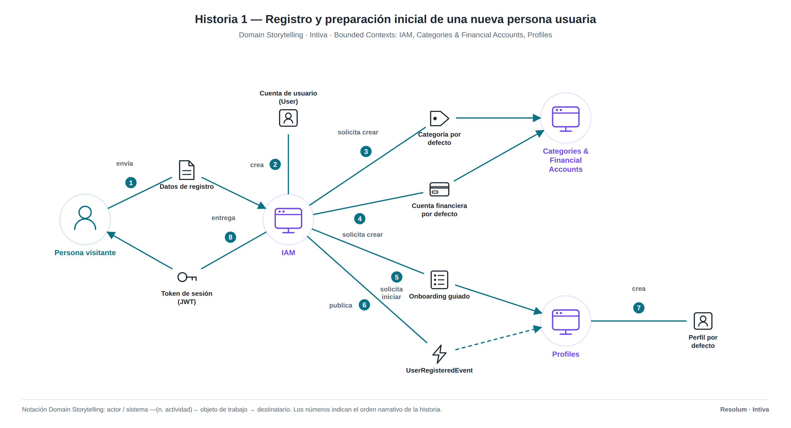

*Diagrama de Domain Storytelling — Historia 1: registro y preparación inicial de una nueva persona usuaria. Fuente: elaboración propia.*

**Representación de apoyo (diagrama de secuencia por carriles):**

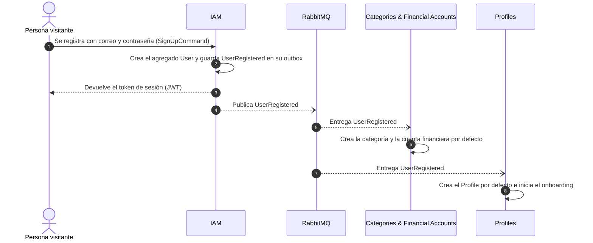

Cuando una persona visitante se registra, IAM crea el agregado `User` y guarda el evento `UserRegistered` en su outbox dentro de la misma transacción. Responde de inmediato con el token y, después, publica el evento en RabbitMQ. *Categories & Financial Accounts* y *Profiles* lo reciben por separado: el primero crea la categoría y la cuenta por defecto, y el segundo crea el perfil e inicia el onboarding. Esta preparación es la que hace posible el escenario de usabilidad (Scenario 1 de la sección 4.1.5): la persona puede registrar su primer gasto sin configurar antes una categoría ni una cuenta.

En el backend anterior, IAM llamaba en cadena a los otros contextos y, además, Profiles escuchaba el mismo evento, de modo que convivían dos mecanismos para un mismo disparador. Con microservicios se usa solo el evento, e IAM ya no depende de que los otros servicios estén disponibles para completar el registro.

#### 4.2.3.2. Historia 2 — Una economía familiar se organiza (Household)

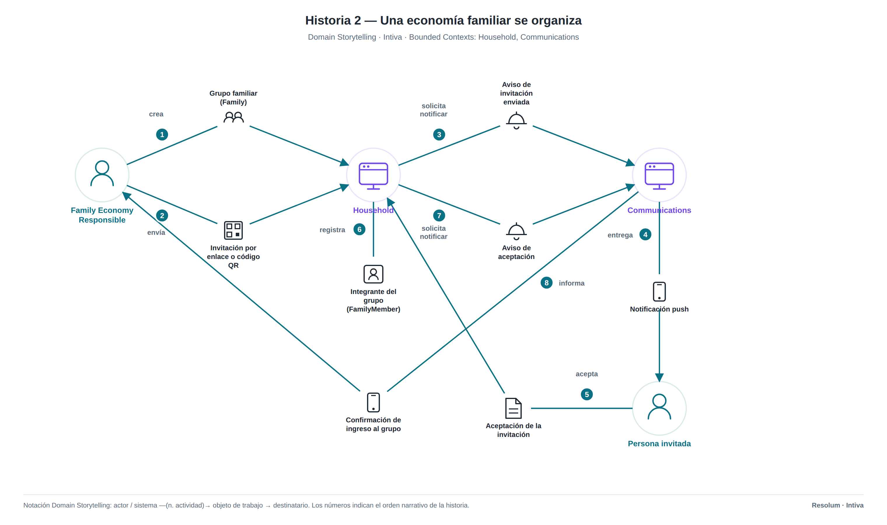

*Diagrama de Domain Storytelling — Historia 2: una economía familiar se organiza. Fuente: elaboración propia.*

**Representación de apoyo (diagrama de secuencia por carriles):**

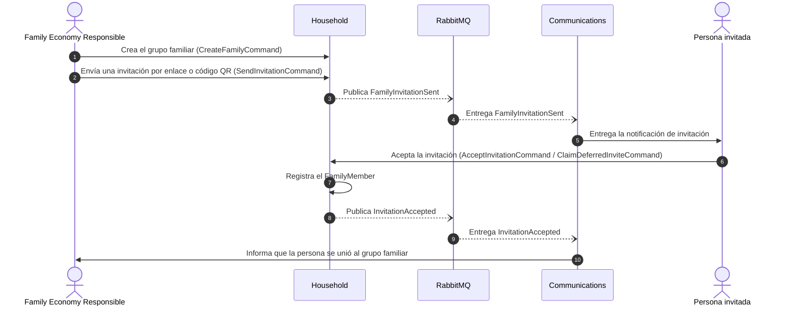

Esta historia muestra el rol diferencial de *Household*: el *Family Economy Responsible* crea el grupo familiar y envía una invitación por enlace o código QR, incluso a personas que aún no tienen la aplicación instalada, mediante *Deferred Deep Link*. Household no llama a Communications: publica `FamilyInvitationSent` e `InvitationAccepted`, y Communications decide cómo notificar a cada persona. Así, la dependencia entre ambos contextos va en un solo sentido.

#### 4.2.3.3. Historia 3 — Se registra una transacción familiar y se evalúa un límite de gasto

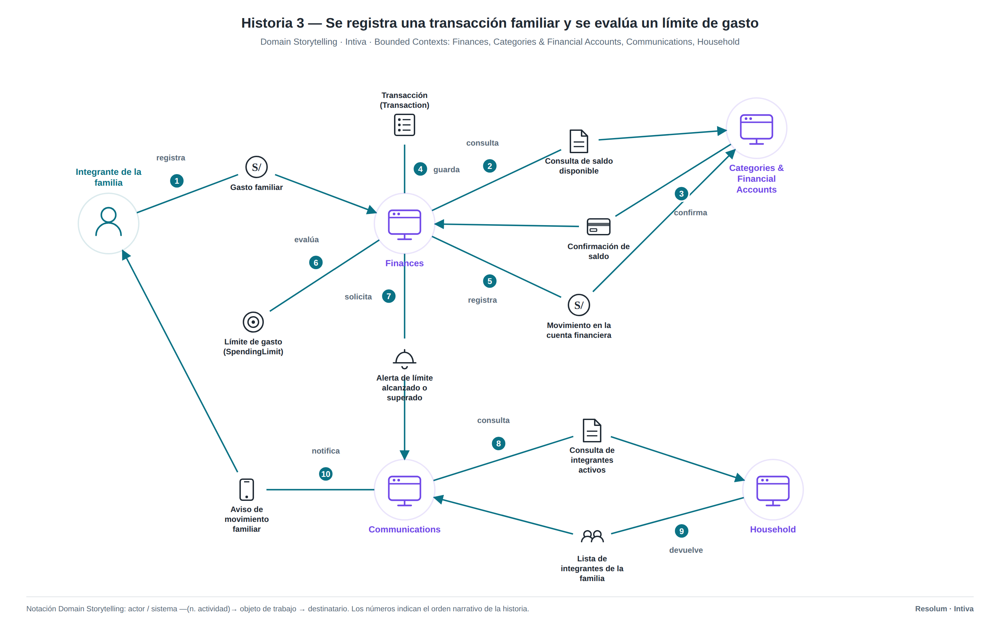

*Diagrama de Domain Storytelling — Historia 3: registro de una transacción familiar y evaluación de un límite de gasto. Fuente: elaboración propia.*

**Representación de apoyo (diagrama de secuencia por carriles):**

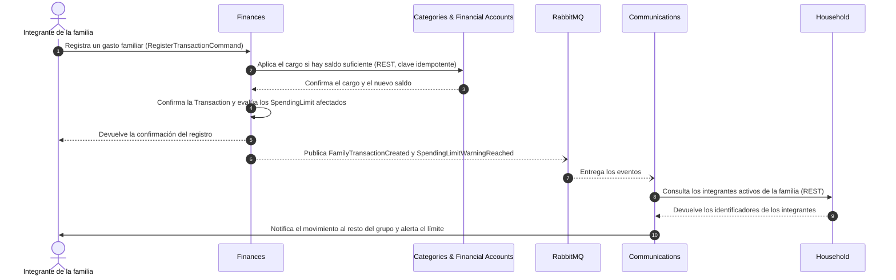

Esta es la historia que atraviesa más contextos y la que sustenta el Scenario 3 de la sección 4.1.5 y la historia US 014. El registro exige una validación síncrona del saldo antes de aceptarse, por eso Finances llama por REST a *Categories & Financial Accounts*, con el identificador de la transacción como clave para que un reintento no cobre dos veces. Las consecuencias del registro (alertar el límite y avisar a la familia) no cambian la respuesta, así que Finances las publica como eventos y responde sin esperarlas. Communications es quien consulta a Household qué integrantes debe notificar.

#### 4.2.3.4. Historia 4 — Un pago recurrente está por vencer

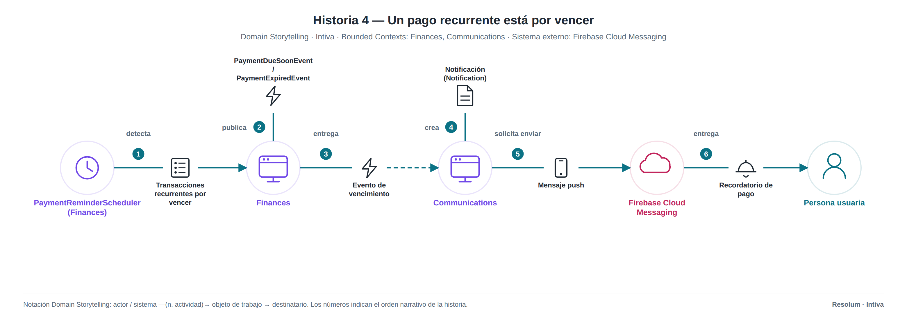

*Diagrama de Domain Storytelling — Historia 4: un pago recurrente está por vencer. Fuente: elaboración propia.*

**Representación de apoyo (diagrama de secuencia por carriles):**

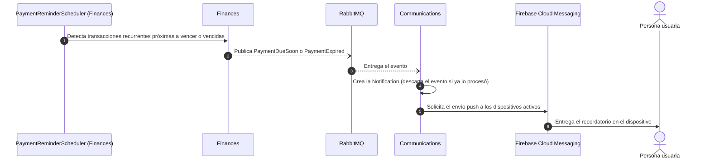

A diferencia de las historias anteriores, este flujo no lo inicia una persona sino un proceso programado dentro de *Finances* (AD-13). Al detectar que una transacción recurrente está por vencer o ya venció, Finances publica `PaymentDueSoon` o `PaymentExpired`, y Communications los procesa para entregar el recordatorio. Como el consumidor es idempotente, si el evento llega dos veces la persona recibe un solo aviso. Es la materialización de la historia US 030.

#### 4.2.3.5. Historia 5 — La familia visualiza sus métricas financieras

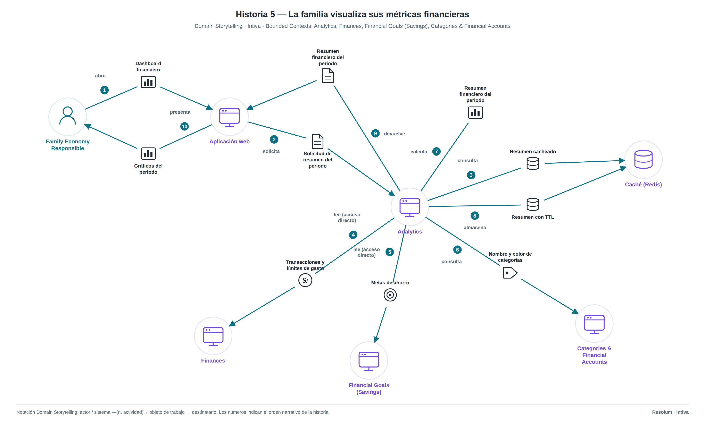

*Diagrama de Domain Storytelling — Historia 5: la familia visualiza sus métricas financieras. Fuente: elaboración propia.*

**Representación de apoyo (diagrama de secuencia por carriles):**

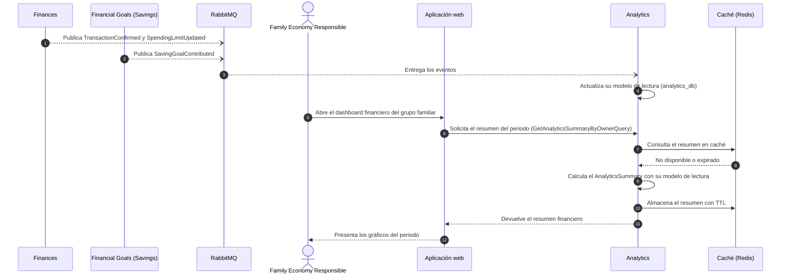

Al abrir el dashboard en la aplicación web, *Analytics* necesita información de Finances, Savings y Categories & Financial Accounts. En el backend anterior la obtenía leyendo directamente los repositorios de esos contextos. Con una base de datos por servicio eso ya no es posible, así que Analytics mantiene su propio modelo de lectura, alimentado por los eventos que publican esos servicios. Al consultar no llama a nadie: busca el resumen en Redis y, si no está, lo calcula con sus propios datos y lo guarda con un tiempo de vida acotado (AD-11). Es la implementación del Scenario 5 de la sección 4.1.5.

#### 4.2.3.6. Historia 6 — La persona planifica su próximo mes con el agente de IA

**Diagrama de secuencia de la historia 6.**

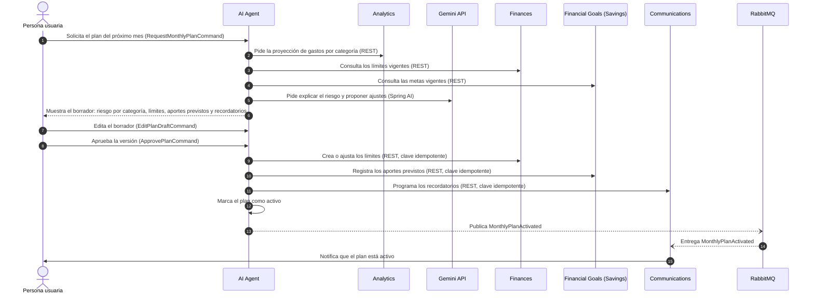

Esta historia corresponde a US 032 y TS 023, y es la que muestra la IA agéntica. La persona pide el plan y AI Agent reúne por su cuenta la información que necesita: la proyección de Analytics y los límites y metas vigentes. Con esos datos, Gemini explica el riesgo y propone ajustes; por ejemplo, si la proyección en Comida es S/ 580 y el límite es S/ 500, el borrador muestra un riesgo de S/ 80. Hasta ese momento nada ha cambiado en la cuenta de la persona. Ella edita el borrador y, solo cuando aprueba una versión, el agente aplica los límites, los aportes previstos y los recordatorios en los servicios que les corresponden, cada uno con su clave idempotente. Si una acción falla, el plan queda con error y la persona puede reintentar solo las pendientes. Al final, el agente publica `MonthlyPlanActivated` y Communications avisa que el plan está activo.

### 4.2.4. Bounded Context Canvases

A partir de los nueve bounded contexts identificados en el Candidate Context Discovery, el equipo elaboró el Bounded Context Canvas de cada uno siguiendo el proceso iterativo propuesto por Nick Tune:

1. **Context Overview Definition** — nombre, propósito y clasificación estratégica del contexto.
2. **Business Rules Distillation & Ubiquitous Language Capture** — el vocabulario y las reglas de negocio no ambiguas que gobiernan el contexto.
3. **Capability Analysis** — qué hace el contexto, expresado como *Commands*, *Queries* y eventos publicados.
4. **Capability Layering** — distinguiendo qué capacidades son el núcleo de la responsabilidad del contexto y cuáles son de soporte.
5. **Dependencies Capture** — con quién colabora el contexto y mediante qué mecanismo (entrante y saliente).
6. **Design Critique** — una revisión honesta de las decisiones de diseño, incluyendo aquellas que se apartan del patrón ideal.

Los contextos se presentan en el orden en que colaboran a lo largo del ciclo de vida de una persona usuaria: primero identidad y perfil, luego los contextos de soporte financiero, después el núcleo transaccional y familiar, luego comunicación y analítica, y al final AI Agent, que surgió con la planificación financiera con IA (US 032).

Los canvases se elaboraron primero a partir del código del backend anterior (`intiva-api-platform`), que era un solo despliegue, y se actualizaron a la arquitectura de microservicios. Por eso, en cada *Design Critique* se explica qué cambió respecto del backend anterior. En las dependencias, "REST" indica una llamada síncrona a la API del otro servicio y "evento" indica un mensaje publicado en RabbitMQ.

Cada canvas se presenta en su representación visual, con las seis secciones del proceso numeradas, acompañada de la tabla con el detalle completo del contenido.

#### 4.2.4.1. Identity and Access Management (IAM)

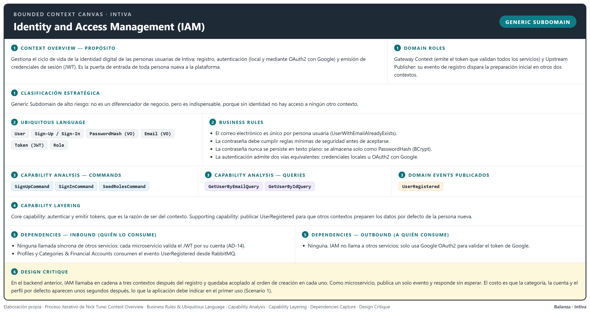

*Bounded Context Canvas de Identity and Access Management (IAM). Fuente: elaboración propia.*

| Sección del Canvas | Contenido |
| --- | --- |
| **1. Context Overview — Propósito** | Gestiona el ciclo de vida de la identidad digital de las personas usuarias de Intiva: registro, autenticación (local y mediante OAuth2 con Google) y emisión de credenciales de sesión (JWT). Es la puerta de entrada de toda persona nueva a la plataforma. |
| **Clasificación estratégica** | Generic Subdomain de alto riesgo: no es un diferenciador de negocio, pero es indispensable, porque sin identidad no hay acceso a ningún otro contexto. |
| **Domain Roles** | Gateway Context (emite el token que validan todos los servicios) y Upstream Publisher: su evento de registro dispara la preparación inicial en otros dos contextos. |
| **2. Ubiquitous Language** | • User • Sign-Up / Sign-In • PasswordHash (VO) • Email (VO) • Token (JWT) • Role |
| **Business Rules** | • El correo electrónico es único por persona usuaria (UserWithEmailAlreadyExists). • La contraseña debe cumplir reglas mínimas de seguridad antes de aceptarse. • La contraseña nunca se persiste en texto plano: se almacena solo como PasswordHash (BCrypt). • La autenticación admite dos vías equivalentes: credenciales locales u OAuth2 con Google. |
| **3. Capability Analysis — Commands** | • SignUpCommand • SignInCommand • SeedRolesCommand |
| **Capability Analysis — Queries** | • GetUserByEmailQuery • GetUserByIdQuery |
| **Capability Analysis — Domain Events publicados** | • UserRegistered |
| **4. Capability Layering** | Core capability: autenticar y emitir tokens, que es la razón de ser del contexto. Supporting capability: publicar UserRegistered para que otros contextos preparen los datos por defecto de la persona nueva. |
| **5. Dependencies — Inbound (quién lo consume)** | • Ninguna llamada síncrona de otros servicios: cada microservicio valida el JWT por su cuenta (AD-14). • Profiles y Categories & Financial Accounts consumen el evento UserRegistered desde RabbitMQ. |
| **Dependencies — Outbound (a quién consume)** | • Ninguna. IAM no llama a otros servicios; solo usa Google OAuth2 para validar el token de Google. |
| **6. Design Critique** | En el backend anterior, IAM llamaba en cadena a tres contextos después del registro y quedaba acoplado al orden de creación en cada uno. Como microservicio, publica un solo evento y responde sin esperar. El costo es que la categoría, la cuenta y el perfil por defecto aparecen unos segundos después, lo que la aplicación debe indicar en el primer uso (Scenario 1). |

#### 4.2.4.2. Profiles

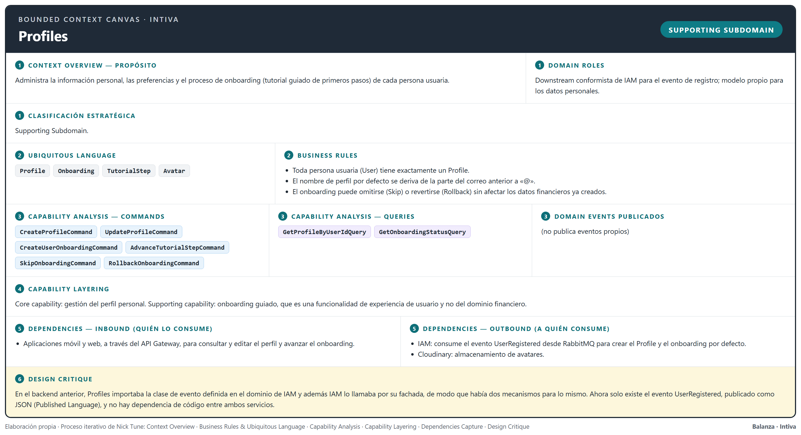

*Bounded Context Canvas de Profiles. Fuente: elaboración propia.*

| Sección del Canvas | Contenido |
| --- | --- |
| **1. Context Overview — Propósito** | Administra la información personal, las preferencias y el proceso de onboarding (tutorial guiado de primeros pasos) de cada persona usuaria. |
| **Clasificación estratégica** | Supporting Subdomain. |
| **Domain Roles** | Downstream conformista de IAM para el evento de registro; modelo propio para los datos personales. |
| **2. Ubiquitous Language** | • Profile • Onboarding • TutorialStep • Avatar |
| **Business Rules** | • Toda persona usuaria (User) tiene exactamente un Profile. • El nombre de perfil por defecto se deriva de la parte del correo anterior a «@». • El onboarding puede omitirse (Skip) o revertirse (Rollback) sin afectar los datos financieros ya creados. |
| **3. Capability Analysis — Commands** | • CreateProfileCommand • UpdateProfileCommand • CreateUserOnboardingCommand • AdvanceTutorialStepCommand • SkipOnboardingCommand • RollbackOnboardingCommand |
| **Capability Analysis — Queries** | • GetProfileByUserIdQuery • GetOnboardingStatusQuery |
| **Capability Analysis — Domain Events publicados** | (no publica eventos propios) |
| **4. Capability Layering** | Core capability: gestión del perfil personal. Supporting capability: onboarding guiado, que es una funcionalidad de experiencia de usuario y no del dominio financiero. |
| **5. Dependencies — Inbound (quién lo consume)** | • Aplicaciones móvil y web, a través del API Gateway, para consultar y editar el perfil y avanzar el onboarding. |
| **Dependencies — Outbound (a quién consume)** | • IAM: consume el evento UserRegistered desde RabbitMQ para crear el Profile y el onboarding por defecto. • Cloudinary: almacenamiento de avatares. |
| **6. Design Critique** | En el backend anterior, Profiles importaba la clase de evento definida en el dominio de IAM y además IAM lo llamaba por su fachada, de modo que había dos mecanismos para lo mismo. Ahora solo existe el evento UserRegistered, publicado como JSON (Published Language), y no hay dependencia de código entre ambos servicios. |

#### 4.2.4.3. Categories & Financial Accounts

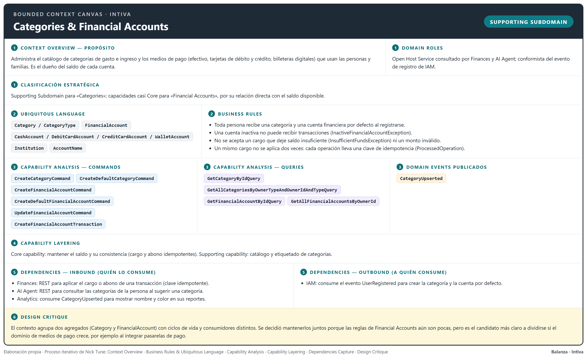

*Bounded Context Canvas de Categories & Financial Accounts. Fuente: elaboración propia.*

| Sección del Canvas | Contenido |
| --- | --- |
| **1. Context Overview — Propósito** | Administra el catálogo de categorías de gasto e ingreso y los medios de pago (efectivo, tarjetas de débito y crédito, billeteras digitales) que usan las personas y familias. Es el dueño del saldo de cada cuenta. |
| **Clasificación estratégica** | Supporting Subdomain para «Categories»; capacidades casi Core para «Financial Accounts», por su relación directa con el saldo disponible. |
| **Domain Roles** | Open Host Service consultado por Finances y AI Agent; conformista del evento de registro de IAM. |
| **2. Ubiquitous Language** | • Category / CategoryType • FinancialAccount • CashAccount / DebitCardAccount / CreditCardAccount / WalletAccount • Institution • AccountName |
| **Business Rules** | • Toda persona recibe una categoría y una cuenta financiera por defecto al registrarse. • Una cuenta inactiva no puede recibir transacciones (InactiveFinancialAccountException). • No se acepta un cargo que deje saldo insuficiente (InsufficientFundsException) ni un monto inválido. • Un mismo cargo no se aplica dos veces: cada operación lleva una clave de idempotencia (ProcessedOperation). |
| **3. Capability Analysis — Commands** | • CreateCategoryCommand • CreateDefaultCategoryCommand • CreateFinancialAccountCommand • CreateDefaultFinancialAccountCommand • UpdateFinancialAccountCommand • CreateFinancialAccountTransaction |
| **Capability Analysis — Queries** | • GetCategoryByIdQuery • GetAllCategoriesByOwnerTypeAndOwnerIdAndTypeQuery • GetFinancialAccountByIdQuery • GetAllFinancialAccountsByOwnerId |
| **Capability Analysis — Domain Events publicados** | • CategoryUpserted |
| **4. Capability Layering** | Core capability: mantener el saldo y su consistencia (cargo y abono idempotentes). Supporting capability: catálogo y etiquetado de categorías. |
| **5. Dependencies — Inbound (quién lo consume)** | • Finances: REST para aplicar el cargo o abono de una transacción (clave idempotente). • AI Agent: REST para consultar las categorías de la persona al sugerir una categoría. • Analytics: consume CategoryUpserted para mostrar nombre y color en sus reportes. |
| **Dependencies — Outbound (a quién consume)** | • IAM: consume el evento UserRegistered para crear la categoría y la cuenta por defecto. |
| **6. Design Critique** | El contexto agrupa dos agregados (Category y FinancialAccount) con ciclos de vida y consumidores distintos. Se decidió mantenerlos juntos porque las reglas de Financial Accounts aún son pocas, pero es el candidato más claro a dividirse si el dominio de medios de pago crece, por ejemplo al integrar pasarelas de pago. |

#### 4.2.4.4. Finances

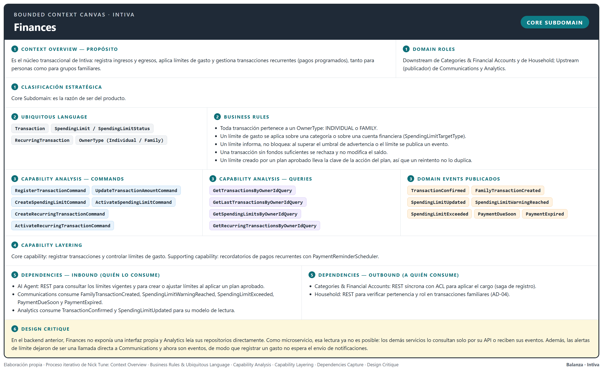

*Bounded Context Canvas de Finances. Fuente: elaboración propia.*

| Sección del Canvas | Contenido |
| --- | --- |
| **1. Context Overview — Propósito** | Es el núcleo transaccional de Intiva: registra ingresos y egresos, aplica límites de gasto y gestiona transacciones recurrentes (pagos programados), tanto para personas como para grupos familiares. |
| **Clasificación estratégica** | Core Subdomain: es la razón de ser del producto. |
| **Domain Roles** | Downstream de Categories & Financial Accounts y de Household; Upstream (publicador) de Communications y Analytics. |
| **2. Ubiquitous Language** | • Transaction • SpendingLimit / SpendingLimitStatus • RecurringTransaction • OwnerType (Individual / Family) |
| **Business Rules** | • Toda transacción pertenece a un OwnerType: INDIVIDUAL o FAMILY. • Un límite de gasto se aplica sobre una categoría o sobre una cuenta financiera (SpendingLimitTargetType). • Un límite informa, no bloquea: al superar el umbral de advertencia o el límite se publica un evento. • Una transacción sin fondos suficientes se rechaza y no modifica el saldo. • Un límite creado por un plan aprobado lleva la clave de la acción del plan, así que un reintento no lo duplica. |
| **3. Capability Analysis — Commands** | • RegisterTransactionCommand • UpdateTransactionAmountCommand • CreateSpendingLimitCommand • ActivateSpendingLimitCommand • CreateRecurringTransactionCommand • ActivateRecurringTransactionCommand |
| **Capability Analysis — Queries** | • GetTransactionsByOwnerIdQuery • GetLastTransactionsByOwnerIdQuery • GetSpendingLimitsByOwnerIdQuery • GetRecurringTransactionsByOwnerIdQuery |
| **Capability Analysis — Domain Events publicados** | • TransactionConfirmed • FamilyTransactionCreated • SpendingLimitUpdated • SpendingLimitWarningReached • SpendingLimitExceeded • PaymentDueSoon • PaymentExpired |
| **4. Capability Layering** | Core capability: registrar transacciones y controlar límites de gasto. Supporting capability: recordatorios de pagos recurrentes con PaymentReminderScheduler. |
| **5. Dependencies — Inbound (quién lo consume)** | • AI Agent: REST para consultar los límites vigentes y para crear o ajustar límites al aplicar un plan aprobado. • Communications consume FamilyTransactionCreated, SpendingLimitWarningReached, SpendingLimitExceeded, PaymentDueSoon y PaymentExpired. • Analytics consume TransactionConfirmed y SpendingLimitUpdated para su modelo de lectura. |
| **Dependencies — Outbound (a quién consume)** | • Categories & Financial Accounts: REST síncrona con ACL para aplicar el cargo (saga de registro). • Household: REST para verificar pertenencia y rol en transacciones familiares (AD-04). |
| **6. Design Critique** | En el backend anterior, Finances no exponía una interfaz propia y Analytics leía sus repositorios directamente. Como microservicio, esa lectura ya no es posible: los demás servicios lo consultan solo por su API o reciben sus eventos. Además, las alertas de límite dejaron de ser una llamada directa a Communications y ahora son eventos, de modo que registrar un gasto no espera el envío de notificaciones. |

#### 4.2.4.5. Financial Goals (Savings)

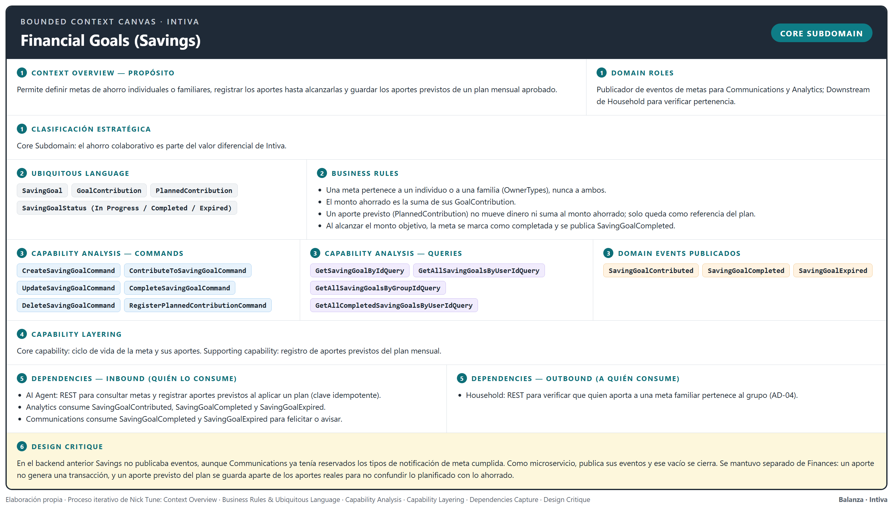

*Bounded Context Canvas de Financial Goals (Savings). Fuente: elaboración propia.*

| Sección del Canvas | Contenido |
| --- | --- |
| **1. Context Overview — Propósito** | Permite definir metas de ahorro individuales o familiares, registrar los aportes hasta alcanzarlas y guardar los aportes previstos de un plan mensual aprobado. |
| **Clasificación estratégica** | Core Subdomain: el ahorro colaborativo es parte del valor diferencial de Intiva. |
| **Domain Roles** | Publicador de eventos de metas para Communications y Analytics; Downstream de Household para verificar pertenencia. |
| **2. Ubiquitous Language** | • SavingGoal • GoalContribution • PlannedContribution • SavingGoalStatus (In Progress / Completed / Expired) |
| **Business Rules** | • Una meta pertenece a un individuo o a una familia (OwnerTypes), nunca a ambos. • El monto ahorrado es la suma de sus GoalContribution. • Un aporte previsto (PlannedContribution) no mueve dinero ni suma al monto ahorrado; solo queda como referencia del plan. • Al alcanzar el monto objetivo, la meta se marca como completada y se publica SavingGoalCompleted. |
| **3. Capability Analysis — Commands** | • CreateSavingGoalCommand • ContributeToSavingGoalCommand • UpdateSavingGoalCommand • CompleteSavingGoalCommand • DeleteSavingGoalCommand • RegisterPlannedContributionCommand |
| **Capability Analysis — Queries** | • GetSavingGoalByIdQuery • GetAllSavingGoalsByUserIdQuery • GetAllSavingGoalsByGroupIdQuery • GetAllCompletedSavingGoalsByUserIdQuery |
| **Capability Analysis — Domain Events publicados** | • SavingGoalContributed • SavingGoalCompleted • SavingGoalExpired |
| **4. Capability Layering** | Core capability: ciclo de vida de la meta y sus aportes. Supporting capability: registro de aportes previstos del plan mensual. |
| **5. Dependencies — Inbound (quién lo consume)** | • AI Agent: REST para consultar metas y registrar aportes previstos al aplicar un plan (clave idempotente). • Analytics consume SavingGoalContributed, SavingGoalCompleted y SavingGoalExpired. • Communications consume SavingGoalCompleted y SavingGoalExpired para felicitar o avisar. |
| **Dependencies — Outbound (a quién consume)** | • Household: REST para verificar que quien aporta a una meta familiar pertenece al grupo (AD-04). |
| **6. Design Critique** | En el backend anterior Savings no publicaba eventos, aunque Communications ya tenía reservados los tipos de notificación de meta cumplida. Como microservicio, publica sus eventos y ese vacío se cierra. Se mantuvo separado de Finances: un aporte no genera una transacción, y un aporte previsto del plan se guarda aparte de los aportes reales para no confundir lo planificado con lo ahorrado. |

#### 4.2.4.6. Household

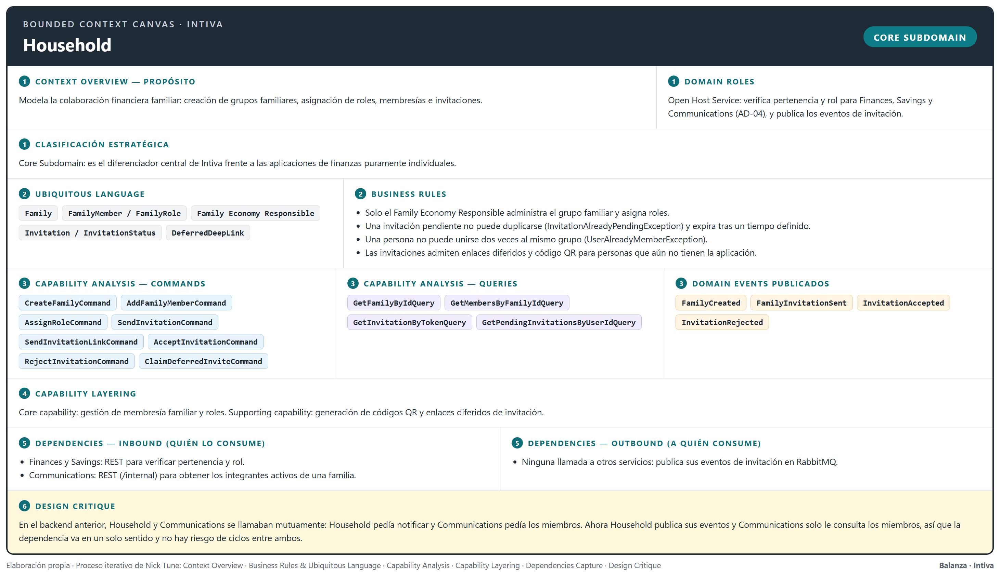

*Bounded Context Canvas de Household. Fuente: elaboración propia.*

| Sección del Canvas | Contenido |
| --- | --- |
| **1. Context Overview — Propósito** | Modela la colaboración financiera familiar: creación de grupos familiares, asignación de roles, membresías e invitaciones. |
| **Clasificación estratégica** | Core Subdomain: es el diferenciador central de Intiva frente a las aplicaciones de finanzas puramente individuales. |
| **Domain Roles** | Open Host Service: verifica pertenencia y rol para Finances, Savings y Communications (AD-04), y publica los eventos de invitación. |
| **2. Ubiquitous Language** | • Family • FamilyMember / FamilyRole • Family Economy Responsible • Invitation / InvitationStatus • DeferredDeepLink |
| **Business Rules** | • Solo el Family Economy Responsible administra el grupo familiar y asigna roles. • Una invitación pendiente no puede duplicarse (InvitationAlreadyPendingException) y expira tras un tiempo definido. • Una persona no puede unirse dos veces al mismo grupo (UserAlreadyMemberException). • Las invitaciones admiten enlaces diferidos y código QR para personas que aún no tienen la aplicación. |
| **3. Capability Analysis — Commands** | • CreateFamilyCommand • AddFamilyMemberCommand • AssignRoleCommand • SendInvitationCommand • SendInvitationLinkCommand • AcceptInvitationCommand • RejectInvitationCommand • ClaimDeferredInviteCommand |
| **Capability Analysis — Queries** | • GetFamilyByIdQuery • GetMembersByFamilyIdQuery • GetInvitationByTokenQuery • GetPendingInvitationsByUserIdQuery |
| **Capability Analysis — Domain Events publicados** | • FamilyCreated • FamilyInvitationSent • InvitationAccepted • InvitationRejected |
| **4. Capability Layering** | Core capability: gestión de membresía familiar y roles. Supporting capability: generación de códigos QR y enlaces diferidos de invitación. |
| **5. Dependencies — Inbound (quién lo consume)** | • Finances y Savings: REST para verificar pertenencia y rol. • Communications: REST (/internal) para obtener los integrantes activos de una familia. |
| **Dependencies — Outbound (a quién consume)** | • Ninguna llamada a otros servicios: publica sus eventos de invitación en RabbitMQ. |
| **6. Design Critique** | En el backend anterior, Household y Communications se llamaban mutuamente: Household pedía notificar y Communications pedía los miembros. Ahora Household publica sus eventos y Communications solo le consulta los miembros, así que la dependencia va en un solo sentido y no hay riesgo de ciclos entre ambos. |

#### 4.2.4.7. Communications

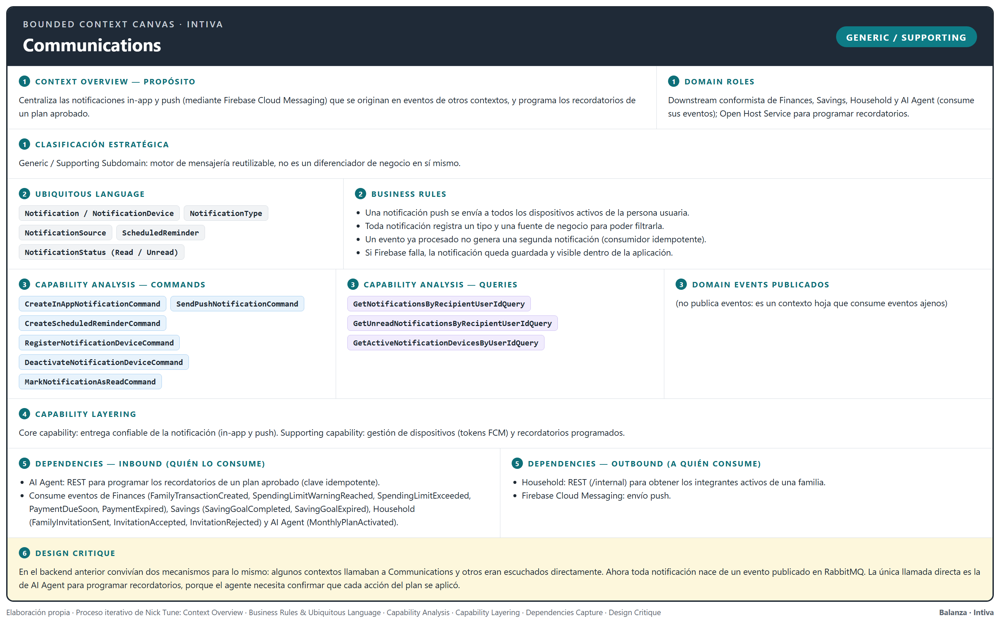

*Bounded Context Canvas de Communications. Fuente: elaboración propia.*

| Sección del Canvas | Contenido |
| --- | --- |
| **1. Context Overview — Propósito** | Centraliza las notificaciones in-app y push (mediante Firebase Cloud Messaging) que se originan en eventos de otros contextos, y programa los recordatorios de un plan aprobado. |
| **Clasificación estratégica** | Generic / Supporting Subdomain: motor de mensajería reutilizable, no es un diferenciador de negocio en sí mismo. |
| **Domain Roles** | Downstream conformista de Finances, Savings, Household y AI Agent (consume sus eventos); Open Host Service para programar recordatorios. |
| **2. Ubiquitous Language** | • Notification / NotificationDevice • NotificationType • NotificationSource • ScheduledReminder • NotificationStatus (Read / Unread) |
| **Business Rules** | • Una notificación push se envía a todos los dispositivos activos de la persona usuaria. • Toda notificación registra un tipo y una fuente de negocio para poder filtrarla. • Un evento ya procesado no genera una segunda notificación (consumidor idempotente). • Si Firebase falla, la notificación queda guardada y visible dentro de la aplicación. |
| **3. Capability Analysis — Commands** | • CreateInAppNotificationCommand • SendPushNotificationCommand • CreateScheduledReminderCommand • RegisterNotificationDeviceCommand • DeactivateNotificationDeviceCommand • MarkNotificationAsReadCommand |
| **Capability Analysis — Queries** | • GetNotificationsByRecipientUserIdQuery • GetUnreadNotificationsByRecipientUserIdQuery • GetActiveNotificationDevicesByUserIdQuery |
| **Capability Analysis — Domain Events publicados** | (no publica eventos: es un contexto hoja que consume eventos ajenos) |
| **4. Capability Layering** | Core capability: entrega confiable de la notificación (in-app y push). Supporting capability: gestión de dispositivos (tokens FCM) y recordatorios programados. |
| **5. Dependencies — Inbound (quién lo consume)** | • AI Agent: REST para programar los recordatorios de un plan aprobado (clave idempotente). • Consume eventos de Finances (FamilyTransactionCreated, SpendingLimitWarningReached, SpendingLimitExceeded, PaymentDueSoon, PaymentExpired), Savings (SavingGoalCompleted, SavingGoalExpired), Household (FamilyInvitationSent, InvitationAccepted, InvitationRejected) y AI Agent (MonthlyPlanActivated). |
| **Dependencies — Outbound (a quién consume)** | • Household: REST (/internal) para obtener los integrantes activos de una familia. • Firebase Cloud Messaging: envío push. |
| **6. Design Critique** | En el backend anterior convivían dos mecanismos para lo mismo: algunos contextos llamaban a Communications y otros eran escuchados directamente. Ahora toda notificación nace de un evento publicado en RabbitMQ. La única llamada directa es la de AI Agent para programar recordatorios, porque el agente necesita confirmar que cada acción del plan se aplicó. |

#### 4.2.4.8. Analytics

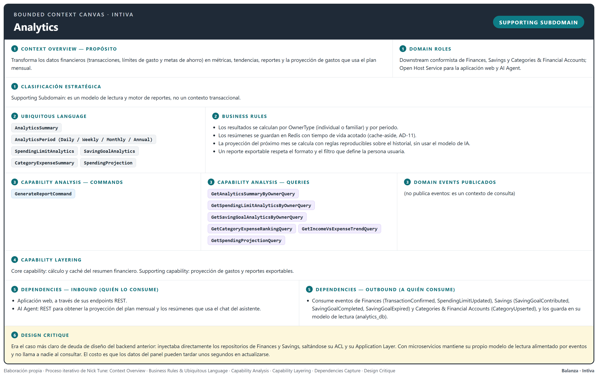

*Bounded Context Canvas de Analytics. Fuente: elaboración propia.*

| Sección del Canvas | Contenido |
| --- | --- |
| **1. Context Overview — Propósito** | Transforma los datos financieros (transacciones, límites de gasto y metas de ahorro) en métricas, tendencias, reportes y la proyección de gastos que usa el plan mensual. |
| **Clasificación estratégica** | Supporting Subdomain: es un modelo de lectura y motor de reportes, no un contexto transaccional. |
| **Domain Roles** | Downstream conformista de Finances, Savings y Categories & Financial Accounts; Open Host Service para la aplicación web y AI Agent. |
| **2. Ubiquitous Language** | • AnalyticsSummary • AnalyticsPeriod (Daily / Weekly / Monthly / Annual) • SpendingLimitAnalytics • SavingGoalAnalytics • CategoryExpenseSummary • SpendingProjection |
| **Business Rules** | • Los resultados se calculan por OwnerType (individual o familiar) y por periodo. • Los resúmenes se guardan en Redis con tiempo de vida acotado (cache-aside, AD-11). • La proyección del próximo mes se calcula con reglas reproducibles sobre el historial, sin usar el modelo de IA. • Un reporte exportable respeta el formato y el filtro que define la persona usuaria. |
| **3. Capability Analysis — Commands** | • GenerateReportCommand |
| **Capability Analysis — Queries** | • GetAnalyticsSummaryByOwnerQuery • GetSpendingLimitAnalyticsByOwnerQuery • GetSavingGoalAnalyticsByOwnerQuery • GetCategoryExpenseRankingQuery • GetIncomeVsExpenseTrendQuery • GetSpendingProjectionQuery |
| **Capability Analysis — Domain Events publicados** | (no publica eventos: es un contexto de consulta) |
| **4. Capability Layering** | Core capability: cálculo y caché del resumen financiero. Supporting capability: proyección de gastos y reportes exportables. |
| **5. Dependencies — Inbound (quién lo consume)** | • Aplicación web, a través de sus endpoints REST. • AI Agent: REST para obtener la proyección del plan mensual y los resúmenes que usa el chat del asistente. |
| **Dependencies — Outbound (a quién consume)** | • Consume eventos de Finances (TransactionConfirmed, SpendingLimitUpdated), Savings (SavingGoalContributed, SavingGoalCompleted, SavingGoalExpired) y Categories & Financial Accounts (CategoryUpserted), y los guarda en su modelo de lectura (analytics_db). |
| **6. Design Critique** | Era el caso más claro de deuda de diseño del backend anterior: inyectaba directamente los repositorios de Finances y Savings, saltándose su ACL y su Application Layer. Con microservicios mantiene su propio modelo de lectura alimentado por eventos y no llama a nadie al consultar. El costo es que los datos del panel pueden tardar unos segundos en actualizarse. |

#### 4.2.4.9. AI Agent

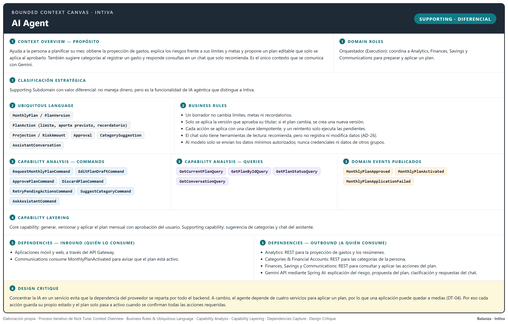

*Bounded Context Canvas de AI Agent. Fuente: elaboración propia.*

| Sección del Canvas | Contenido |
| --- | --- |
| **1. Context Overview — Propósito** | Ayuda a la persona a planificar su mes: obtiene la proyección de gastos, explica los riesgos frente a sus límites y metas y propone un plan editable que solo se aplica al aprobarlo. También sugiere categorías al registrar un gasto y responde consultas en un chat que solo recomienda. Es el único contexto que se comunica con Gemini. |
| **Clasificación estratégica** | Supporting Subdomain con valor diferencial: no maneja dinero, pero es la funcionalidad de IA agéntica que distingue a Intiva. |
| **Domain Roles** | Orquestador (Execution): coordina a Analytics, Finances, Savings y Communications para preparar y aplicar un plan. |
| **2. Ubiquitous Language** | • MonthlyPlan / PlanVersion • PlanAction (límite, aporte previsto, recordatorio) • Projection / RiskAmount • Approval • CategorySuggestion • AssistantConversation |
| **Business Rules** | • Un borrador no cambia límites, metas ni recordatorios. • Solo se aplica la versión que aprueba su titular; si el plan cambia, se crea una nueva versión. • Cada acción se aplica con una clave idempotente, y un reintento solo ejecuta las pendientes. • El chat solo tiene herramientas de lectura: recomienda, pero no registra ni modifica datos (AD-26). • Al modelo solo se envían los datos mínimos autorizados; nunca credenciales ni datos de otros grupos. |
| **3. Capability Analysis — Commands** | • RequestMonthlyPlanCommand • EditPlanDraftCommand • ApprovePlanCommand • DiscardPlanCommand • RetryPendingActionsCommand • SuggestCategoryCommand • AskAssistantCommand |
| **Capability Analysis — Queries** | • GetCurrentPlanQuery • GetPlanByIdQuery • GetPlanStatusQuery • GetConversationQuery |
| **Capability Analysis — Domain Events publicados** | • MonthlyPlanApproved • MonthlyPlanActivated • MonthlyPlanApplicationFailed |
| **4. Capability Layering** | Core capability: generar, versionar y aplicar el plan mensual con aprobación del usuario. Supporting capability: sugerencia de categorías y chat del asistente. |
| **5. Dependencies — Inbound (quién lo consume)** | • Aplicaciones móvil y web, a través del API Gateway. • Communications consume MonthlyPlanActivated para avisar que el plan está activo. |
| **Dependencies — Outbound (a quién consume)** | • Analytics: REST para la proyección de gastos y los resúmenes. • Categories & Financial Accounts: REST para las categorías de la persona. • Finances, Savings y Communications: REST para consultar y aplicar las acciones del plan. • Gemini API mediante Spring AI: explicación del riesgo, propuesta del plan, clasificación y respuestas del chat. |
| **6. Design Critique** | Concentrar la IA en un servicio evita que la dependencia del proveedor se reparta por todo el backend. A cambio, el agente depende de cuatro servicios para aplicar un plan, por lo que una aplicación puede quedar a medias (DT-04). Por eso cada acción guarda su propio estado y el plan solo pasa a activo cuando se confirman todas las acciones requeridas. |

### 4.2.5. Context Mapping

Con las *Dependencies Capture* de cada Bounded Context Canvas ya relevadas, el equipo construyó el Context Map de Intiva, que muestra las relaciones entre los nueve bounded contexts. En la arquitectura de microservicios hay dos tipos de colaboración: llamadas REST síncronas a la API que publica cada servicio, para consultas y validaciones (**Customer/Supplier con Anti-Corruption Layer / Open Host Service**), y eventos de integración publicados en RabbitMQ, para avisos (**Conformist / Published Language**). El análisis del backend anterior encontró un tercer tipo, el acceso directo de Analytics a los repositorios de otros contextos. Ese acceso desaparece con una base de datos por servicio, y las relaciones 11 a 13 de la tabla muestran cómo se reemplazó.

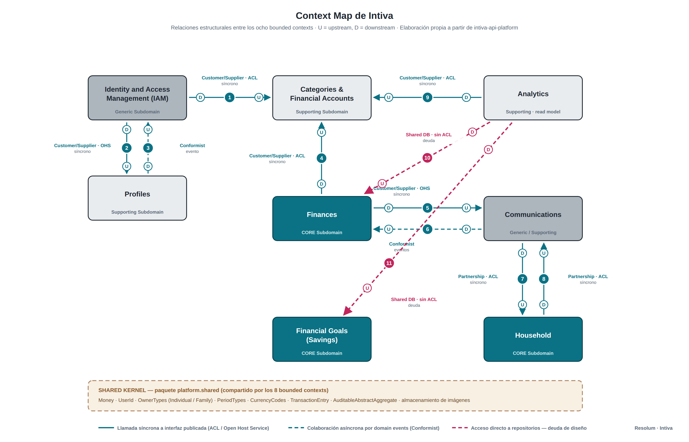

*Context Map de Intiva, en notación de Context Mapping de Domain-Driven Design: cada relación indica su extremo upstream (U, proveedor) y downstream (D, consumidor), junto con el patrón de relación aplicado. Las líneas continuas son llamadas REST y las discontinuas, eventos en RabbitMQ. Los números remiten a la tabla de relaciones que se detalla a continuación. Fuente: elaboración propia.*

#### Tabla de relaciones entre bounded contexts

| # | Relación (consumidor → proveedor) | Patrón DDD | Mecanismo de integración | Uso |
| --- | --- | --- | --- | --- |
| 1 | Profiles → IAM | Conformist (Published Language) | Evento `UserRegistered` en RabbitMQ. | Crear el Profile y el onboarding por defecto. |
| 2 | Categories & Financial Accounts → IAM | Conformist (Published Language) | Evento `UserRegistered` en RabbitMQ. | Crear la categoría y la cuenta financiera por defecto. |
| 3 | Finances → Categories & Financial Accounts | Customer/Supplier con ACL (Open Host Service) | REST síncrona con clave idempotente (saga de registro). | Validar el saldo y aplicar el cargo de una transacción. |
| 4 | Finances → Household | Customer/Supplier con ACL | REST síncrona. | Verificar pertenencia y rol en transacciones familiares (AD-04). |
| 5 | Financial Goals (Savings) → Household | Customer/Supplier con ACL | REST síncrona. | Verificar pertenencia en metas familiares (AD-04). |
| 6 | Communications → Finances | Conformist (Published Language) | Eventos `FamilyTransactionCreated`, `SpendingLimitWarningReached`, `SpendingLimitExceeded`, `PaymentDueSoon` y `PaymentExpired`. | Notificar movimientos familiares, alertas de límite y pagos por vencer. |
| 7 | Communications → Financial Goals (Savings) | Conformist (Published Language) | Eventos `SavingGoalCompleted` y `SavingGoalExpired`. | Felicitar o avisar sobre una meta. |
| 8 | Communications → Household | Conformist (Published Language) | Eventos `FamilyInvitationSent`, `InvitationAccepted` e `InvitationRejected`. | Notificar invitaciones. |
| 9 | Communications → Household | Customer/Supplier con ACL | REST síncrona sobre `/internal`. | Obtener los integrantes activos que deben recibir una notificación familiar. |
| 10 | Communications → AI Agent | Conformist (Published Language) | Evento `MonthlyPlanActivated`. | Avisar que el plan del mes está activo. |
| 11 | Analytics → Finances | Conformist (Published Language) | Eventos `TransactionConfirmed` y `SpendingLimitUpdated`, guardados en su modelo de lectura. | Cálculo de AnalyticsSummary, SpendingLimitAnalytics y la proyección. |
| 12 | Analytics → Financial Goals (Savings) | Conformist (Published Language) | Eventos `SavingGoalContributed`, `SavingGoalCompleted` y `SavingGoalExpired`. | Cálculo de SavingGoalAnalytics. |
| 13 | Analytics → Categories & Financial Accounts | Conformist (Published Language) | Evento `CategoryUpserted`. | Nombre y color de cada categoría en los reportes. |
| 14 | AI Agent → Analytics | Customer/Supplier con ACL | REST síncrona. | Proyección de gastos por categoría y resúmenes para el chat. |
| 15 | AI Agent → Categories & Financial Accounts | Customer/Supplier con ACL | REST síncrona. | Categorías de la persona para sugerir una al registrar un gasto. |
| 16 | AI Agent → Finances, Savings y Communications | Customer/Supplier con ACL | REST síncrona; las escrituras llevan clave idempotente por acción. | Consultar límites y metas, y aplicar el plan aprobado: límites, aportes previstos y recordatorios. |

#### Shared Kernel

Los microservicios comparten deliberadamente la librería `intiva-shared-kernel`, que actúa como un **Shared Kernel**: `Money`, `UserId`, `OwnerTypes`, `PeriodTypes`, `CurrencyCodes` y la clase base `AuditableAbstractAggregate`. Se publica con número de versión y cada servicio la incluye como dependencia. Mantener estos tipos de valor en un único lugar evita que cada servicio reinvente su propia noción de "dinero" o de "titular" (individual frente a familiar), algo especialmente riesgoso en un dominio financiero. El costo es el habitual del Shared Kernel: cualquier cambio en estos tipos requiere coordinación entre los responsables de los servicios. Como la librería tiene versión, cada servicio puede adoptar el cambio cuando le corresponda, sin que todos tengan que redesplegarse al mismo tiempo. Los eventos de integración no forman parte del Shared Kernel: se publican como JSON (Published Language), de modo que ningún servicio importa clases de otro.

#### Discusión de diseño: preguntas "¿qué pasaría si…?"

Siguiendo las preguntas de diseño sugeridas para el proceso de Context Mapping, el equipo discutió explícitamente las siguientes alternativas antes de llegar al mapa presentado:

- **"¿Qué pasaría si movemos este *capability* a otro bounded context?"** — Se evaluó extraer *Financial Accounts* fuera de *Categories* hacia un contexto propio de "Payment Methods". Se decidió no hacerlo todavía: el volumen de reglas de negocio de *Financial Accounts* aún es reducido, pero queda identificado como el candidato más claro a separarse si el dominio de medios de pago crece. También se evaluó poner la sugerencia de categoría dentro de *Categories & Financial Accounts*; se descartó para que Gemini quede detrás de un solo servicio, AI Agent.
- **"¿Qué pasaría si aislamos los *core capabilities* y movemos los otros a un contexto aparte?"** — Aplicado a *Finances*: se consideró separar el recordatorio de pagos recurrentes en un contexto de soporte. Se descartó porque ambos comparten el agregado `RecurringTransaction` y la separación duplicaría reglas sin un beneficio claro todavía.
- **"¿Qué pasaría si creamos un *shared service* para reducir la duplicación entre múltiples bounded contexts?"** — Ya está aplicado como el Shared Kernel descrito arriba, para los tipos de valor fundamentales del dominio financiero.
- **"¿Qué pasaría si duplicamos una funcionalidad para romper la dependencia?"** — Es lo que se aplicó a *Analytics*. En lugar de leer los repositorios de *Finances* y *Savings*, mantiene su propio modelo de lectura al estilo CQRS, alimentado por sus eventos (relaciones 11 a 13). Así se eliminó la deuda de diseño del backend anterior sin sacrificar el rendimiento del dashboard, a cambio de que los datos tarden unos segundos en actualizarse.
- **"¿Qué pasaría si partimos el bounded context en múltiples bounded contexts?"** — Aplicado a *Communications*: se evaluó separar la gestión de dispositivos de la generación y entrega de notificaciones. Se descartó porque ambos comparten el mismo ciclo de vida y la separación solo añadiría una llamada más sin reducir el acoplamiento real.

**Conclusión del Context Mapping.** El Context Map confirma que *Finances*, *Household* y *Financial Goals* son los Core Subdomains del negocio, mientras que *IAM*, *Communications* y *Analytics* cumplen roles de soporte. Las relaciones siguen una regla sencilla: REST para consultas y validaciones, y eventos para avisos. Gracias a eso, Communications y Analytics reciben todo lo que necesitan por eventos y ninguno de los servicios que los alimentan espera por ellos. *AI Agent* es el contexto con más dependencias salientes, porque coordina a cuatro servicios para aplicar un plan; por eso cada acción del plan es idempotente y guarda su propio estado. La relación menos saludable del análisis original, el acceso directo de *Analytics* a los repositorios de *Finances* y *Savings*, se reemplazó por eventos de integración con la decisión de microservicios de la Iteración 1 del ADD.

## 4.3. Software Architecture

En esta sección, el equipo presenta y explica la representación de la Arquitectura de Software para la solución Intiva, aplicando el C4 Model y utilizando la herramienta Structurizr. A continuación, se desglosa el diseño desde una vista macro del ecosistema tecnológico, pasando por el contexto del sistema y los contenedores internos, hasta llegar a la distribución en el diagrama de despliegue.

### 4.3.1. Software Architecture System Landscape Diagram

En esta sección se presenta el System Landscape Diagram, el cual ilustra el panorama tecnológico completo, delimitando la frontera de la empresa frente a los sistemas externos que no controla.

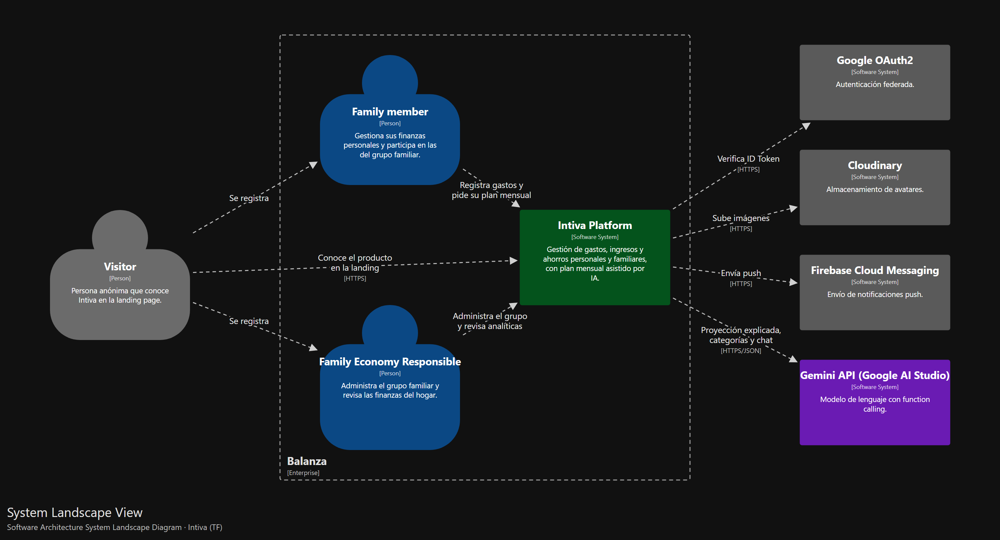

**Explicación del diagrama:**
El diagrama muestra a la startup Balanza como el límite empresarial ("Enterprise Boundary") que agrupa a sus usuarios registrados (integrantes de familia y responsables de la economía familiar) y a su producto central, Intiva Platform. Fuera de este límite se ubican los visitantes anónimos, que conocen el producto en la landing page, y los sistemas externos con los que la empresa interactúa: Google OAuth2 (autenticación federada), Firebase Cloud Messaging (notificaciones push), Cloudinary (imágenes de perfil) y Gemini API de Google AI Studio (funciones de IA). Google Play Billing no se incluye porque las suscripciones se postergan a una etapa posterior.

### 4.3.2. Software Architecture Context Level Diagrams

En esta sección se presenta el Context Level Diagram. A diferencia del Landscape, este diagrama hace un acercamiento para mostrar a Intiva Platform como un recuadro único en el centro, rodeado por sus usuarios y otros sistemas con los que interactúa directamente.

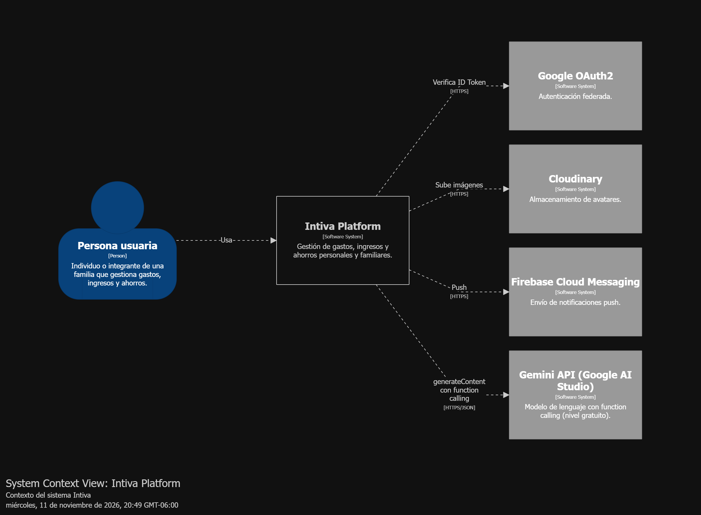

**Explicación del diagrama:**
Intiva Platform se posiciona como el núcleo de la solución para la gestión financiera. La persona usuaria, ya sea un individuo o un integrante de una familia, la usa para gestionar gastos, ingresos y ahorros. Para lograrlo, el sistema delega responsabilidades a servicios externos: la verificación de identidad federada a Google OAuth2, el almacenamiento de imágenes a Cloudinary, el envío de notificaciones push a Firebase Cloud Messaging y la clasificación, el plan mensual y las respuestas del asistente a Gemini API, mediante *function calling*.

### 4.3.3. Software Architecture Container Level Diagrams

En esta sección se presenta el Container Diagram de la plataforma Intiva. Dicho diagrama muestra los elementos de alto nivel de la arquitectura de software, cómo se distribuyen las responsabilidades entre ellos, las principales decisiones de tecnología y cómo los contenedores se comunican entre sí.

**Explicación del diagrama:**
El diagrama muestra los contenedores de Intiva con una base de datos por microservicio. Los visitantes llegan a la Landing Page estática. Una vez registrados, usan la aplicación móvil para el registro diario y el plan mensual, o la aplicación web para revisar sus analíticas. Ambos clientes envían peticiones HTTPS con JSON al API Gateway (Spring Cloud Gateway), que enruta cada petición al microservicio correspondiente. Hay nueve microservicios Spring Boot, uno por bounded context, y cada uno escribe solo en su propia base de datos PostgreSQL. Entre ellos usan REST para consultas y el message broker (RabbitMQ) para avisos. Analytics guarda en Redis los resúmenes que se consultan con frecuencia, e IAM, los códigos temporales de recuperación. AI Agent es el único servicio que llama a Gemini API.

A continuación, se detallan las responsabilidades y tecnologías de cada contenedor:

| Contenedor | Tecnología | Descripción |
| :--- | :--- | :--- |
| **Landing Page** | Astro.js | Sitio web estático con las funcionalidades y beneficios de Intiva. |
| **Web Application** | Vue.js | Aplicación para navegadores web con la analítica financiera y los gráficos estadísticos para familias y usuarios. |
| **Mobile Application** | Kotlin, Jetpack Compose | Aplicación Android para el registro diario de finanzas, la gestión de grupos familiares y el plan mensual con IA. |
| **API Gateway** | Spring Cloud Gateway | Punto de entrada único. Recibe las peticiones de los clientes, valida el JWT y las enruta al microservicio que corresponde según la ruta. |
| **IAM Service** | Java, Spring Boot | Autenticación, registro, roles y emisión de JWT. Base de datos: `iam_db`. |
| **Profiles Service** | Java, Spring Boot | Datos personales, avatares (Cloudinary) y onboarding guiado. Base de datos: `profiles_db`. |
| **Categories & Financial Accounts Service** | Java, Spring Boot | Categorías y cuentas financieras; dueño del saldo. Base de datos: `catalog_db`. |
| **Finances Service** | Java, Spring Boot | Core: transacciones, límites de gasto y pagos recurrentes. Base de datos: `finances_db`. |
| **Financial Goals (Savings) Service** | Java, Spring Boot | Metas de ahorro personales y familiares, sus aportes y los aportes previstos del plan. Base de datos: `savings_db`. |
| **Household Service** | Java, Spring Boot | Core: grupos familiares, roles, membresías e invitaciones por QR o enlace. Base de datos: `household_db`. |
| **Communications Service** | Java, Spring Boot | Notificaciones in-app y push mediante Firebase Cloud Messaging, y recordatorios programados. Base de datos: `communications_db`. |
| **Analytics Service** | Java, Spring Boot | Métricas, tendencias, reportes y proyección de gastos, con caché en Redis. Base de datos: `analytics_db`. |
| **AI Agent Service** | Java, Spring Boot, Spring AI | Plan mensual (proyección, borrador, aprobación y aplicación), sugerencia de categorías y chat del asistente que solo recomienda, mediante Gemini API. Base de datos: `agent_db`. |
| **Message Broker** | RabbitMQ | Exchange de tipo *topic* `intiva.events`. Los servicios publican con outbox y consumen de forma idempotente. |
| **Cache** | Redis (Redis Cloud) | Resúmenes de analítica y códigos temporales de recuperación. |

**Integración del plan financiero (US 032 y TS 023).**

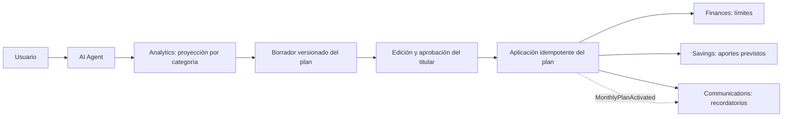

### 4.3.4. Software Architecture Deployment Diagrams

En esta sección se presenta y explica el Deployment Diagram, el cual ilustra cómo los contenedores de software descritos anteriormente se mapean a la infraestructura de nube para su ejecución en producción.

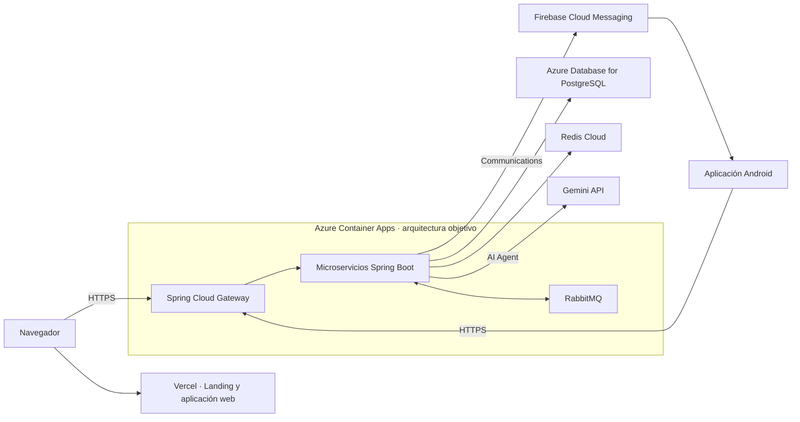

**Explicación del diagrama:**
Por el lado del cliente, la aplicación móvil de Kotlin se ejecuta en los dispositivos Android de los usuarios (versión 8.0 o superior), mientras que la aplicación web (Vue.js) y el sitio estático (Astro.js) se publican en Vercel y se ejecutan en el navegador.

El despliegue objetivo del backend se plantea en **Microsoft Azure**, en un entorno de **Azure Container Apps**. Las peticiones entrantes llegan a Spring Cloud Gateway, que es el único contenedor con acceso desde internet y enruta el tráfico hacia los nueve microservicios Spring Boot, que corren como contenedores en una red interna. En el mismo entorno se despliega RabbitMQ para los eventos entre servicios. Los datos se guardan en un servidor gestionado de PostgreSQL, representado como **Azure Database for PostgreSQL**, que aloja una base de datos separada para cada microservicio; el proveedor definitivo se confirmará con la Spike Story SS 001, que compara opciones con plan gratuito. La caché de analíticas y los códigos temporales se guardan en **Redis Cloud** mediante conexiones cifradas con TLS. Fuera de Azure, el servicio AI Agent se conecta a **Gemini API** (Google AI Studio) con una clave guardada como secreto, y Communications envía las notificaciones push a través de Firebase Cloud Messaging. La PoC local usa Docker Compose y ejecuta un subconjunto de estos servicios, según la sección 7.2.
