# Capítulo V: Tactical-Level Software Design

En este capítulo se presenta y explica la propuesta para la perspectiva táctica del diseño de la solución de software Intiva. La solución se descompone en **nueve *Bounded Contexts***, cada uno desplegado como un **microservicio** independiente (tecnología emergente 1: *Microservices*). Ocho de ellos provienen del diseño estratégico (IAM, Profiles, Categories & Financial Accounts, Finances, Financial Goals, Household, Communications y Analytics) y el noveno, **AI Agent**, incorpora la tecnología emergente 2: un **agente de inteligencia artificial (*Agentic AI*)** basado en el modelo Gemini de Google AI Studio, capaz de ejecutar acciones reales sobre la plataforma mediante *function calling*.

Para cada contexto se documentan, a manera de diccionario, las clases que conforman sus cuatro capas arquitectónicas (*Domain*, *Interface*, *Application* e *Infrastructure*), junto con sus diagramas de arquitectura a nivel de componentes (C4 Model) y los diagramas a nivel de código (clases y base de datos).

---

## Visión general de la arquitectura de microservicios

### Estrategia de descomposición

La descomposición sigue el principio de **un microservicio por *Bounded Context***: cada servicio es dueño de su modelo de dominio, de su base de datos y de su ciclo de despliegue. Las *facades* (*Open Host Service*) que en el diseño estratégico se invocaban dentro del mismo proceso pasan a ser **APIs REST internas** (`/internal/v1/**`), y los *Domain Events* que antes circulaban en memoria pasan a ser **mensajes publicados en un *message broker***. La migración desde la API modular existente (Java 21, Spring Boot, PostgreSQL, Redis) se plantea con el patrón *Strangler Fig*: cada módulo se extrae manteniendo su paquete de dominio, capas y repositorios.

| Microservicio / contenedor | Bounded Context | Persistencia / infraestructura asociada | Integración representada en el C4 |
| :--- | :--- | :--- | :--- |
| `landing-page` | — (frontend público) | Sitio estático | Astro.js; recibe navegación de `Visitor`. |
| `api-gateway` | — (infraestructura compartida) | — | Spring Cloud Gateway; recibe solicitudes de las aplicaciones Web y Mobile y enruta hacia los nueve contextos. |
| `iam-service` | IAM | PostgreSQL `iam_db`; Redis compartido para códigos temporales de recuperación | Verifica identidad federada con Google OAuth2; publica/consume mensajes mediante RabbitMQ. |
| `profiles-service` | Profiles | PostgreSQL `profiles_db` | Almacena avatares en Cloudinary; publica/consume mensajes mediante RabbitMQ. |
| `catalog-accounts-service` | Categories & Financial Accounts | PostgreSQL `catalog_db` | Gestiona categorías y cuentas; publica/consume mensajes mediante RabbitMQ. |
| `finances-service` | Finances | PostgreSQL `finances_db` | Gestiona transacciones, límites y pagos recurrentes; publica/consume mensajes mediante RabbitMQ. |
| `savings-service` | Financial Goals (Savings) | PostgreSQL `savings_db` | Gestiona metas y aportes; publica/consume mensajes mediante RabbitMQ. |
| `household-service` | Household | PostgreSQL `household_db` | Gestiona grupos familiares, membresías e invitaciones; publica/consume mensajes mediante RabbitMQ. |
| `communications-service` | Communications | PostgreSQL `communications_db` | Centraliza alertas y notificaciones; se integra con Firebase Cloud Messaging y RabbitMQ. |
| `analytics-service` | Analytics | PostgreSQL `analytics_db`; Redis compartido para caché | Procesa métricas y reportes; publica/consume mensajes mediante RabbitMQ. |
| `agent-service` | AI Agent | PostgreSQL `agent_db` | Se integra con Gemini API (Google AI Studio) mediante `generateContent` / *function calling*. |
| `message-broker` | — (infraestructura compartida) | RabbitMQ, *exchange* `intiva.events` | Canal de mensajería de los contextos; el C4 representa relaciones de publicación/consumo desde los contextos de negocio, no desde AI Agent. |
| `redis-database` | — (infraestructura compartida) | Redis Cloud | Recurso compartido utilizado por IAM y Analytics. |

### Decisiones arquitectónicas transversales

| ID | Decisión | Justificación |
| :--- | :--- | :--- |
| **AD-MS-01** | Un microservicio por *Bounded Context* con **base de datos propia** (*database per service*). Ningún servicio lee tablas de otro. | Autonomía de despliegue y de evolución del modelo; elimina el acoplamiento por base de datos de la API modular. |
| **AD-MS-02** | **API Gateway** (Spring Cloud Gateway) como único punto de entrada: enrutamiento, validación del JWT, CORS y *rate limiting*. Las rutas `/internal/**` no se exponen. | Los clientes (Android y Web) conocen una sola URL y las APIs internas quedan protegidas. |
| **AD-MS-03** | Comunicación **síncrona REST/JSON** para consultas y comandos que requieren respuesta inmediata, mediante *Outbound ACL Clients* con *timeout*, *retry* y *circuit breaker* (Resilience4j). | Mantiene el patrón OHS/ACL del diseño estratégico sobre la red. |
| **AD-MS-04** | Comunicación **asíncrona por eventos** con RabbitMQ (*exchange* `intiva.events`, tipo *topic*), patrón ***Transactional Outbox*** en el publicador y ***Idempotent Consumer*** en el consumidor. | Entrega *at-least-once* sin pérdida de eventos ni duplicidad de efectos. |
| **AD-MS-05** | Consistencia eventual mediante ***Sagas***: coreografía para el aprovisionamiento inicial de usuario y orquestación para el registro de transacciones. | No existen transacciones ACID entre servicios. |
| **AD-MS-06** | Empaquetado en **Docker** y orquestación local con **Docker Compose**; descubrimiento por DNS de Compose y configuración por variables de entorno. | Alcance de prueba de concepto; Kubernetes queda fuera de alcance. |
| **AD-MS-07** | Observabilidad mínima: *Spring Boot Actuator* (`/actuator/health`), cabecera de correlación `X-Correlation-Id` propagada en HTTP y en mensajes, y *logs* estructurados en JSON. | Permite trazar una operación a través de varios servicios. |
| **AD-AG-01** | El agente usa **Gemini API (Google AI Studio, nivel gratuito)** con *function calling*, aislado tras el puerto de dominio `LlmPort`. El modelo se configura por propiedad (`gemini.model`) y no se acopla al dominio. | Proveedor sin costo para el alcance académico; el puerto permite sustituirlo. |
| **AD-AG-02** | ***Human-in-the-loop***: las herramientas de lectura se ejecutan de forma autónoma; toda herramienta de **escritura** genera una `PendingAction` que solo se ejecuta tras la confirmación explícita de la persona usuaria. | Evita acciones financieras no deseadas por alucinación o inyección de *prompt*. |
| **AD-AG-03** | El agente actúa con el **JWT de la persona usuaria** (*token relay*). El identificador del titular (`ownerId`) lo fija el servicio desde el token y **nunca** proviene de los argumentos generados por el LLM. | El agente no puede hacer más de lo que la persona podría hacer por sí misma. |
| **AD-AG-04** | **Degradación y cuotas:** *rate limiter* y *circuit breaker* sobre el cliente Gemini, *timeout* acotado y mensaje de contingencia que remite a los flujos manuales. **Minimización de datos:** solo se envían montos, descripciones y nombres de categoría (sin correos, nombres ni identificadores de terceros), porque las solicitudes del nivel gratuito pueden ser utilizadas por el proveedor para mejorar sus productos. | El nivel gratuito tiene límites de uso no garantizados y una política de datos menos restrictiva; el desarrollo y la demostración usan datos sintéticos. |

Se conservan las decisiones **AD-03** (marca de privacidad `OwnerTypes`), **AD-04** (verificación de pertenencia y rol como servicio consultable), **AD-11** (caché *cache-aside* con TTL en Redis) y **AD-13** (procesos programados de vencimiento).

### Componentes transversales (*starters* compartidos)

Para evitar duplicar infraestructura, los servicios comparten tres librerías internas versionadas:

| Librería | Contenido |
| :--- | :--- |
| `intiva-shared-kernel` | Únicamente *Value Objects* y abstracciones del *Shared Kernel*: `UserId`, `Money`, `OwnerTypes`, `AuditableAbstractAggregate`. No contiene entidades de negocio. |
| `intiva-security-starter` | Filtro de autenticación JWT (`JwtAuthorizationFilter`), extracción del usuario autenticado y validación de la cabecera `X-Internal-Api-Key` en rutas `/internal/**`. |
| `intiva-messaging-starter` | Puerto `DomainEventPublisher`, entidad `OutboxEvent`, `OutboxRelayScheduler` (publica a RabbitMQ), entidad `ProcessedEvent` y soporte de consumidor idempotente. |

**Nota de infraestructura:** el modelo C4 representa una única instancia lógica de Redis Cloud compartida por `iam-service` y `analytics-service`; esto no modifica la propiedad exclusiva de las bases de datos PostgreSQL de cada microservicio.

### Catálogo de eventos de integración

Todos los eventos incluyen `eventId: UUID`, `occurredOn: Instant` y `correlationId`. La clave de enrutamiento sigue el formato `<servicio>.<agregado>.<evento>`.

| Evento | Productor | Consumidores | Datos principales | Routing key |
| :--- | :--- | :--- | :--- | :--- |
| `UserRegistered` | `iam-service` | `profiles-service`, `catalog-accounts-service` | `userId`, `email` | `iam.user.registered` |
| `CategoryUpserted` | `catalog-accounts-service` | `analytics-service` | `categoryId`, `name`, `color`, `icon`, `ownerType`, `ownerId` | `catalog.category.upserted` |
| `TransactionConfirmed` | `finances-service` | `analytics-service` | `transactionId`, `accountId`, `categoryId`, `amount`, `type`, `date`, `ownerType`, `ownerId` | `finances.transaction.confirmed` |
| `FamilyTransactionCreated` | `finances-service` | `communications-service` | `transactionId`, `familyId`, `authorUserId`, `amount` | `finances.transaction.family-created` |
| `SpendingLimitUpdated` | `finances-service` | `analytics-service` | `limitId`, `ownerId`, `limitAmount`, `usedAmount`, `status` | `finances.limit.updated` |
| `SpendingLimitWarningReached` / `SpendingLimitExceeded` | `finances-service` | `communications-service` | `limitId`, `ownerId`, `percentage` / `exceededAmount` | `finances.limit.warning` / `finances.limit.exceeded` |
| `PaymentDueSoon` / `PaymentExpired` | `finances-service` | `communications-service` | `recurringTransactionId`, `ownerId`, `dueDate` | `finances.payment.due-soon` / `finances.payment.expired` |
| `SavingGoalContributed` | `savings-service` | `analytics-service` | `goalId`, `ownerType`, `ownerId`, `targetAmount`, `savedAmount` | `savings.goal.contributed` |
| `SavingGoalCompleted` / `SavingGoalExpired` | `savings-service` | `communications-service`, `analytics-service` | `goalId`, `ownerId`, `name` | `savings.goal.completed` / `savings.goal.expired` |
| `FamilyInvitationSent` / `InvitationAccepted` / `InvitationRejected` | `household-service` | `communications-service` | `invitationId`, `familyId`, `inviterUserId`, `inviteeEmail` | `household.invitation.*` |

### Saga de registro de transacción (orquestación)

El registro de un movimiento involucra a dos servicios: `finances-service` (dueño de la `Transaction`) y `catalog-accounts-service` (dueño del saldo de la cuenta). `finances-service` actúa como orquestador. La clave de idempotencia es el `transactionId`, de modo que un reintento nunca aplica el cargo dos veces.

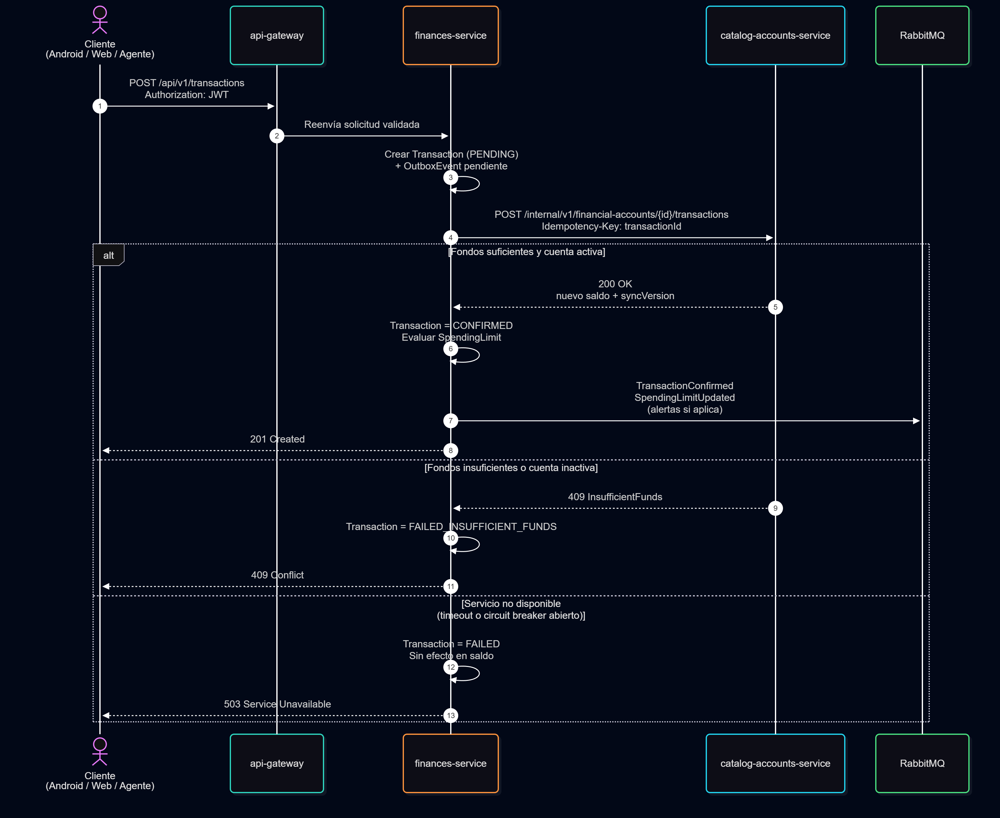

### Seguridad y propagación de identidad

1. `iam-service` emite el JWT (BCrypt para contraseñas, Google OAuth2 para el acceso federado).
2. El `api-gateway` valida firma y expiración antes de enrutar y reenvía la cabecera `Authorization`.
3. Cada microservicio vuelve a validar el JWT con `intiva-security-starter` (defensa en profundidad). En el alcance de la prueba de concepto la clave de firma se comparte por variable de entorno; para producción se recomienda firma asimétrica (RS256) con publicación de claves.
4. Las llamadas disparadas por una persona usuaria (incluidas las del agente) **retransmiten su JWT**. Las llamadas disparadas por eventos (por ejemplo, Communications consultando miembros a Household) usan la cabecera `X-Internal-Api-Key` sobre rutas `/internal/**`, accesibles solo dentro de la red de Docker.

### Diagramas C4 de contexto y contenedores

El modelo C4 de referencia utilizado para alinear este capítulo corresponde al archivo Structurizr DSL de Intiva. La versión suministrada define explícitamente la vista maestra `Containers_Master_View`, que incluye los contenedores de frontend, API Gateway, los nueve *Bounded Contexts*, sus bases de datos, RabbitMQ, Redis y las integraciones externas. Las vistas de componentes y los diagramas dinámicos que aparecen en las secciones particulares de este capítulo constituyen el diseño táctico detallado de cada servicio; no forman parte de la vista maestra de contenedores suministrada y deben mantenerse sincronizados con ella cuando se actualice el workspace.

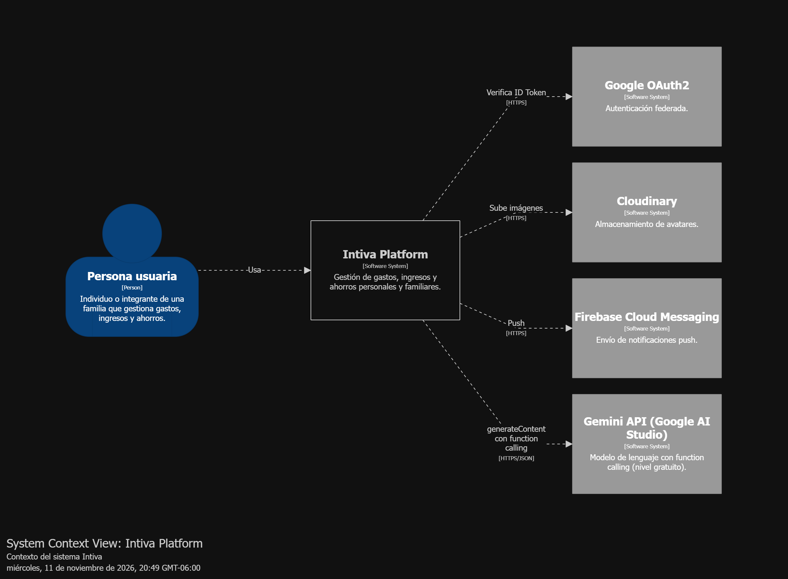

---

## 5.1. Bounded Context: Identity and Access Management (IAM)

Este contexto, desplegado como **`iam-service`**, gestiona el ciclo de vida de la identidad digital de las personas usuarias: registro, autenticación (credenciales locales o federada con Google OAuth2), asignación de roles y emisión de credenciales de sesión mediante JSON Web Tokens (JWT). Actúa como *Upstream Publisher*: al completarse un registro publica el evento `UserRegistered`, que los servicios `profiles-service` y `catalog-accounts-service` consumen para aprovisionar los datos por defecto del nuevo usuario (coreografía de la saga de *bootstrap*, **AD-MS-05**).

### 5.1.1. Domain Layer

| Clase / Interfaz | Categoría Táctica | Propósito | Atributos | Métodos | Relaciones |
| :--- | :--- | :--- | :--- | :--- | :--- |
| **`User`** | Aggregate Root | Representa la cuenta de identidad digital de una persona usuaria y gobierna las invariantes de acceso. | `- id: Long` `- email: Email` `- passwordHash: PasswordHash` `- googleId: String` `- roles: Set<Role>` `- active: boolean` | `+ User(SignUpCommand, String hashedPwd)` `+ verifyPassword(String): boolean` `+ assignRole(Role): void` `+ linkGoogleAccount(String): void` | Extiende de `AuditableAbstractAggregate`; contiene `Email`, `PasswordHash` y una colección de `Role` (`1..*`). |
| **`Role`** | Entity | Rol de autorización asignado a un usuario. | `- id: Long` `- name: Roles` | `+ getStringName(): String` `+ getDefaultRole(): Role` | Asociado a `User` (`*..*`). |
| **`Roles`** | Enumeration | Catálogo cerrado de roles de acceso. | `ROLE_USER` `ROLE_PREMIUM_USER` `ROLE_FAMILY_ADMIN` | `+ valueOf(String): Roles` | Utilizado por `Role` (`1`). |
| **`Email`** | Value Object | Encapsula y valida el formato del correo electrónico. | `- address: String` | `+ Email(String address)` `+ validate(): boolean` | Composición dentro de `User` (`1`). |
| **`PasswordHash`** | Value Object | Encapsula el hash criptográfico de la contraseña. | `- value: String` | `+ PasswordHash(String value)` `+ isPasswordValid(String raw): boolean` | Composición dentro de `User` (`1`). |
| **`SignUpCommand`** | Command | Intención de registrar un nuevo usuario. | `- fullName: String` `- email: String` `- password: String` | `+ email(): String` `+ password(): String` | Consumido por `UserCommandService`. |
| **`SignInCommand`** | Command | Intención de autenticar a un usuario existente. | `- email: String` `- password: String` `- idTokenGoogle: String` | `+ email(): String` `+ password(): String` | Consumido por `UserCommandService`. |
| **`SeedRolesCommand`** | Command | Inicializa los roles base al arrancar el servicio. | *(Sin atributos)* | *(Constructor por defecto)* | Consumido por `RoleCommandService`. |
| **`GetUserByIdQuery`** | Query | Búsqueda de un usuario por identificador. | `- userId: Long` | `+ userId(): Long` | Consumido por `UserQueryService`. |
| **`GetUserByEmailQuery`** | Query | Búsqueda de un usuario por correo. | `- email: String` | `+ email(): String` | Consumido por `UserQueryService`. |
| **`UserRegisteredEvent`** | Domain / Integration Event | Notifica que un nuevo usuario completó su registro. Se publica en RabbitMQ con la clave `iam.user.registered`. | `- eventId: UUID` `- userId: Long` `- email: String` `- occurredOn: Instant` | `+ getUserId(): Long` `+ getEmail(): String` | Publicado por `User` a través del *Outbox*; consumido por `profiles-service` y `catalog-accounts-service`. |
| **`UserCommandService`** | Domain Service (Interface) | Contrato de los casos de uso de escritura sobre `User`. | *(Interface)* | `+ handle(SignUpCommand): Optional<User>` `+ handle(SignInCommand): Optional<Pair<User, String>>` | Implementado por `UserCommandServiceImpl`. |
| **`UserQueryService`** | Domain Service (Interface) | Contrato de las consultas sobre `User`. | *(Interface)* | `+ handle(GetUserByIdQuery): Optional<User>` `+ handle(GetUserByEmailQuery): Optional<User>` | Implementado por `UserQueryServiceImpl`. |

### 5.1.2. Interface Layer

| Clase | Categoría Táctica | Propósito | Atributos | Métodos | Relaciones |
| :--- | :--- | :--- | :--- | :--- | :--- |
| **`AuthenticationController`** | REST Controller | Expone `/api/v1/auth/sign-up`, `/api/v1/auth/sign-in` y `/api/v1/auth/google`, enrutados por el API Gateway. | `- userCommandService: UserCommandService` | `+ signUp(SignUpResource): ResponseEntity<UserResource>` `+ signIn(SignInResource): ResponseEntity<AuthenticatedUserResource>` `+ googleAuth(GoogleTokenResource): ResponseEntity<AuthenticatedUserResource>` | Invoca a `UserCommandService`; usa los *Assemblers*. |
| **`UsersController`** | REST Controller | Expone endpoints protegidos bajo `/api/v1/users` para consultar información de identidad. | `- userQueryService: UserQueryService` | `+ getUserById(Long userId): ResponseEntity<UserResource>` | Invoca a `UserQueryService`. |
| **`SignUpCommandFromResourceAssembler`** | Assembler | Transforma `SignUpResource` en `SignUpCommand`. | *(Clase utilitaria estática)* | `+ toCommandFromResource(SignUpResource): SignUpCommand` | Utilizado por `AuthenticationController`. |
| **`AuthenticatedUserResourceFromEntityAssembler`** | Assembler | Ensambla la respuesta con ID, correo y token JWT. | *(Clase utilitaria estática)* | `+ toResourceFromEntity(User, String token): AuthenticatedUserResource` | Utilizado por `AuthenticationController`. |

### 5.1.3. Application Layer

| Clase | Categoría Táctica | Propósito | Atributos | Métodos | Relaciones |
| :--- | :--- | :--- | :--- | :--- | :--- |
| **`UserCommandServiceImpl`** | Command Handler | Orquesta registro y autenticación: valida unicidad de correo, encripta contraseñas, emite el JWT y registra `UserRegisteredEvent` en el *Outbox* dentro de la misma transacción local. | `- userRepository: UserRepository` `- hashingService: HashingService` `- tokenService: TokenService` `- oauth2Service: OAuth2IntegrationService` `- eventPublisher: DomainEventPublisher` | `+ handle(SignUpCommand): Optional<User>` `+ handle(SignInCommand): Optional<Pair<User, String>>` | Implementa `UserCommandService`; consume repositorios, adaptadores y el puerto de eventos. |
| **`UserQueryServiceImpl`** | Query Handler | Ejecuta las consultas de lectura sobre usuarios. | `- userRepository: UserRepository` | `+ handle(GetUserByIdQuery): Optional<User>` `+ handle(GetUserByEmailQuery): Optional<User>` | Implementa `UserQueryService`. |
| **`RoleCommandServiceImpl`** | Command Handler | Inicializa los roles por defecto al iniciar el servicio. | `- roleRepository: RoleRepository` | `+ handle(SeedRolesCommand): void` | Implementa `RoleCommandService`. |

### 5.1.4. Infrastructure Layer

| Clase / Interfaz | Categoría Táctica | Propósito | Atributos | Métodos | Relaciones |
| :--- | :--- | :--- | :--- | :--- | :--- |
| **`UserRepository`** | Repository (JPA) | Acceso a la tabla `users` en `iam_db`. | *(Interface JPA)* | `+ findByEmail(Email): Optional<User>` `+ existsByEmail(Email): boolean` | Extiende `JpaRepository<User, Long>`. |
| **`RoleRepository`** | Repository (JPA) | Persistencia de roles. | *(Interface JPA)* | `+ findByName(Roles): Optional<Role>` | Extiende `JpaRepository<Role, Long>`. |
| **`BCryptHashingServiceImpl`** | Security Adapter | Encriptación irreversible de contraseñas con BCrypt. | `- passwordEncoder: BCryptPasswordEncoder` | `+ encode(CharSequence): String` `+ matches(CharSequence, String): boolean` | Inyectado en `UserCommandServiceImpl`. |
| **`BearerTokenServiceImpl`** | Security Adapter | Genera y valida firma y expiración de JWT (*Chain of Responsibility*). | `- secret: String` `- expirationDays: int` | `+ generateToken(String username): String` `+ validateToken(String token): boolean` `+ getUsernameFromToken(String): String` | Usado por `UserCommandServiceImpl` y el filtro de seguridad. |
| **`IamRedisTokenAdapter`** | Cache Adapter | Almacena en Redis los códigos de 6 dígitos de recuperación de contraseña con TTL. | `- redisTemplate: StringRedisTemplate` | `+ saveRecoveryCode(String email, String code, Duration ttl): void` `+ validateAndConsumeCode(String email, String code): boolean` | Se conecta a `Intiva Redis Database`. |
| **`GoogleOAuth2Adapter`** | External Service Adapter | Valida los *ID Tokens* de Google contra sus certificados públicos. | `- verifier: GoogleIdTokenVerifier` | `+ verifyGoogleToken(String idToken): Optional<GoogleUserPayload>` | Se comunica con `Google OAuth2`. |
| **`RabbitMqDomainEventPublisher`** | Messaging Adapter (starter) | Implementa `DomainEventPublisher`: guarda el evento en `outbox_events` y el `OutboxRelayScheduler` lo publica en `intiva.events` con reintentos. | `- outboxRepository: OutboxEventRepository` `- rabbitTemplate: RabbitTemplate` | `+ publish(DomainEvent): void` `+ relayPending(): void` | Implementa `DomainEventPublisher`; se conecta a `RabbitMQ`. |

### 5.1.5. Bounded Context Software Architecture Component Level Diagrams

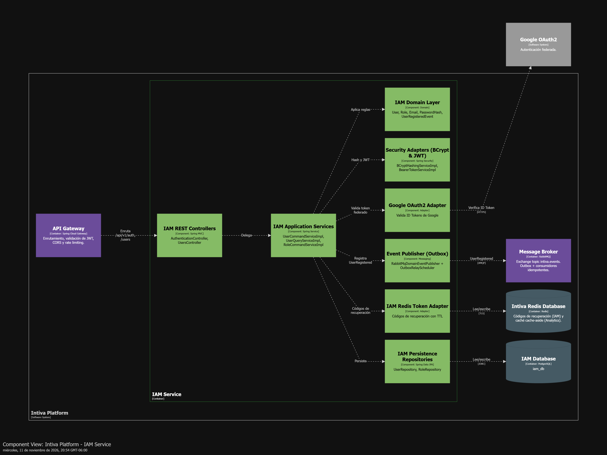

**Explicación del diagrama:**
El API Gateway enruta las solicitudes de autenticación y consulta a **`IAM REST Controllers`**, que las delega a **`IAM Application Services`**. Esta capa coordina los casos de uso apoyándose en **`IAM Domain Layer`**, e invoca a **`Security Adapters (BCrypt & JWT)`**, a **`Google OAuth2 Adapter`**, a **`IAM Redis Token Adapter`** y a **`IAM Persistence Repositories`** (PostgreSQL `iam_db`). Al registrar un usuario, el servicio de aplicación entrega el evento a **`Event Publisher (Outbox)`**, que lo publica en RabbitMQ.

### 5.1.6. Bounded Context Software Architecture Code Level Diagrams

#### 5.1.6.1. Bounded Context Domain Layer Class Diagrams

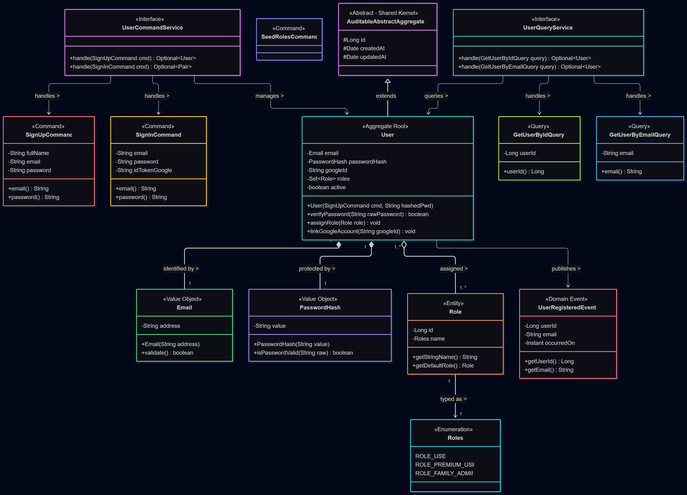

#### 5.1.6.2. Bounded Context Database Design Diagram

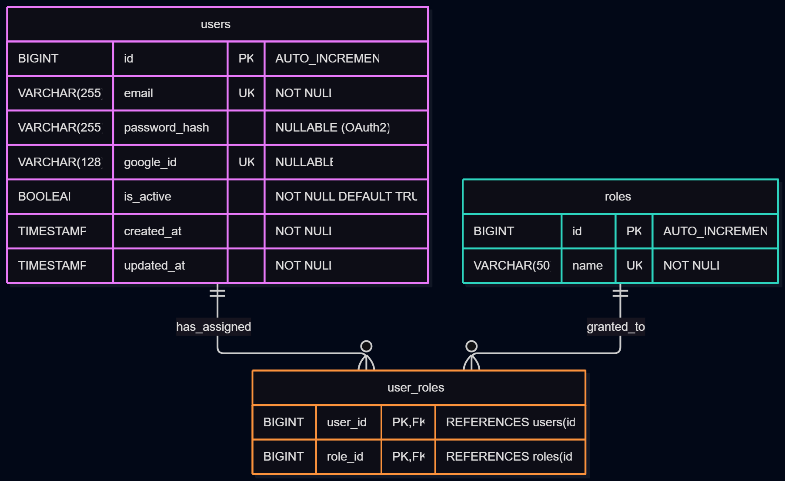

---

## 5.2. Bounded Context: Profiles

Este contexto, desplegado como **`profiles-service`**, administra la información personal, las preferencias de cuenta, el almacenamiento de avatares y el proceso de *onboarding* (tutorial guiado de primeros pasos). El perfil y el *onboarding* se crean de forma automática al consumir el evento `UserRegistered` publicado por `iam-service`.

### 5.2.1. Domain Layer

| Clase / Interfaz | Categoría Táctica | Propósito | Atributos | Métodos | Relaciones |
| :--- | :--- | :--- | :--- | :--- | :--- |
| **`Profile`** | Aggregate Root | Perfil personal de un usuario: nombre visible, correo de contacto y avatar. | `- id: Long` `- userId: UserId` `- fullName: String` `- email: String` `- avatar: Avatar` | `+ Profile(CreateProfileCommand)` `+ updatePersonalData(String fullName): void` `+ updateAvatar(Avatar newAvatar): void` | Extiende `AuditableAbstractAggregate`; contiene `UserId` (Shared Kernel) y `Avatar` (`1`). |
| **`Onboarding`** | Aggregate Root | Estado y avance del tutorial guiado para usuarios nuevos. | `- id: Long` `- userId: UserId` `- currentStep: TutorialStep` `- completed: boolean` `- skipped: boolean` | `+ advanceStep(): void` `+ skipOnboarding(): void` `+ rollbackOnboarding(): void` | Extiende `AuditableAbstractAggregate`; usa `TutorialStep` (`1`). |
| **`Avatar`** | Value Object | URL pública y metadatos de validación de la imagen de perfil. | `- imageUrl: String` `- format: String` `- sizeInBytes: Long` | `+ Avatar(String url, String format, Long size)` `+ isValidFormatAndSize(): boolean` | Composición dentro de `Profile` (`1`). |
| **`TutorialStep`** | Value Object | Paso actual dentro de la secuencia del tutorial. | `- stepNumber: int` `- stepCode: String` | `+ next(): TutorialStep` `+ reset(): TutorialStep` | Composición dentro de `Onboarding` (`1`). |
| **`CreateProfileCommand`** | Command | Crea el perfil derivando el nombre inicial del correo. | `- userId: Long` `- email: String` `- fullName: String` | `+ userId(): Long` `+ email(): String` | Consumido por `ProfileCommandService`. |
| **`UpdateProfileCommand`** | Command | Actualiza nombre o avatar. | `- userId: Long` `- fullName: String` `- imageFileBytes: byte[]` | `+ userId(): Long` `+ fullName(): String` | Consumido por `ProfileCommandService`. |
| **`CreateUserOnboardingCommand`** | Command | Inicializa el seguimiento del tutorial. | `- userId: Long` | `+ userId(): Long` | Consumido por `OnboardingCommandService`. |
| **`AdvanceTutorialStepCommand`** | Command | Avanza al siguiente paso. | `- userId: Long` | `+ userId(): Long` | Consumido por `OnboardingCommandService`. |
| **`SkipOnboardingCommand`** | Command | Omite el tutorial sin afectar datos financieros. | `- userId: Long` | `+ userId(): Long` | Consumido por `OnboardingCommandService`. |
| **`RollbackOnboardingCommand`** | Command | Revierte o reinicia el tutorial. | `- userId: Long` | `+ userId(): Long` | Consumido por `OnboardingCommandService`. |
| **`GetProfileByUserIdQuery`** | Query | Consulta el perfil de un usuario. | `- userId: Long` | `+ userId(): Long` | Consumido por `ProfileQueryService`. |
| **`GetOnboardingStatusQuery`** | Query | Consulta el estado del tutorial. | `- userId: Long` | `+ userId(): Long` | Consumido por `OnboardingQueryService`. |
| **`ProfileCommandService`** | Domain Service (Interface) | Contrato de escritura de perfiles. | *(Interface)* | `+ handle(CreateProfileCommand): Optional<Profile>` `+ handle(UpdateProfileCommand): Optional<Profile>` | Implementado por `ProfileCommandServiceImpl`. |
| **`OnboardingCommandService`** | Domain Service (Interface) | Contrato de escritura del *onboarding*. | *(Interface)* | `+ handle(CreateUserOnboardingCommand): Optional<Onboarding>` `+ handle(AdvanceTutorialStepCommand): Optional<Onboarding>` `+ handle(SkipOnboardingCommand): void` | Implementado por `OnboardingCommandServiceImpl`. |

### 5.2.2. Interface Layer

| Clase | Categoría Táctica | Propósito | Atributos | Métodos | Relaciones |
| :--- | :--- | :--- | :--- | :--- | :--- |
| **`ProfilesController`** | REST Controller | Expone `/api/v1/profiles` para consultar y actualizar información personal y foto. | `- profileCommandService: ProfileCommandService` `- profileQueryService: ProfileQueryService` | `+ getProfileByUserId(Long userId): ResponseEntity<ProfileResource>` `+ updateProfile(Long userId, UpdateProfileResource): ResponseEntity<ProfileResource>` | Invoca a los servicios de perfil. |
| **`OnboardingController`** | REST Controller | Expone `/api/v1/onboarding` para consultar, avanzar, omitir o reiniciar el tutorial. | `- onboardingCommandService: OnboardingCommandService` `- onboardingQueryService: OnboardingQueryService` | `+ getStatus(Long userId): ResponseEntity<OnboardingResource>` `+ advanceStep(Long userId): ResponseEntity<OnboardingResource>` `+ skip(Long userId): ResponseEntity<Void>` | Invoca a los servicios de *onboarding*. |
| **`ProfileResourceFromEntityAssembler`** | Assembler | Transforma `Profile` en `ProfileResource`. | *(Clase utilitaria estática)* | `+ toResourceFromEntity(Profile): ProfileResource` | Utilizado por `ProfilesController`. |

### 5.2.3. Application Layer

| Clase | Categoría Táctica | Propósito | Atributos | Métodos | Relaciones |
| :--- | :--- | :--- | :--- | :--- | :--- |
| **`ProfileCommandServiceImpl`** | Command Handler | Gestiona creación y actualización del perfil; coordina la subida de imágenes con el adaptador de Cloudinary y conserva el avatar anterior si el servicio externo falla. | `- profileRepository: ProfileRepository` `- cloudinaryPort: ImageStoragePort` | `+ handle(CreateProfileCommand): Optional<Profile>` `+ handle(UpdateProfileCommand): Optional<Profile>` | Implementa `ProfileCommandService`. |
| **`ProfileQueryServiceImpl`** | Query Handler | Recupera el perfil desde `profiles_db`. | `- profileRepository: ProfileRepository` | `+ handle(GetProfileByUserIdQuery): Optional<Profile>` | Implementa `ProfileQueryService`. |
| **`OnboardingCommandServiceImpl`** | Command Handler | Ejecuta las transiciones del tutorial (avanzar, omitir, revertir). | `- onboardingRepository: OnboardingRepository` | `+ handle(CreateUserOnboardingCommand): Optional<Onboarding>` `+ handle(AdvanceTutorialStepCommand): Optional<Onboarding>` `+ handle(SkipOnboardingCommand): void` `+ handle(RollbackOnboardingCommand): void` | Implementa `OnboardingCommandService`. |
| **`UserRegisteredEventListener`** | Event Handler (Idempotent Consumer) | Escucha `UserRegistered` desde la cola `profiles.user-registered`, crea el perfil por defecto (prefijo del correo) y el registro de *onboarding*. Ignora eventos ya procesados (`ProcessedEvent`) y usuarios con perfil existente. | `- profileCommandService: ProfileCommandService` `- onboardingCommandService: OnboardingCommandService` `- processedEventRepository: ProcessedEventRepository` | `+ on(UserRegisteredEvent): void` | Invoca a los servicios de comandos del contexto. |

### 5.2.4. Infrastructure Layer

| Clase / Interfaz | Categoría Táctica | Propósito | Atributos | Métodos | Relaciones |
| :--- | :--- | :--- | :--- | :--- | :--- |
| **`ProfileRepository`** | Repository (JPA) | Persistencia de `Profile` en `profiles`. | *(Interface JPA)* | `+ findByUserId(UserId): Optional<Profile>` `+ existsByUserId(UserId): boolean` | Extiende `JpaRepository<Profile, Long>`. |
| **`OnboardingRepository`** | Repository (JPA) | Persistencia del estado del tutorial en `onboardings`. | *(Interface JPA)* | `+ findByUserId(UserId): Optional<Onboarding>` | Extiende `JpaRepository<Onboarding, Long>`. |
| **`CloudinaryStorageAdapter`** | External Service Adapter | Sube avatares (JPG, PNG, WEBP hasta 5 MB) a Cloudinary y retorna la URL segura; captura caídas del proveedor sin interrumpir el flujo. | `- cloudinaryClient: Cloudinary` `- maxFileSizeBytes: Long` | `+ uploadAvatar(byte[] fileBytes, String fileName): Optional<String>` | Se comunica con `Cloudinary Service`. |
| **`RabbitMqEventConsumerConfig`** | Messaging Adapter (starter) | Declara la cola `profiles.user-registered` enlazada a `iam.user.registered`, con cola de mensajes fallidos (*dead-letter*). | `- queueName: String` `- routingKey: String` | `+ userRegisteredQueue(): Queue` | Se conecta a `RabbitMQ`. |

### 5.2.5. Bounded Context Software Architecture Component Level Diagrams

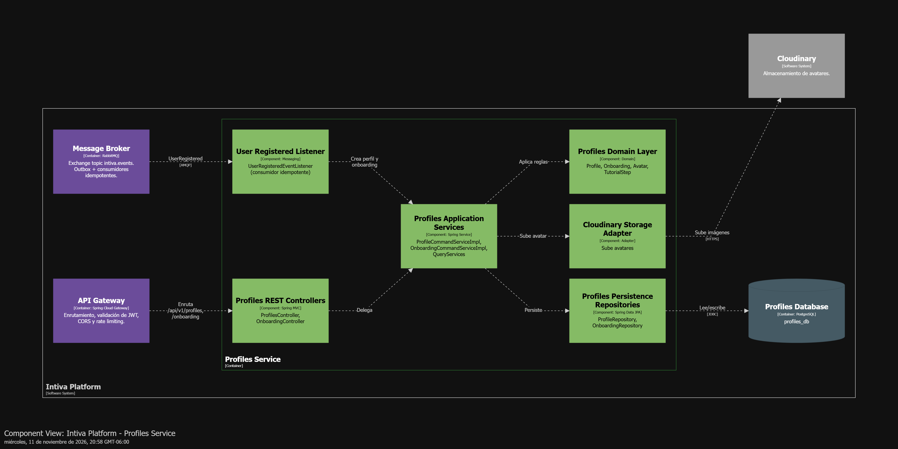

**Explicación del diagrama:**
Las peticiones de perfil y tutorial llegan desde el API Gateway a **`Profiles REST Controllers`**. El evento `UserRegistered` llega desde RabbitMQ a **`User Registered Listener`**. Ambos delegan en **`Profiles Application Services`**, que aplica las reglas de **`Profiles Domain Layer`**. Los avatares se almacenan mediante **`Cloudinary Storage Adapter`** y los datos estructurados en PostgreSQL (`profiles_db`) mediante **`Profiles Persistence Repositories`**.

### 5.2.6. Bounded Context Software Architecture Code Level Diagrams

#### 5.2.6.1. Bounded Context Domain Layer Class Diagrams

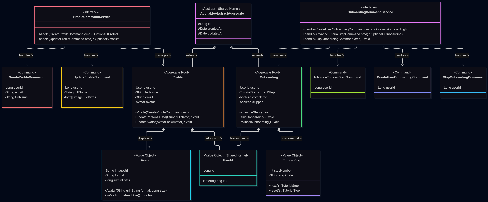

#### 5.2.6.2. Bounded Context Database Design Diagram

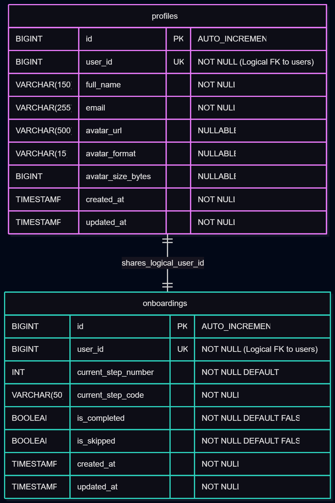

---

## 5.3. Bounded Context: Categories & Financial Accounts

Este contexto, desplegado como **`catalog-accounts-service`**, administra el catálogo de categorías de gasto e ingreso y los medios de pago (efectivo, tarjetas de débito/crédito y billeteras digitales) de personas y familias. Es el **dueño del saldo** de las cuentas: ningún otro servicio modifica un saldo directamente, sino a través de su API interna con una clave de idempotencia. Aprovisiona las categorías y la cuenta por defecto al consumir `UserRegistered`, y publica `CategoryUpserted` para mantener actualizado el modelo de lectura de Analytics.

### 5.3.1. Domain Layer

| Clase / Interfaz | Categoría Táctica | Propósito | Atributos | Métodos | Relaciones |
| :--- | :--- | :--- | :--- | :--- | :--- |
| **`Category`** | Aggregate Root | Categoría de clasificación de transacciones, asociada a un titular individual o familiar. | `- id: Long` `- name: String` `- type: CategoryType` `- color: String` `- icon: String` `- ownerType: OwnerTypes` `- ownerId: Long` | `+ Category(CreateCategoryCommand)` `+ updateDetails(String name, String color, String icon): void` | Extiende `AuditableAbstractAggregate`; usa `CategoryType` y `OwnerTypes` (Shared Kernel). |
| **`FinancialAccount`** | Aggregate Root | Medio de pago o cuenta (efectivo, tarjeta o billetera): controla saldo, estado de activación y versión de sincronización. | `- id: Long` `- name: AccountName` `- type: FinancialAccountType` `- balance: Money` `- creditLimit: Money` `- institution: Institution` `- active: boolean` `- syncVersion: Long` `- ownerType: OwnerTypes` `- ownerId: Long` | `+ applyTransaction(Money amount, String opType): void` `+ hasSufficientBalance(Money amount): boolean` `+ deactivate(): void` `+ validateSyncVersion(Long clientVersion): void` | Extiende `AuditableAbstractAggregate`; compuesta por `AccountName`, `Institution` y `Money`. |
| **`ProcessedOperation`** | Entity (Idempotency) | Registra la clave de idempotencia de cada cargo/abono aplicado, para que un reintento de la saga no duplique el movimiento. | `- idempotencyKey: String` `- accountId: Long` `- resultingBalance: Money` `- processedAt: Instant` | `+ isSameOperation(String key): boolean` | Consultada por `FinancialAccountCommandServiceImpl`. |
| **`AccountName`** | Value Object | Nombre asignado por el usuario a su cuenta. | `- value: String` | `+ AccountName(String value)` | Composición dentro de `FinancialAccount` (`1`). |
| **`Institution`** | Value Object | Entidad bancaria o emisora de la billetera. | `- name: String` | `+ Institution(String name)` | Composición dentro de `FinancialAccount` (`0..1`). |
| **`CreateCategoryCommand`** | Command | Crea una categoría verificando que no exista duplicidad de nombre para el titular. | `- name: String` `- type: String` `- color: String` `- icon: String` `- ownerType: String` `- ownerId: Long` | `+ name(): String` `+ ownerId(): Long` | Consumido por `CategoryCommandService`. |
| **`CreateDefaultCategoryCommand`** | Command | Crea el catálogo de categorías por defecto de un usuario nuevo. | `- ownerId: Long` `- ownerType: String` | `+ ownerId(): Long` | Consumido por `CategoryCommandService`. |
| **`CreateFinancialAccountCommand`** | Command | Registra una nueva cuenta con su saldo inicial. | `- name: String` `- type: String` `- initialBalance: BigDecimal` `- institution: String` `- ownerType: String` `- ownerId: Long` | `+ name(): String` `+ initialBalance(): BigDecimal` | Consumido por `FinancialAccountCommandService`. |
| **`CreateFinancialAccountTransaction`** | Command | Aplica un cargo o abono sobre el saldo o línea de crédito de una cuenta activa. | `- accountId: Long` `- amount: BigDecimal` `- operationType: String` `- expectedVersion: Long` `- idempotencyKey: String` | `+ accountId(): Long` `+ amount(): BigDecimal` | Consumido por `FinancialAccountCommandService`. |
| **`GetCategoryByIdQuery`** | Query | Consulta una categoría por identificador. | `- categoryId: Long` | `+ categoryId(): Long` | Consumido por `CategoryQueryService`. |
| **`GetAllCategoriesByOwnerTypeAndOwnerIdAndTypeQuery`** | Query | Lista las categorías de un titular por tipo. | `- ownerType: String` `- ownerId: Long` `- type: String` | `+ ownerId(): Long` | Consumido por `CategoryQueryService`. |
| **`CategoryUpsertedEvent`** | Integration Event | Notifica la creación o modificación de una categoría (`catalog.category.upserted`). | `- eventId: UUID` `- categoryId: Long` `- name: String` `- color: String` `- icon: String` `- ownerType: String` `- ownerId: Long` | `+ getCategoryId(): Long` | Publicado por `Category` mediante *Outbox*; consumido por `analytics-service`. |

### 5.3.2. Interface Layer

| Clase | Categoría Táctica | Propósito | Atributos | Métodos | Relaciones |
| :--- | :--- | :--- | :--- | :--- | :--- |
| **`CategoriesController`** | REST Controller | Expone `/api/v1/categories` para crear y listar categorías. | `- categoryCommandService: CategoryCommandService` `- categoryQueryService: CategoryQueryService` | `+ createCategory(CreateCategoryResource): ResponseEntity<CategoryResource>` `+ getCategoriesByOwner(...): ResponseEntity<List<CategoryResource>>` | Consume los servicios de categorías. |
| **`FinancialAccountsController`** | REST Controller | Expone `/api/v1/financial-accounts` para registrar, consultar e inhabilitar cuentas. | `- accountCommandService: FinancialAccountCommandService` `- accountQueryService: FinancialAccountQueryService` | `+ createAccount(CreateFinancialAccountResource): ResponseEntity<FinancialAccountResource>` `+ getAccountsByOwner(Long ownerId): ResponseEntity<List<FinancialAccountResource>>` `+ disableAccount(Long id, DisableAccountResource): ResponseEntity<Void>` | Consume los servicios de cuentas. |
| **`CatalogInternalController`** | Inbound ACL / OHS (REST interno) | Reemplaza a las *facades* en proceso. Expone `/internal/v1/**` (no enrutado por el Gateway) para: validar la existencia y titularidad de una categoría, consultar metadatos de categoría, verificar saldo suficiente y aplicar movimientos con `Idempotency-Key`. | `- categoryQueryService: CategoryQueryService` `- accountCommandService: FinancialAccountCommandService` `- accountQueryService: FinancialAccountQueryService` | `+ getCategoryMetadata(Long categoryId): ResponseEntity<CategoryMetadataResource>` `+ hasSufficientBalance(Long accountId, BigDecimal amount): ResponseEntity<BalanceCheckResource>` `+ applyTransaction(Long accountId, ApplyMovementResource, String idempotencyKey): ResponseEntity<FinancialAccountResource>` | Delega a los servicios de aplicación; protegido por `X-Internal-Api-Key` o JWT retransmitido. |

### 5.3.3. Application Layer

| Clase | Categoría Táctica | Propósito | Atributos | Métodos | Relaciones |
| :--- | :--- | :--- | :--- | :--- | :--- |
| **`CategoryCommandServiceImpl`** | Command Handler | Crea categorías personalizadas y por defecto validando nombres duplicados; registra `CategoryUpsertedEvent` en el *Outbox*. | `- categoryRepository: CategoryRepository` `- eventPublisher: DomainEventPublisher` | `+ handle(CreateCategoryCommand): Optional<Category>` `+ handle(CreateDefaultCategoryCommand): Optional<Category>` | Implementa `CategoryCommandService`. |
| **`CategoryQueryServiceImpl`** | Query Handler | Recupera las categorías del usuario. | `- categoryRepository: CategoryRepository` | `+ handle(GetCategoryByIdQuery): Optional<Category>` `+ handle(GetAllCategoriesByOwnerTypeAndOwnerIdAndTypeQuery): List<Category>` | Implementa `CategoryQueryService`. |
| **`FinancialAccountCommandServiceImpl`** | Command Handler | Gestiona el ciclo de vida de las cuentas y la aplicación de cargos/abonos: verifica fondos (`InsufficientFundsException`), versión de sincronización (`FinancialAccountSyncConflictException`) e **idempotencia** (si la clave ya fue procesada devuelve el resultado previo sin reaplicar). | `- accountRepository: FinancialAccountRepository` `- processedOperationRepository: ProcessedOperationRepository` | `+ handle(CreateFinancialAccountCommand): Optional<FinancialAccount>` `+ handle(CreateFinancialAccountTransaction): Optional<FinancialAccount>` `+ handle(UpdateFinancialAccountCommand): Optional<FinancialAccount>` | Implementa `FinancialAccountCommandService`. |
| **`FinancialAccountQueryServiceImpl`** | Query Handler | Consulta cuentas activas y verificación de saldos por titular. | `- accountRepository: FinancialAccountRepository` | `+ handle(GetFinancialAccountByIdQuery): Optional<FinancialAccount>` `+ handle(GetAllFinancialAccountsByOwnerId): List<FinancialAccount>` | Implementa `FinancialAccountQueryService`. |
| **`UserRegisteredEventListener`** | Event Handler (Idempotent Consumer) | Escucha `UserRegistered` desde la cola `catalog.user-registered` y crea las categorías y la cuenta financiera por defecto del usuario. | `- categoryCommandService: CategoryCommandService` `- accountCommandService: FinancialAccountCommandService` `- processedEventRepository: ProcessedEventRepository` | `+ on(UserRegisteredEvent): void` | Invoca a los servicios de comandos del contexto. |

### 5.3.4. Infrastructure Layer

| Clase / Interfaz | Categoría Táctica | Propósito | Atributos | Métodos | Relaciones |
| :--- | :--- | :--- | :--- | :--- | :--- |
| **`CategoryRepository`** | Repository (JPA) | Persistencia de `Category` en `categories`. | *(Interface JPA)* | `+ findByOwnerTypeAndOwnerId(OwnerTypes, Long): List<Category>` `+ existsByNameAndOwnerId(String, Long): boolean` | Extiende `JpaRepository<Category, Long>`. |
| **`FinancialAccountRepository`** | Repository (JPA) | Persistencia de cuentas en `financial_accounts`. | *(Interface JPA)* | `+ findByOwnerTypeAndOwnerIdAndActiveTrue(OwnerTypes, Long): List<FinancialAccount>` | Extiende `JpaRepository<FinancialAccount, Long>`. |
| **`ProcessedOperationRepository`** | Repository (JPA) | Persiste las claves de idempotencia en `processed_operations` (índice único por clave). | *(Interface JPA)* | `+ findByIdempotencyKey(String): Optional<ProcessedOperation>` | Extiende `JpaRepository<ProcessedOperation, Long>`. |
| **`RabbitMqDomainEventPublisher`** | Messaging Adapter (starter) | Publica eventos mediante *Outbox* y `OutboxRelayScheduler`. | `- outboxRepository: OutboxEventRepository` `- rabbitTemplate: RabbitTemplate` | `+ publish(DomainEvent): void` | Implementa `DomainEventPublisher`. |

### 5.3.5. Bounded Context Software Architecture Component Level Diagrams

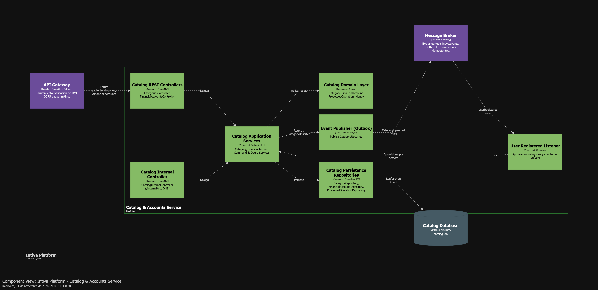

**Explicación del diagrama:**
Las solicitudes de usuario llegan desde el API Gateway a **`Catalog REST Controllers`**; las consultas internas de `finances-service` y las lecturas del agente ingresan por **`Catalog Internal Controller`** y los controladores públicos respectivamente. El evento `UserRegistered` llega a **`User Registered Listener`**. Todos delegan en **`Catalog Application Services`**, que valida saldo, activación, versión e idempotencia en **`Catalog Domain Layer`**, persiste en PostgreSQL (`catalog_db`) mediante **`Catalog Persistence Repositories`** y publica `CategoryUpserted` mediante **`Event Publisher (Outbox)`**.

### 5.3.6. Bounded Context Software Architecture Code Level Diagrams

#### 5.3.6.1. Bounded Context Domain Layer Class Diagrams

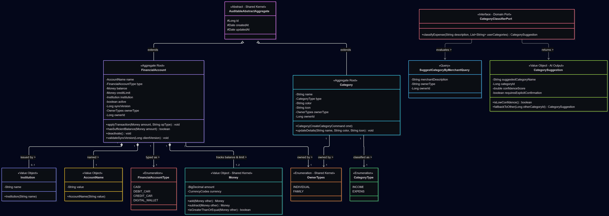

#### 5.3.6.2. Bounded Context Database Design Diagram

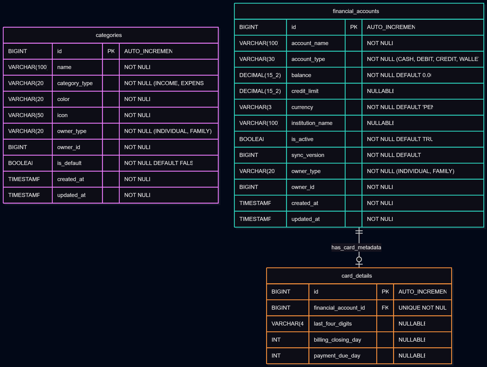

---

## 5.4. Bounded Context: Finances

Este contexto gestiona ingresos, gastos, límites y pagos recurrentes. Para US 032 y TS 023 incorpora propuestas de gasto del fondo familiar, separadas de los movimientos confirmados: todos los miembros deben aprobar la misma propuesta y el smart contract debe confirmar su validación antes de registrar el gasto (AD-23 a AD-25). Para US 033, el gasto personal se guarda después de revisar la categoría sugerida por IA.

### 5.4.1. Domain Layer

| Clase / Interfaz | Categoría Táctica | Propósito | Atributos | Métodos | Relaciones |
| :--- | :--- | :--- | :--- | :--- | :--- |
| **`Transaction`** | Aggregate Root | Movimiento confirmado, personal o familiar. La propuesta familiar se modela por separado. | `id`, `financialAccountId`, `categoryId`, `amount: Money`, `type`, `status`, `description`, `transactionDate`, `ownerType`, `ownerId`, `proposalId: UUID?` | `register()`, `isFamilyTransaction()` | Publica FamilyTransactionCreatedEvent tras conciliación; proposalId único si proviene del fondo. |
| **`SpendingLimit`** | Aggregate Root | Representa un tope presupuestario configurado por periodo sobre una categoría o cuenta financiera. | `- id: Long` `- targetType: SpendingLimitTargetType` `- targetId: Long` `- limitAmount: Money` `- currentSpentAmount: Money` `- warningThresholdPercent: int` `- period: PeriodTypes` `- status: SpendingLimitStatus` `- ownerType: OwnerTypes` `- ownerId: Long` | `+ evaluateExpense(Money expenseAmount): SpendingLimitStatus` `+ isWarningReached(): boolean` `+ isExceeded(): boolean` `+ activate(): void` | Extiende de `AuditableAbstractAggregate`; emite `SpendingLimitWarningReachedEvent` y `SpendingLimitExceededEvent`. |
| **`RecurringTransaction`** | Aggregate Root | Representa un gasto o ingreso fijo programado con fecha de vencimiento y frecuencia periódica. | `- id: Long` `- financialAccountId: Long` `- categoryId: Long` `- amount: Money` `- frequency: PeriodTypes` `- nextDueDate: LocalDate` `- active: boolean` `- ownerType: OwnerTypes` `- ownerId: Long` | `+ isDueSoon(LocalDate today): boolean` `+ isExpired(LocalDate today): boolean` `+ advanceNextDueDate(): void` `+ activate(): void` | Extiende de `AuditableAbstractAggregate`; emite `PaymentDueSoonEvent` y `PaymentExpiredEvent`. |
| **`TransactionStatus`** | Enumeration | Resultado del registro de un movimiento; no equivale al estado de una propuesta. | `CONFIRMED`, `FAILED_INSUFFICIENT_FUNDS` | `valueOf(String)` | Utilizado por Transaction. |
| **`SpendingLimitTargetType`** | Enumeration | Define sobre qué elemento se aplica el límite de gasto. | `CATEGORY` `FINANCIAL_ACCOUNT` `PERIOD` | `+ valueOf(String): SpendingLimitTargetType` | Utilizado por `SpendingLimit` (`1`). |
| **`RegisterTransactionCommand`** | Command | Registra un movimiento personal revisado; el cliente no puede usar este comando para eludir el contrato del fondo. | `accountId`, `categoryId`, `amount`, `type`, `description`, `ownerId` | `amount()` | Consumido por TransactionCommandService. |

| **`CreateSpendingLimitCommand`** | Command | Solicita configurar un nuevo límite de gasto por categoría, cuenta o periodo. | `- targetType: String` `- targetId: Long` `- limitAmount: BigDecimal` `- period: String` `- ownerType: String` `- ownerId: Long` | `+ limitAmount(): BigDecimal` | Consumido por `SpendingLimitCommandService`. |
| **`CreateRecurringTransactionCommand`** | Command | Solicita programar un ingreso o gasto recurrente con fecha de pago. | `- accountId: Long` `- categoryId: Long` `- amount: BigDecimal` `- frequency: String` `- nextDueDate: LocalDate` `- ownerId: Long` | `+ nextDueDate(): LocalDate` | Consumido por `RecurringTransactionCommandService`. |
| **`FamilyTransactionCreatedEvent`** | Domain Event | Notifica que un integrante ha registrado una transacción dentro del grupo familiar. | `- transactionId: Long` `- familyId: Long` `- authorUserId: Long` `- amount: BigDecimal` | `+ getFamilyId(): Long` | Publicado por `Transaction`. |
| **`SpendingLimitWarningReachedEvent`** | Domain Event | Notifica que el gasto acumulado se encuentra próximo a alcanzar el límite configurado (US 027). | `- spendingLimitId: Long` `- ownerId: Long` `- currentPercentage: double` | `+ getSpendingLimitId(): Long` | Publicado por `SpendingLimit`. |
| **`SpendingLimitExceededEvent`** | Domain Event | Notifica que un gasto registrado ha superado el límite de presupuesto establecido (US 026). | `- spendingLimitId: Long` `- ownerId: Long` `- exceededAmount: BigDecimal` | `+ getExceededAmount(): BigDecimal` | Publicado por `SpendingLimit`. |
| **`PaymentDueSoonEvent`** | Domain Event | Notifica que un pago recurrente programado está próximo a su fecha de vencimiento (US 030). | `- recurringTransactionId: Long` `- ownerId: Long` `- dueDate: LocalDate` | `+ getDueDate(): LocalDate` | Publicado por `RecurringTransaction`. |

| **`SharedFundProposal`** | Aggregate Root | Gasto propuesto, separado del movimiento; US 032 y TS 023. | `id: UUID`, `familyId`, `amount: Money`, `recipient`, `termsHash`, `requiredMemberIds: Set<UserId>`, `status: ProposalStatus` | `approve(member, signature)`, `reject(member)`, `isUnanimous()` | Composición de ProposalApproval; instantánea de miembros y condiciones inmutables. |
| **`ProposalApproval`** | Entity | Un voto por miembro sobre el hash de la misma propuesta. | `proposalId`, `memberId`, `decision`, `signature`, `signedAt` | `matchesTermsHash(hash)` | UNIQUE(proposalId, memberId); una firma no sustituye otras aprobaciones. |
| **`ProposalStatus`** | Enumeration | Distingue acuerdo, envío y confirmación del contrato. | `PENDING_APPROVAL`, `READY_FOR_SUBMISSION`, `PENDING_CHAIN`, `CONFIRMED`, `REJECTED`, `ERROR` | `valueOf(String)` | El saldo no cambia antes de CONFIRMED. |
| **`SmartContractGatewayPort`** | Domain Port | Envía aprobaciones firmadas y consulta resultado sin custodiar claves privadas. | Interfaz | `submitApprovedProposal(proposal, signatures)`, `getResult(reference)` | Implementado por SmartContractGatewayAdapter. |

### 5.4.2. Interface Layer

| Clase | Categoría Táctica | Propósito | Atributos | Métodos | Relaciones |
| :--- | :--- | :--- | :--- | :--- | :--- |
| **`TransactionsController`** | REST Controller | Registra movimientos personales revisados y consulta historial. | `transactionCommandService`, `transactionQueryService` | `registerTransaction(resource)`, `getTransactionsByOwner(...)` | Delega en los servicios de Finances. |
| **`SpendingLimitsController`** | REST Controller | Expone `/api/v1/spending-limits` para crear, activar y consultar límites de gasto y su monto utilizado/disponible. | `- limitCommandService: SpendingLimitCommandService` `- limitQueryService: SpendingLimitQueryService` | `+ createSpendingLimit(CreateSpendingLimitResource): ResponseEntity<SpendingLimitResource>` `+ getLimitsByOwner(Long ownerId): ResponseEntity<List<SpendingLimitResource>>` | Invoca a `SpendingLimitCommandService` y `SpendingLimitQueryService`. |
| **`RecurringTransactionsController`** | REST Controller | Expone `/api/v1/recurring-transactions` para configurar y listar pagos e ingresos programados. | `- recurringCommandService: RecurringTransactionCommandService` `- recurringQueryService: RecurringTransactionQueryService` | `+ createRecurring(CreateRecurringResource): ResponseEntity<RecurringTransactionResource>` `+ getRecurringByOwner(Long ownerId): ResponseEntity<List<RecurringTransactionResource>>` | Invoca a `RecurringTransactionCommandService` y `RecurringTransactionQueryService`. |

### 5.4.3. Application Layer

| Clase | Categoría Táctica | Propósito | Atributos | Métodos | Relaciones |
| :--- | :--- | :--- | :--- | :--- | :--- |
| **`TransactionCommandServiceImpl`** | Command Handler / Saga Orchestrator | Orquesta el registro: valida titularidad (y pertenencia si el titular es una familia), crea la `Transaction` en `PENDING`, aplica el cargo en la cuenta con `idempotencyKey = transactionId`, confirma o marca la falla, evalúa los límites y registra los eventos en el *Outbox*. | `- transactionRepository: TransactionRepository` `- limitRepository: SpendingLimitRepository` `- accountService: FinancesExternalFinancialAccountService` `- categoriesService: FinancesExternalCategoriesService` `- householdService: FinancesExternalHouseholdService` `- eventPublisher: DomainEventPublisher` | `+ handle(RegisterTransactionCommand): Optional<Transaction>` | Implementa `TransactionCommandService`. |
| **`TransactionQueryServiceImpl`** | Query Handler | Consultas de historial respetando la marca de privacidad `OwnerTypes` (**AD-03**). | `- transactionRepository: TransactionRepository` | `+ handle(GetTransactionsByOwnerIdQuery): List<Transaction>` `+ handle(GetLastTransactionsByOwnerIdQuery): List<Transaction>` | Implementa `TransactionQueryService`. |
| **`SpendingLimitCommandServiceImpl`** | Command Handler | Crea y activa límites; recalcula el consumo al confirmarse una transacción y publica `SpendingLimitUpdated` y las alertas correspondientes. | `- limitRepository: SpendingLimitRepository` `- eventPublisher: DomainEventPublisher` | `+ handle(CreateSpendingLimitCommand): Optional<SpendingLimit>` `+ handle(ActivateSpendingLimitCommand): Optional<SpendingLimit>` | Implementa `SpendingLimitCommandService`. |
| **`PaymentReminderScheduler`** | Application Scheduler | Proceso programado (**AD-13**) que inspecciona diariamente las `RecurringTransaction` activas y publica `PaymentDueSoon` o `PaymentExpired`. | `- recurringRepository: RecurringTransactionRepository` `- eventPublisher: DomainEventPublisher` | `+ checkUpcomingAndExpiredPayments(): void` | Consulta `RecurringTransactionRepository`. |
| **`FinancesExternalFinancialAccountService`** | Outbound ACL Client | Cliente REST hacia `catalog-accounts-service` con *timeout*, *retry* y *circuit breaker*: verifica saldo y aplica movimientos enviando `Idempotency-Key`. | `- restClient: RestClient` `- circuitBreaker: CircuitBreaker` | `+ hasSufficientBalance(Long accountId, BigDecimal amount): boolean` `+ applyMovement(Long accountId, BigDecimal amount, String opType, String idempotencyKey): MovementResult` | Consume `CatalogInternalController`. |
| **`FinancesExternalCategoriesService`** | Outbound ACL Client | Cliente REST que valida que la categoría exista y pertenezca al titular. | `- restClient: RestClient` | `+ existsAndBelongsTo(Long categoryId, Long ownerId): boolean` | Consume `CatalogInternalController`. |
| **`FinancesExternalHouseholdService`** | Outbound ACL Client | Cliente REST (AD-04) que verifica la pertenencia activa del usuario a la familia cuando el titular es `FAMILY`. | `- restClient: RestClient` | `+ isUserMemberOfFamily(Long userId, Long familyId): boolean` | Consume `HouseholdInternalController`. |

### 5.4.4. Infrastructure Layer

| Clase / Interfaz | Categoría Táctica | Propósito | Atributos | Métodos | Relaciones |
| :--- | :--- | :--- | :--- | :--- | :--- |
| **`TransactionRepository`** | Repository (JPA) | Persistencia de movimientos en `transactions`. | *(Interface JPA)* | `+ findByOwnerTypeAndOwnerId(OwnerTypes, Long): List<Transaction>` `+ findByStatus(TransactionStatus): List<Transaction>` | Extiende `JpaRepository<Transaction, Long>`. |
| **`SpendingLimitRepository`** | Repository (JPA) | Persistencia de límites. | *(Interface JPA)* | `+ findByOwnerTypeAndOwnerIdAndStatus(OwnerTypes, Long, SpendingLimitStatus): List<SpendingLimit>` | Extiende `JpaRepository<SpendingLimit, Long>`. |
| **`RecurringTransactionRepository`** | Repository (JPA) | Persistencia de recurrentes. | *(Interface JPA)* | `+ findByActiveTrueAndNextDueDateLessThanEqual(LocalDate): List<RecurringTransaction>` | Extiende `JpaRepository<RecurringTransaction, Long>`. |
| **`PendingTransactionRecoveryScheduler`** | Application Scheduler | Revisa periódicamente las transacciones que permanecen en `PENDING` (por caída entre pasos de la saga) y reintenta el cargo con la misma clave de idempotencia o las marca `FAILED`. | `- transactionRepository: TransactionRepository` `- accountService: FinancesExternalFinancialAccountService` `- maxPendingMinutes: int` | `+ recoverStalePending(): void` | Usa `TransactionRepository` y el ACL de cuentas. |
| **`RabbitMqDomainEventPublisher`** | Messaging Adapter (starter) | Publica los eventos de Finances mediante *Outbox*. | `- outboxRepository: OutboxEventRepository` `- rabbitTemplate: RabbitTemplate` | `+ publish(DomainEvent): void` | Implementa `DomainEventPublisher`. |

### 5.4.5. Bounded Context Software Architecture Component Level Diagrams

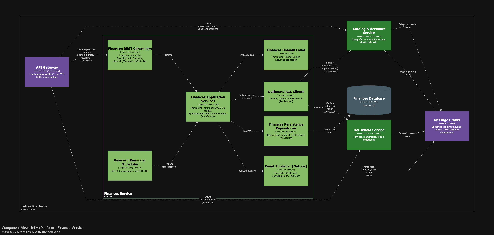

**Explicación del diagrama:**
Los controladores reciben movimientos personales revisados y propuestas del fondo. Los servicios de aplicación verifican membresía mediante Household, recopilan firmas sobre la misma propuesta y consultan el contrato a través de SmartContractGatewayAdapter. Solo un resultado confirmado permite conciliar el gasto de forma idempotente; rechazo, error o aprobaciones incompletas no modifican el saldo. Los repositorios guardan los datos fuera de blockchain y los schedulers conservan los recordatorios de vencimiento.

### 5.4.6. Bounded Context Software Architecture Code Level Diagrams

#### 5.4.6.1. Bounded Context Domain Layer Class Diagrams

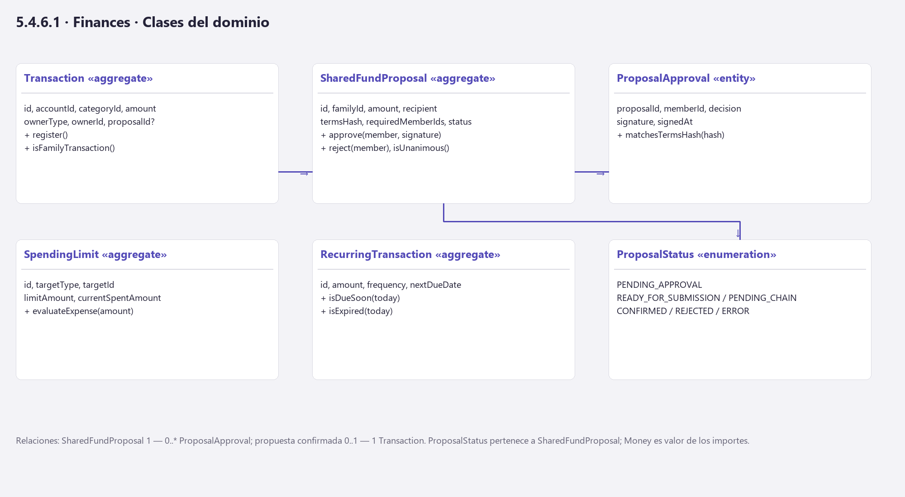

#### 5.4.6.2. Bounded Context Database Design Diagram

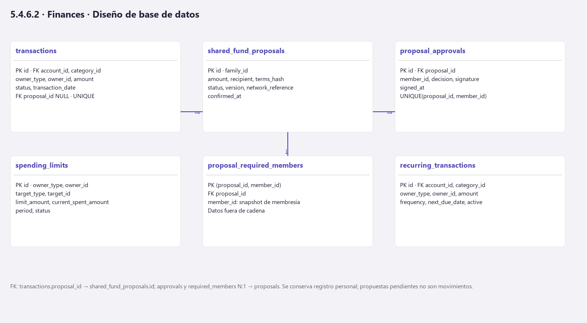

## 5.5. Bounded Context: Financial Goals (Savings)

Este contexto constituye uno de los subdominios núcleo (*Core Subdomain*) de la plataforma: permite definir metas de ahorro individuales o familiares y registrar los aportes progresivos hasta alcanzarlas. Como parte de las tecnologías emergentes incorporadas al diseño, este contexto integra un adaptador hacia una red de **Smart Contracts (Blockchain)** que permite registrar condiciones inmutables de ahorro y verificar automáticamente el cumplimiento de los hitos financieros antes de habilitar o marcar como completado un objetivo.

### 5.5.1. Domain Layer

En esta capa se modela el ciclo de vida de las metas de ahorro (`SavingGoal`), sus contribuciones individuales o grupales (`GoalContribution`), las reglas de reversibilidad de estado y el puerto de dominio para la verificación en cadena (*on-chain*) mediante contratos inteligentes.

| Clase / Interfaz | Categoría Táctica | Propósito | Atributos | Métodos | Relaciones |
| :--- | :--- | :--- | :--- | :--- | :--- |
| **`SavingGoal`** | Aggregate Root | Representa un objetivo de ahorro personal o compartido en familia, controlando el monto acumulado, fechas límite de modificación y estado de cumplimiento. | `- id: Long` `- name: String` `- targetAmount: Money` `- currentSavedAmount: Money` `- deadlineDate: LocalDate` `- modificationLimitDate: LocalDate` `- status: SavingGoalStatus` `- smartContractAddress: String` `- ownerType: OwnerTypes` `- ownerId: Long` `- contributions: List<GoalContribution>` | `+ SavingGoal(CreateSavingGoalCommand)` `+ addContribution(GoalContribution): void` `+ canBeModified(LocalDate today): boolean` `+ completeGoal(): void` `+ uncompleteGoal(): void` | Extiende de `AuditableAbstractAggregate`; contiene una colección de `GoalContribution` (`0..*`) y utiliza `Money` y `OwnerTypes` (Shared Kernel). |
| **`GoalContribution`** | Entity | Representa un aporte monetario específico realizado por un usuario hacia una meta de ahorro activa. | `- id: Long` `- contributorUserId: UserId` `- amount: Money` `- contributionDate: LocalDateTime` `- txHash: String` | `+ GoalContribution(UserId, Money, String txHash)` `+ isValidAmount(): boolean` | Pertenece al agregado `SavingGoal` (`1`). |
| **`SavingGoalStatus`** | Enumeration | Define los estados posibles de una meta de ahorro a lo largo de su ciclo de vida. | `IN_PROGRESS` `COMPLETED` `INCOMPLETE_EXPIRED` | `+ valueOf(String): SavingGoalStatus` | Utilizado por `SavingGoal` (`1`). |
| **`CreateSavingGoalCommand`** | Command | Solicita la creación de una nueva meta de ahorro personal o familiar con fecha límite y ventana de edición. | `- name: String` `- targetAmount: BigDecimal` `- deadlineDate: LocalDate` `- modificationLimitDate: LocalDate` `- ownerType: String` `- ownerId: Long` | `+ targetAmount(): BigDecimal` `+ deadlineDate(): LocalDate` | Consumido por `SavingGoalCommandService`. |
| **`ContributeToSavingGoalCommand`** | Command | Ordena registrar un aporte monetario positivo sobre una meta de ahorro existente. | `- savingGoalId: Long` `- contributorUserId: Long` `- amount: BigDecimal` | `+ savingGoalId(): Long` `+ amount(): BigDecimal` | Consumido por `SavingGoalCommandService`. |
| **`UpdateSavingGoalCommand`** | Command | Solicita actualizar el nombre, monto objetivo o fecha límite mientras el periodo de modificación siga vigente (US 020). | `- savingGoalId: Long` `- name: String` `- targetAmount: BigDecimal` `- deadlineDate: LocalDate` | `+ savingGoalId(): Long` | Consumido por `SavingGoalCommandService`. |
| **`CompleteSavingGoalCommand`** | Command | Ordena marcar explícitamente una meta de ahorro como completada. | `- savingGoalId: Long` | `+ savingGoalId(): Long` | Consumido por `SavingGoalCommandService`. |
| **`UncompleteSavingGoalCommand`** | Command | Revierte de forma simétrica el estado de una meta completada a en progreso. | `- savingGoalId: Long` | `+ savingGoalId(): Long` | Consumido por `SavingGoalCommandService`. |
| **`DeleteSavingGoalCommand`** | Command | Solicita eliminar una meta de ahorro dentro del tiempo límite permitido. | `- savingGoalId: Long` | `+ savingGoalId(): Long` | Consumido por `SavingGoalCommandService`. |
| **`GetSavingGoalByIdQuery`** | Query | Consulta el detalle y aportes de una meta específica por su identificador. | `- savingGoalId: Long` | `+ savingGoalId(): Long` | Consumido por `SavingGoalQueryService`. |
| **`GetAllSavingGoalsByUserIdQuery`** | Query | Consulta todas las metas de ahorro individuales asociadas a un usuario. | `- userId: Long` | `+ userId(): Long` | Consumido por `SavingGoalQueryService`. |
| **`GetAllSavingGoalsByGroupIdQuery`** | Query | Consulta todas las metas de ahorro compartidas pertenecientes a un grupo familiar. | `- groupId: Long` | `+ groupId(): Long` | Consumido por `SavingGoalQueryService`. |
| **`SmartContractEscrowPort`** | Domain Port (Interface) | Define la abstracción para desplegar y verificar reglas inmutables de cumplimiento de metas de ahorro en Blockchain. | *(Interface)* | `+ deploySavingRule(Long goalId, BigDecimal target, LocalDate deadline): String` `+ recordOnChainContribution(String contractAddr, BigDecimal amount): String` `+ verifyMilestoneCompletion(String contractAddr): boolean` | Implementado en infraestructura por `SmartContractEscrowAdapter`. |

### 5.5.2. Interface Layer

| Clase | Categoría Táctica | Propósito | Atributos | Métodos | Relaciones |
| :--- | :--- | :--- | :--- | :--- | :--- |
| **`SavingGoalsController`** | REST Controller | Expone `/api/v1/saving-goals` para crear, modificar, eliminar, consultar metas y registrar contribuciones. Es el mismo punto de entrada que usa el agente de IA con el JWT de la persona usuaria. | `- goalCommandService: SavingGoalCommandService` `- goalQueryService: SavingGoalQueryService` | `+ createGoal(CreateSavingGoalResource): ResponseEntity<SavingGoalResource>` `+ addContribution(Long id, ContributeResource): ResponseEntity<SavingGoalResource>` `+ updateGoal(Long id, UpdateSavingGoalResource): ResponseEntity<SavingGoalResource>` `+ getGoalsByUser(Long userId): ResponseEntity<List<SavingGoalResource>>` `+ getGoalsByGroup(Long groupId): ResponseEntity<List<SavingGoalResource>>` | Invoca a los servicios de metas. |
| **`SavingGoalResourceFromEntityAssembler`** | Assembler | Transforma `SavingGoal` y su progreso en `SavingGoalResource`. | *(Clase utilitaria estática)* | `+ toResourceFromEntity(SavingGoal): SavingGoalResource` | Utilizado por `SavingGoalsController`. |

### 5.5.3. Application Layer

Coordina la creación y actualización de metas, validando ventanas de modificación, sumatoria de aportes y sincronización de estados con el contrato inteligente.

| Clase | Categoría Táctica | Propósito | Atributos | Métodos | Relaciones |
| :--- | :--- | :--- | :--- | :--- | :--- |
| **`SavingGoalCommandServiceImpl`** | Command Handler | Ejecuta la creación y modificación de metas (verificando que la fecha límite de edición no haya expirado), registra los aportes, invoca la validación del Smart Contract y marca la meta como `COMPLETED` al alcanzar el monto objetivo. | `- savingGoalRepository: SavingGoalRepository` `- smartContractPort: SmartContractEscrowPort` | `+ handle(CreateSavingGoalCommand): Optional<SavingGoal>` `+ handle(ContributeToSavingGoalCommand): Optional<SavingGoal>` `+ handle(UpdateSavingGoalCommand): Optional<SavingGoal>` `+ handle(CompleteSavingGoalCommand): Optional<SavingGoal>` `+ handle(UncompleteSavingGoalCommand): Optional<SavingGoal>` `+ handle(DeleteSavingGoalCommand): void` | Implementa `SavingGoalCommandService`; consume `SavingGoalRepository` y `SmartContractEscrowPort`. |
| **`SavingGoalQueryServiceImpl`** | Query Handler | Ejecuta las consultas de metas de ahorro por ID, por usuario individual, por grupo familiar y metas completadas. | `- savingGoalRepository: SavingGoalRepository` | `+ handle(GetSavingGoalByIdQuery): Optional<SavingGoal>` `+ handle(GetAllSavingGoalsByUserIdQuery): List<SavingGoal>` `+ handle(GetAllSavingGoalsByGroupIdQuery): List<SavingGoal>` `+ handle(GetAllCompletedSavingGoalsByUserIdQuery): List<SavingGoal>` | Implementa `SavingGoalQueryService` y consume `SavingGoalRepository`. |

### 5.5.4. Infrastructure Layer

| Clase / Interfaz | Categoría Táctica | Propósito | Atributos | Métodos | Relaciones |
| :--- | :--- | :--- | :--- | :--- | :--- |
| **`SavingGoalRepository`** | Repository (JPA) | Gestiona la persistencia del agregado `SavingGoal` y sus entidades `GoalContribution` en PostgreSQL. | *(Interface JPA)* | `+ findByOwnerTypeAndOwnerId(OwnerTypes, Long): List<SavingGoal>` `+ findByOwnerTypeAndOwnerIdAndStatus(OwnerTypes, Long, SavingGoalStatus): List<SavingGoal>` | Extiende `JpaRepository<SavingGoal, Long>`. |
| **`SmartContractEscrowAdapter`** | Emerging Tech Blockchain Adapter | Conecta el backend mediante JSON-RPC (Web3j) con la red Blockchain para desplegar contratos de metas compartidas/personales y verificar de forma transparente e inmutable que la suma de aportes cumplió la condición pactada. | `- web3jClient: Web3j` `- credentials: Credentials` `- rpcEndpointUrl: String` | `+ deploySavingRule(Long goalId, BigDecimal target, LocalDate deadline): String` `+ recordOnChainContribution(String contractAddr, BigDecimal amount): String` `+ verifyMilestoneCompletion(String contractAddr): boolean` | Implementa `SmartContractEscrowPort`; se comunica con `Blockchain Smart Contracts`. |

### 5.5.5. Bounded Context Software Architecture Component Level Diagrams

En esta sección se presenta el diagrama de componentes del contenedor **Financial Goals (Savings) Context**, mostrando sus componentes internos y su integración con la base de datos y la red de contratos inteligentes.

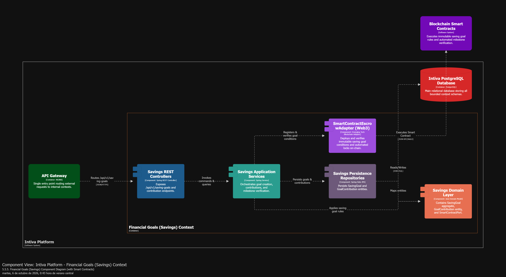

**Explicación del diagrama:**
El componente **`Savings REST Controllers`** recibe las solicitudes HTTP desde el API Gateway y las delega a **`Savings Application Services`**. Esta capa aplica las reglas de negocio sobre los agregados `SavingGoal` y `GoalContribution` definidos en **`Savings Domain Layer`**. Cuando se crea una meta o se registra un nuevo aporte, la capa de aplicación se apoya en **`SmartContractEscrowAdapter (Web3)`** para registrar y verificar de manera inmutable las condiciones del objetivo en **`Blockchain Smart Contracts`**, mientras que **`Savings Persistence Repositories`** almacena el estado relacional en PostgreSQL.

### 5.5.6. Bounded Context Software Architecture Code Level Diagrams

#### 5.5.6.1. Bounded Context Domain Layer Class Diagrams

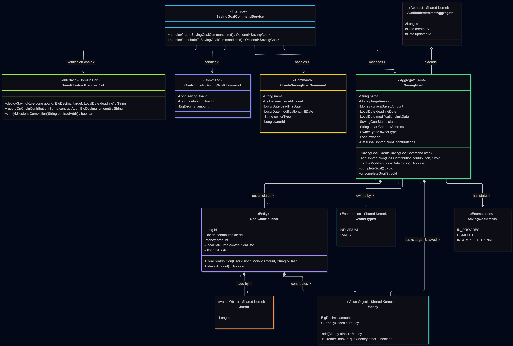

#### 5.5.6.2. Bounded Context Database Design Diagram

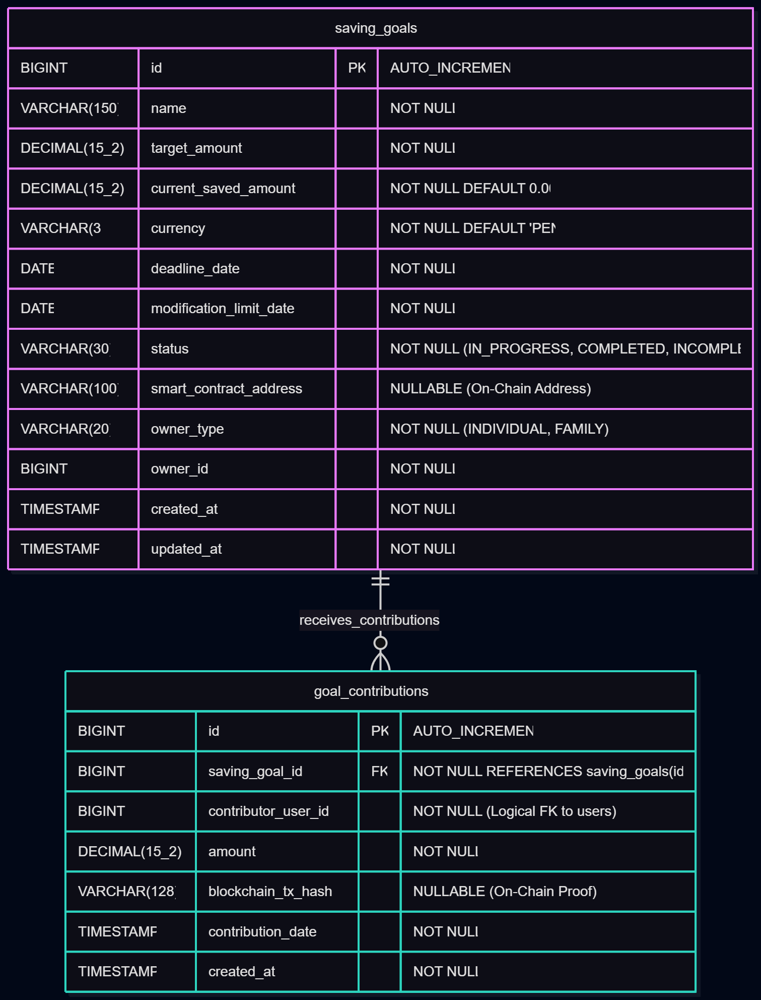

---

## 5.6. Bounded Context: Household

Este contexto modela la colaboración financiera familiar (*Core Subdomain*): gestiona la creación de grupos familiares, la administración de membresías y roles de acceso, y el ciclo de vida de invitaciones mediante enlaces diferidos (*Deferred Deep Links*) y códigos QR. Además, concentra la verificación de pertenencia y rol como servicio consultable según la decisión arquitectónica **AD-04**.

Para el fondo de US 032, Household proporciona la instantánea de miembros activos a Finances. El rol de administrador no permite validar una propuesta sin las aprobaciones de todos. Las firmas de cada miembro se verifican sobre las mismas condiciones (AD-23).

### 5.6.1. Domain Layer

| Clase / Interfaz | Categoría Táctica | Propósito | Atributos | Métodos | Relaciones |
| :--- | :--- | :--- | :--- | :--- | :--- |
| **`Family`** | Aggregate Root | Grupo familiar para la gestión compartida de ingresos, gastos y metas. | `- id: Long` `- name: String` `- adminUserId: UserId` `- active: boolean` `- members: List<FamilyMember>` | `+ Family(CreateFamilyCommand)` `+ addMember(UserId, FamilyRole): FamilyMember` `+ assignMemberRole(UserId, FamilyRole): void` `+ isUserActiveMember(UserId): boolean` | Extiende `AuditableAbstractAggregate`; contiene `FamilyMember` (`1..*`); emite `FamilyCreatedEvent`. |
| **`FamilyMember`** | Entity / Aggregate | Membresía activa de un usuario con su rol y permisos. | `- id: Long` `- familyId: Long` `- userId: UserId` `- role: FamilyRole` `- joinedAt: LocalDateTime` `- active: boolean` | `+ updateRole(FamilyRole newRole): void` `+ deactivateMembership(): void` `+ isResponsibleAdmin(): boolean` | Asociado a `Family` (`1`); tipado con `FamilyRole` (`1`). |
| **`Invitation`** | Aggregate Root | Ciclo de vida de una invitación a un familiar, con tokens QR y enlaces diferidos. | `- id: Long` `- familyId: Long` `- inviterUserId: UserId` `- inviteeEmail: String` `- token: String` `- deepLink: DeferredDeepLink` `- status: InvitationStatus` `- expiresAt: LocalDateTime` | `+ accept(UserId accepterId): void` `+ reject(): void` `+ invalidatePreviousLink(): void` `+ isExpired(LocalDateTime now): boolean` | Extiende `AuditableAbstractAggregate`; emite `FamilyInvitationSentEvent`, `InvitationAcceptedEvent` e `InvitationRejectedEvent`. |
| **`FamilyRole`** | Enumeration | Niveles de autoridad en un grupo familiar. | `FAMILY_ECONOMY_RESPONSIBLE` `FAMILY_MEMBER` | `+ valueOf(String): FamilyRole` | Utilizado por `FamilyMember` (`1`). |
| **`InvitationStatus`** | Enumeration | Estados válidos de una invitación. | `PENDING` `ACCEPTED` `REJECTED` `EXPIRED` `INVALIDATED` | `+ valueOf(String): InvitationStatus` | Utilizado por `Invitation` (`1`). |
| **`DeferredDeepLink`** | Value Object | Enlace diferido y *payload* QR para invitar a quien aún no tiene la aplicación. | `- deepLinkUrl: String` `- qrCodePayload: String` | `+ DeferredDeepLink(String token)` | Composición dentro de `Invitation` (`1`). |
| **`CreateFamilyCommand`** | Command | Crea un grupo familiar con el creador como administrador responsable. | `- name: String` `- creatorUserId: Long` | `+ name(): String` `+ creatorUserId(): Long` | Consumido por `FamilyCommandService`. |
| **`SendInvitationCommand`** | Command | Genera y envía una invitación. | `- familyId: Long` `- inviterUserId: Long` `- inviteeEmail: String` | `+ familyId(): Long` `+ inviteeEmail(): String` | Consumido por `InvitationCommandService`. |
| **`AcceptInvitationCommand`** | Command | Acepta una invitación pendiente y vigente (US 024). | `- invitationToken: String` `- userId: Long` | `+ invitationToken(): String` `+ userId(): Long` | Consumido por `InvitationCommandService`. |
| **`ClaimDeferredInviteCommand`** | Command | Reclama una invitación diferida tras instalar la aplicación y registrarse. | `- deepLinkToken: String` `- newUserId: Long` | `+ deepLinkToken(): String` | Consumido por `InvitationCommandService`. |
| **`AssignRoleCommand`** | Command | Cambia el rol de un integrante (US 025). | `- familyId: Long` `- adminUserId: Long` `- targetMemberUserId: Long` `- newRole: String` | `+ targetMemberUserId(): Long` `+ newRole(): String` | Consumido por `FamilyCommandService`. |
| **`FamilyInvitationSentEvent`** | Integration Event | Notifica que se envió una invitación (`household.invitation.sent`). | `- eventId: UUID` `- invitationId: Long` `- familyId: Long` `- inviterUserId: Long` `- inviteeEmail: String` | `+ getInvitationId(): Long` | Publicado por `Invitation`; consumido por `communications-service`. |
| **`InvitationAcceptedEvent`** / **`InvitationRejectedEvent`** | Integration Event | Notifican la respuesta a una invitación. | `- invitationId: Long` `- familyId: Long` `- userId: Long` | `+ getInvitationId(): Long` | Publicados por `Invitation`; consumidos por `communications-service`. |

### 5.6.2. Interface Layer

| Clase | Categoría Táctica | Propósito | Atributos | Métodos | Relaciones |
| :--- | :--- | :--- | :--- | :--- | :--- |
| **`FamiliesController`** | REST Controller | Expone `/api/v1/families` para crear grupos, listar integrantes y asignar roles. | `- familyCommandService: FamilyCommandService` `- familyQueryService: FamilyQueryService` | `+ createFamily(CreateFamilyResource): ResponseEntity<FamilyResource>` `+ getMembersByFamily(Long familyId): ResponseEntity<List<FamilyMemberResource>>` `+ assignRole(Long familyId, AssignRoleResource): ResponseEntity<FamilyMemberResource>` | Invoca a los servicios de familia. |
| **`InvitationsController`** | REST Controller | Expone `/api/v1/invitations` para generar enlaces/QR, aceptar, rechazar o reclamar invitaciones diferidas. | `- invitationCommandService: InvitationCommandService` `- invitationQueryService: InvitationQueryService` | `+ sendInvitation(SendInvitationResource): ResponseEntity<InvitationResource>` `+ acceptInvitation(String token): ResponseEntity<Void>` `+ rejectInvitation(String token): ResponseEntity<Void>` `+ claimDeferredInvite(ClaimInviteResource): ResponseEntity<Void>` | Invoca a los servicios de invitación. |
| **`HouseholdInternalController`** | Inbound ACL / OHS (REST interno) | Implementa **AD-04** sobre la red: expone `/internal/v1/families/**` (no enrutado por el Gateway) para consultar miembros activos y validar pertenencia/rol. | `- familyQueryService: FamilyQueryService` | `+ getActiveFamilyMemberUserIds(Long familyId): ResponseEntity<List<Long>>` `+ isUserMemberOfFamily(Long userId, Long familyId): ResponseEntity<MembershipResource>` | Delega a `FamilyQueryService`; consumido por Finances, Savings y Communications. |

### 5.6.3. Application Layer

| Clase | Categoría Táctica | Propósito | Atributos | Métodos | Relaciones |
| :--- | :--- | :--- | :--- | :--- | :--- |
| **`FamilyCommandServiceImpl`** | Command Handler | Gestiona la creación de la familia, el alta de miembros (`UserAlreadyMemberException`) y la asignación de roles. | `- familyRepository: FamilyRepository` `- memberRepository: FamilyMemberRepository` | `+ handle(CreateFamilyCommand): Optional<Family>` `+ handle(AddFamilyMemberCommand): Optional<FamilyMember>` `+ handle(AssignRoleCommand): Optional<FamilyMember>` | Implementa `FamilyCommandService`. |
| **`InvitationCommandServiceImpl`** | Command Handler | Crea invitaciones invalidando enlaces previos, valida duplicados pendientes (`InvitationAlreadyPendingException`) y tokens vencidos (`InvitationExpiredException`), y registra los eventos de invitación en el *Outbox*. | `- invitationRepository: InvitationRepository` `- familyRepository: FamilyRepository` `- eventPublisher: DomainEventPublisher` | `+ handle(SendInvitationCommand): Optional<Invitation>` `+ handle(SendInvitationLinkCommand): Optional<Invitation>` `+ handle(AcceptInvitationCommand): Optional<Invitation>` `+ handle(RejectInvitationCommand): void` `+ handle(ClaimDeferredInviteCommand): Optional<Invitation>` | Implementa `InvitationCommandService`. |
| **`FamilyQueryServiceImpl`** | Query Handler | Resuelve consultas de familias e integrantes activos. | `- familyRepository: FamilyRepository` `- memberRepository: FamilyMemberRepository` | `+ handle(GetFamilyByIdQuery): Optional<Family>` `+ handle(GetMembersByFamilyIdQuery): List<FamilyMember>` | Implementa `FamilyQueryService`. |

### 5.6.4. Infrastructure Layer

| Clase / Interfaz | Categoría Táctica | Propósito | Atributos | Métodos | Relaciones |
| :--- | :--- | :--- | :--- | :--- | :--- |
| **`FamilyRepository`** | Repository (JPA) | Persistencia en `families`. | *(Interface JPA)* | `+ findByAdminUserId(UserId): List<Family>` | Extiende `JpaRepository<Family, Long>`. |
| **`FamilyMemberRepository`** | Repository (JPA) | Persistencia en `family_members`. | *(Interface JPA)* | `+ findByFamilyIdAndActiveTrue(Long): List<FamilyMember>` `+ existsByFamilyIdAndUserId(Long, UserId): boolean` | Extiende `JpaRepository<FamilyMember, Long>`. |
| **`InvitationRepository`** | Repository (JPA) | Persistencia en `invitations`. | *(Interface JPA)* | `+ findByToken(String): Optional<Invitation>` `+ findByInviteeEmailAndStatus(String, InvitationStatus): List<Invitation>` | Extiende `JpaRepository<Invitation, Long>`. |
| **`RabbitMqDomainEventPublisher`** | Messaging Adapter (starter) | Publica los eventos de invitación mediante *Outbox*. | `- outboxRepository: OutboxEventRepository` `- rabbitTemplate: RabbitTemplate` | `+ publish(DomainEvent): void` | Implementa `DomainEventPublisher`. |

### 5.6.5. Bounded Context Software Architecture Component Level Diagrams

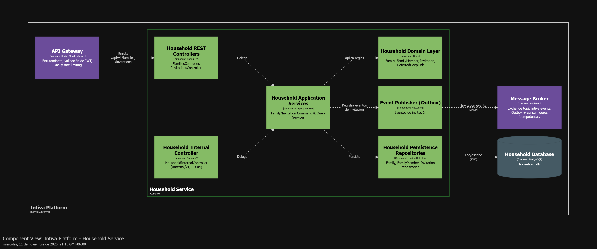

**Explicación del diagrama:**
**`Household REST Controllers`** atiende desde el API Gateway la gestión familiar y las invitaciones, mientras que **`Household Internal Controller`** atiende las verificaciones de membresía y rol que realizan los demás servicios (**AD-04**). Ambos delegan en **`Household Application Services`**, que hace cumplir las invariantes de rol, unicidad de miembro y vigencia de tokens definidas en **`Household Domain Layer`**. La persistencia se realiza en PostgreSQL (`household_db`) y los eventos de invitación se publican mediante **`Event Publisher (Outbox)`**.

### 5.6.6. Bounded Context Software Architecture Code Level Diagrams

#### 5.6.6.1. Bounded Context Domain Layer Class Diagrams

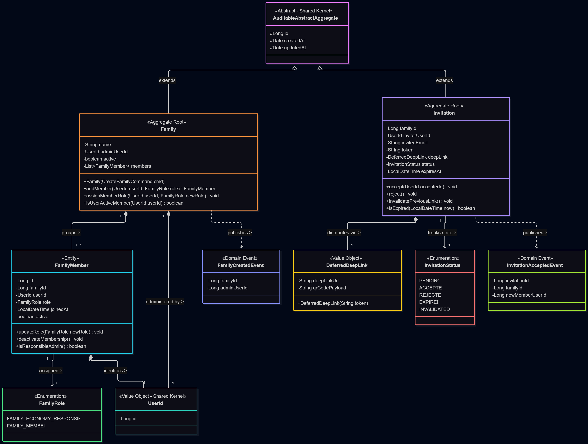

#### 5.6.6.2. Bounded Context Database Design Diagram

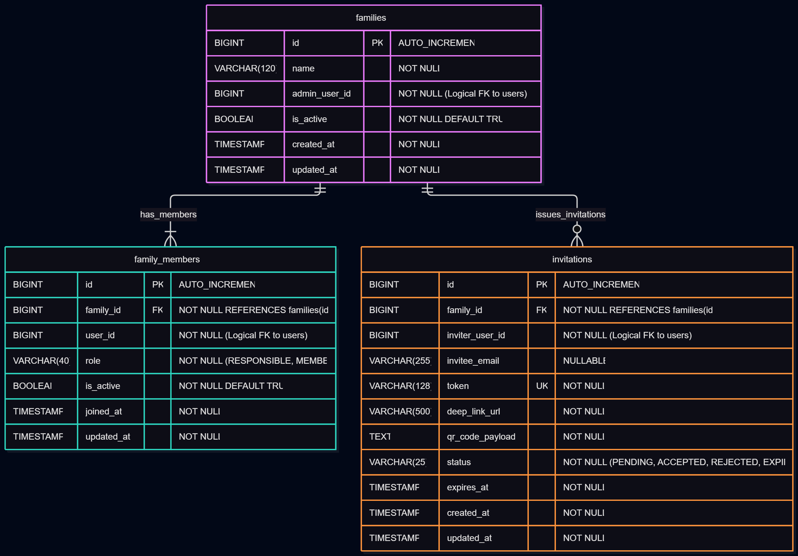

---

## 5.7. Bounded Context: Communications

Este contexto, desplegado como **`communications-service`**, centraliza las notificaciones in-app y las alertas push de los eventos de negocio. Es un **consumidor puro de eventos**: escucha los eventos publicados por Finances, Savings y Household, persiste la alerta y la envía mediante Firebase Cloud Messaging (TS 017). Si el canal push falla, la notificación permanece consultable en la aplicación.

### 5.7.1. Domain Layer

En esta capa se modelan los agregados `Notification` y `NotificationDevice`, los tipos y orígenes de alerta, y el puerto de salida hacia el proveedor de mensajería móvil.

| Clase / Interfaz | Categoría Táctica | Propósito | Atributos | Métodos | Relaciones |
| :--- | :--- | :--- | :--- | :--- | :--- |
| **`Notification`** | Aggregate Root | Alerta o recordatorio dirigido a un usuario: estado de lectura, origen y entrega. | `- id: Long` `- recipientUserId: UserId` `- title: String` `- message: String` `- type: NotificationType` `- source: NotificationSource` `- status: NotificationStatus` `- pushDelivered: boolean` | `+ Notification(CreateInAppNotificationCommand)` `+ markAsRead(): void` `+ markPushDelivered(): void` | Extiende `AuditableAbstractAggregate`; usa `NotificationType`, `NotificationSource` y `NotificationStatus`. |
| **`NotificationDevice`** | Aggregate Root | Dispositivo móvil registrado con su token FCM (TS 017). | `- id: Long` `- userId: UserId` `- fcmToken: String` `- devicePlatform: String` `- active: boolean` | `+ NotificationDevice(RegisterNotificationDeviceCommand)` `+ deactivateDevice(): void` `+ refreshToken(String newToken): void` | Extiende `AuditableAbstractAggregate`; contiene `UserId`. |
| **`NotificationType`** | Enumeration | Propósito de negocio de la alerta. | `SPENDING_LIMIT_WARNING` `SPENDING_LIMIT_EXCEEDED` `PAYMENT_DUE_SOON` `PAYMENT_EXPIRED` `FAMILY_TRANSACTION_CREATED` `FAMILY_INVITATION` `SAVING_GOAL_COMPLETED` `SAVING_GOAL_NOT_COMPLETED` | `+ valueOf(String): NotificationType` | Utilizado por `Notification` (`1`). |
| **`NotificationStatus`** | Enumeration | Estado de lectura. | `UNREAD` `READ` | `+ valueOf(String): NotificationStatus` | Utilizado por `Notification` (`1`). |
| **`CreateInAppNotificationCommand`** | Command | Persiste una notificación en la bandeja del usuario. | `- recipientUserId: Long` `- title: String` `- message: String` `- type: String` `- source: String` | `+ recipientUserId(): Long` `+ type(): String` | Consumido por `NotificationCommandService`. |
| **`SendPushNotificationCommand`** | Command | Despacha una alerta *push* a los dispositivos activos del destinatario. | `- recipientUserId: Long` `- title: String` `- rawBody: String` `- type: String` | `+ recipientUserId(): Long` | Consumido por `NotificationCommandService`. |
| **`RegisterNotificationDeviceCommand`** | Command | Asocia un token FCM a la cuenta del usuario. | `- userId: Long` `- fcmToken: String` `- platform: String` | `+ fcmToken(): String` | Consumido por `NotificationDeviceCommandService`. |
| **`DeactivateNotificationDeviceCommand`** | Command | Inhabilita un token FCM (cierre de sesión o token inválido). | `- fcmToken: String` | `+ fcmToken(): String` | Consumido por `NotificationDeviceCommandService`. |
| **`MarkNotificationAsReadCommand`** | Command | Marca una notificación como leída. | `- notificationId: Long` | `+ notificationId(): Long` | Consumido por `NotificationCommandService`. |
| **`FirebaseMessagingGatewayPort`** | Domain Port | Contrato del envío push a dispositivos activos. | *(Interface)* | `+ sendPush(tokens, title, body)` | Implementado por `FirebaseMessagingGatewayAdapter`. |

### 5.7.2. Interface Layer

| Clase | Categoría Táctica | Propósito | Atributos | Métodos | Relaciones |
| :--- | :--- | :--- | :--- | :--- | :--- |
| **`NotificationsController`** | REST Controller | Expone `/api/v1/notifications` para consultar notificaciones, no leídas y marcarlas como leídas. | `- notificationCommandService: NotificationCommandService` `- notificationQueryService: NotificationQueryService` | `+ getByRecipient(Long userId): ResponseEntity<List<NotificationResource>>` `+ getUnreadByRecipient(Long userId): ResponseEntity<List<NotificationResource>>` `+ markAsRead(Long id): ResponseEntity<Void>` | Invoca a los servicios de notificaciones. |
| **`NotificationDevicesController`** | REST Controller | Expone `/api/v1/devices` para registrar y desactivar tokens FCM desde la aplicación Android. | `- deviceCommandService: NotificationDeviceCommandService` `- deviceQueryService: NotificationDeviceQueryService` | `+ registerDevice(RegisterDeviceResource): ResponseEntity<DeviceResource>` `+ deactivateDevice(String token): ResponseEntity<Void>` | Invoca a los servicios de dispositivos. |

### 5.7.3. Application Layer

| Clase | Categoría Táctica | Propósito | Atributos | Métodos | Relaciones |
| :--- | :--- | :--- | :--- | :--- | :--- |
| **`NotificationCommandServiceImpl`** | Command Handler | Persiste la alerta, obtiene los tokens activos y solicita el envío a FCM. Una falla del proveedor no elimina la notificación de la bandeja. | `- notificationRepository: NotificationRepository` `- deviceRepository: NotificationDeviceRepository` `- fcmGatewayPort: FirebaseMessagingGatewayPort` | `+ handle(CreateInAppNotificationCommand): Optional<Notification>` `+ handle(SendPushNotificationCommand): void` `+ handle(MarkNotificationAsReadCommand): void` | Implementa `NotificationCommandService`. |
| **`NotificationDeviceCommandServiceImpl`** | Command Handler | Registra tokens FCM e invalida los que Firebase reporta como expirados o no registrados. | `- deviceRepository: NotificationDeviceRepository` | `+ handle(RegisterNotificationDeviceCommand): Optional<NotificationDevice>` `+ handle(DeactivateNotificationDeviceCommand): void` | Implementa `NotificationDeviceCommandService`. |
| **`DomainEventsNotificationListener`** | Event Handler (Idempotent Consumer) | Escucha desde RabbitMQ los eventos de Finances (`FamilyTransactionCreated`, `SpendingLimitWarningReached`, `SpendingLimitExceeded`, `PaymentDueSoon`, `PaymentExpired`), Savings (`SavingGoalCompleted`, `SavingGoalExpired`) y Household (`FamilyInvitationSent`, `InvitationAccepted`, `InvitationRejected`), y dispara la creación y envío de la notificación. Descarta eventos ya procesados. | `- notificationCommandService: NotificationCommandService` `- householdService: CommunicationsExternalHouseholdService` `- processedEventRepository: ProcessedEventRepository` | `+ onFamilyTransaction(FamilyTransactionCreatedEvent): void` `+ onLimitWarning(SpendingLimitWarningReachedEvent): void` `+ onLimitExceeded(SpendingLimitExceededEvent): void` `+ onPaymentDueSoon(PaymentDueSoonEvent): void` `+ onPaymentExpired(PaymentExpiredEvent): void` `+ onSavingGoalCompleted(SavingGoalCompletedEvent): void` `+ onSavingGoalExpired(SavingGoalExpiredEvent): void` `+ onInvitationSent(FamilyInvitationSentEvent): void` | Invoca a `NotificationCommandService`. |
| **`CommunicationsExternalHouseholdService`** | Outbound ACL Client | Cliente REST (AD-04, autenticado con `X-Internal-Api-Key`) que obtiene los miembros activos de una familia para notificar movimientos familiares. | `- restClient: RestClient` | `+ getActiveFamilyMemberUserIds(Long familyId): List<Long>` | Consume `HouseholdInternalController`. |

### 5.7.4. Infrastructure Layer

| Clase / Interfaz | Categoría Táctica | Propósito | Atributos | Métodos | Relaciones |
| :--- | :--- | :--- | :--- | :--- | :--- |
| **`NotificationRepository`** | Repository (JPA) | Persistencia en `notifications`. | *(Interface JPA)* | `+ findByRecipientUserIdOrderByCreatedAtDesc(UserId): List<Notification>` `+ findByRecipientUserIdAndStatus(UserId, NotificationStatus): List<Notification>` | Extiende `JpaRepository<Notification, Long>`. |
| **`NotificationDeviceRepository`** | Repository (JPA) | Persistencia en `notification_devices`. | *(Interface JPA)* | `+ findByUserIdAndActiveTrue(UserId): List<NotificationDevice>` `+ findByFcmToken(String): Optional<NotificationDevice>` | Extiende `JpaRepository<NotificationDevice, Long>`. |
| **`FirebaseMessagingGatewayAdapter`** | External Service Adapter | Envía alertas con el SDK de FCM y devuelve los tokens inválidos para desactivarlos. Incluye `DevFirebaseMessagingGatewayStub` para desarrollo. | `- firebaseMessaging: FirebaseMessaging` | `+ sendPush(tokens, title, body)` | Implementa `FirebaseMessagingGatewayPort`; se comunica con `Firebase Cloud Messaging`. |
| **`RabbitMqEventConsumerConfig`** | Messaging Adapter (starter) | Declara las colas `communications.*` enlazadas a los eventos de Finances, Savings y Household, con *dead-letter queue* y reintentos. | `- bindings: Map<String, String>` | `+ communicationsQueues(): Declarables` | Se conecta a `RabbitMQ`. |

### 5.7.5. Bounded Context Software Architecture Component Level Diagrams

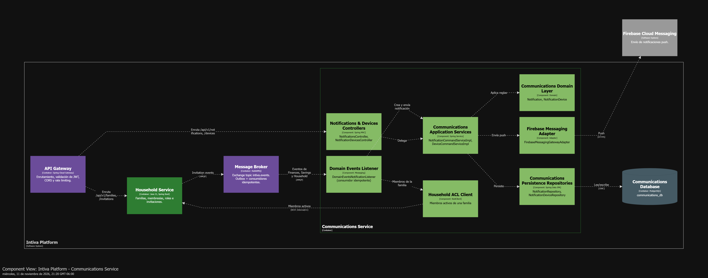

**Explicación del diagrama:**
**`Domain Events Listener`** recibe desde RabbitMQ los eventos de negocio de los demás servicios y los delega en **`Communications Application Services`**. Cuando se trata de un evento familiar, consulta los miembros activos mediante **`Household ACL Client`**. El servicio construye y persiste la `Notification` en `communications_db`, obtiene los tokens activos y utiliza **`Firebase Messaging Adapter`** para enviar la alerta a FCM. Si el envío falla, conserva la alerta in-app y registra el resultado controlado; los tokens inválidos se desactivan. **`Notifications & Devices Controllers`** sirven la bandeja y el registro de dispositivos a las aplicaciones cliente.

---

## 5.8. Bounded Context: Analytics

Este contexto, desplegado como **`analytics-service`**, actúa como el motor de lectura y reportes (*Supporting Subdomain*): transforma los datos de transacciones, límites de gasto y metas de ahorro en métricas agregadas, rankings, tendencias y reportes descargables. Al no poder leer las tablas de otros servicios (**AD-MS-01**), se implementa como un **modelo de lectura (CQRS)** alimentado por eventos: mantiene en `analytics_db` proyecciones de los datos que necesita y las actualiza al consumir los eventos de Finances, Savings y Catalog. Sobre ese modelo conserva la estrategia de caché *cache-aside* en **Redis** con TTL (**AD-11**), con invalidación por titular cuando llega un evento que modifica sus datos.

### 5.8.1. Domain Layer

| Clase / Interfaz | Categoría Táctica | Propósito | Atributos | Métodos | Relaciones |
| :--- | :--- | :--- | :--- | :--- | :--- |
| **`AnalyticsSummary`** | Aggregate Root (Read Model) | Consolida ingresos, gastos, ahorro neto, distribución por categorías y evolución temporal de un titular y periodo. | `- id: String` `- ownerType: OwnerTypes` `- ownerId: Long` `- period: AnalyticsPeriod` `- totalIncome: Money` `- totalExpense: Money` `- netSavings: Money` `- categoryRankings: List<CategoryExpenseSummary>` `- limitAnalytics: List<SpendingLimitAnalytics>` `- goalAnalytics: List<SavingGoalAnalytics>` `- calculatedAt: Instant` | `+ calculateNetBalance(): Money` `+ getTopExpenseCategories(int limit): List<CategoryExpenseSummary>` | Compuesto por `AnalyticsPeriod`, `CategoryExpenseSummary`, `SpendingLimitAnalytics` y `SavingGoalAnalytics`. |
| **`CategoryExpenseSummary`** | Value Object | Monto y porcentaje de gasto de una categoría, con nombre, color e ícono. | `- categoryId: Long` `- categoryName: String` `- color: String` `- icon: String` `- totalAmount: Money` `- percentageOfTotal: double` | `+ CategoryExpenseSummary(...)` | Composición dentro de `AnalyticsSummary` (`0..*`). |
| **`SpendingLimitAnalytics`** | Value Object | Consumo porcentual y saldo disponible de cada límite. | `- limitId: Long` `- limitAmount: Money` `- usedAmount: Money` `- consumptionPercentage: double` | `+ isOverBudget(): boolean` | Composición dentro de `AnalyticsSummary` (`0..*`). |
| **`SavingGoalAnalytics`** | Value Object | Avance y monto restante de las metas. | `- goalId: Long` `- goalName: String` `- targetAmount: Money` `- savedAmount: Money` `- progressPercentage: double` | `+ remainingAmount(): Money` | Composición dentro de `AnalyticsSummary` (`0..*`). |
| **`AnalyticsPeriod`** | Enumeration / Value Object | Ventana temporal de agregación. | `DAILY` `WEEKLY` `MONTHLY` `ANNUAL` | `+ getDateRange(LocalDate ref): Pair<LocalDate, LocalDate>` | Utilizado por `AnalyticsSummary` y las consultas. |
| **`TransactionProjection`** | Entity (Read Model) | Copia mínima de un movimiento confirmado, necesaria para agregar. | `- transactionId: Long` `- categoryId: Long` `- amount: Money` `- type: String` `- date: LocalDate` `- ownerType: OwnerTypes` `- ownerId: Long` | `+ isExpense(): boolean` | Actualizada por `AnalyticsProjectionEventListener`. |
| **`SpendingLimitProjection`** | Entity (Read Model) | Estado de consumo de un límite. | `- limitId: Long` `- limitAmount: Money` `- usedAmount: Money` `- status: String` `- ownerId: Long` | `+ consumption(): double` | Actualizada al consumir `SpendingLimitUpdated`. |
| **`SavingGoalProjection`** | Entity (Read Model) | Estado de avance de una meta. | `- goalId: Long` `- name: String` `- targetAmount: Money` `- savedAmount: Money` `- status: String` `- ownerId: Long` | `+ progress(): double` | Actualizada al consumir eventos de Savings. |
| **`CategoryProjection`** | Entity (Read Model) | Nombre, color e ícono de una categoría. | `- categoryId: Long` `- name: String` `- color: String` `- icon: String` `- ownerId: Long` | `+ displayName(): String` | Actualizada al consumir `CategoryUpserted`. |
| **`GenerateReportCommand`** | Command | Genera y exporta un reporte estadístico según formato (`ReportFormat`) y filtro (`ReportFilter`) (US 031). | `- ownerType: String` `- ownerId: Long` `- period: String` `- reportFormat: String` | `+ reportFormat(): String` | Consumido por `AnalyticsCommandService`. |
| **`GetAnalyticsSummaryByOwnerQuery`** | Query | Resumen financiero integral para el *dashboard* de un individuo o familia. | `- ownerType: String` `- ownerId: Long` `- period: String` | `+ buildCacheKey(): String` | Consumido por `AnalyticsQueryService`. |
| **`GetCategoryExpenseRankingQuery`** | Query | Ranking de categorías con mayor gasto. | `- ownerType: String` `- ownerId: Long` `- period: String` | `+ ownerId(): Long` | Consumido por `AnalyticsQueryService`. |
| **`GetIncomeVsExpenseTrendQuery`** | Query | Serie comparativa de ingresos versus egresos. | `- ownerType: String` `- ownerId: Long` `- period: String` | `+ period(): String` | Consumido por `AnalyticsQueryService`. |
| **`AnalyticsCachePort`** | Domain Port (Interface) | Contrato de acceso a la caché de resúmenes con TTL (**AD-11**). | *(Interface)* | `+ getSummary(String key): Optional<AnalyticsSummary>` `+ putSummary(String key, AnalyticsSummary summary, Duration ttl): void` `+ evictByOwner(OwnerTypes, Long): void` | Implementado por `AnalyticsRedisCacheAdapter`. |

### 5.8.2. Interface Layer

Expone los endpoints REST consumidos por la aplicación web Vue.js para renderizar gráficos y descargar reportes, y por el agente de IA para consultar resúmenes con el JWT de la persona usuaria.

| Clase | Categoría Táctica | Propósito | Atributos | Métodos | Relaciones |
| :--- | :--- | :--- | :--- | :--- | :--- |
| **`AnalyticsController`** | REST Controller | Expone `/api/v1/analytics` para el resumen general, métricas de límites, progreso de metas, ranking por categorías y exportación de reportes. | `- analyticsQueryService: AnalyticsQueryService` `- analyticsCommandService: AnalyticsCommandService` | `+ getSummaryByOwner(String ownerType, Long ownerId, String period): ResponseEntity<AnalyticsSummaryResource>` `+ getCategoryRanking(...): ResponseEntity<List<CategoryExpenseResource>>` `+ exportReport(GenerateReportResource): ResponseEntity<byte[]>` | Invoca a los servicios de analítica. |
| **`AnalyticsSummaryResourceFromEntityAssembler`** | Assembler | Transforma `AnalyticsSummary` en un DTO para las librerías de gráficos. | *(Clase utilitaria estática)* | `+ toResourceFromEntity(AnalyticsSummary): AnalyticsSummaryResource` | Utilizado por `AnalyticsController`. |

### 5.8.3. Application Layer

Implementa *cache-aside* sobre Redis (**AD-11**, **QAS-05**) y la actualización del modelo de lectura a partir de eventos.

| Clase | Categoría Táctica | Propósito | Atributos | Métodos | Relaciones |
| :--- | :--- | :--- | :--- | :--- | :--- |
| **`AnalyticsQueryServiceImpl`** | Query Handler | Resuelve las consultas de resumen, límites, metas, ranking y tendencia: consulta primero `AnalyticsCachePort` y, ante *cache miss*, agrega sobre las proyecciones locales y guarda el resultado con TTL. | `- cachePort: AnalyticsCachePort` `- projectionRepository: AnalyticsProjectionRepository` | `+ handle(GetAnalyticsSummaryByOwnerQuery): Optional<AnalyticsSummary>` `+ handle(GetCategoryExpenseRankingQuery): List<CategoryExpenseSummary>` `+ handle(GetIncomeVsExpenseTrendQuery): TrendData` | Implementa `AnalyticsQueryService`. |
| **`AnalyticsCommandServiceImpl`** | Command Handler | Genera los archivos de reporte según formato y filtros. | `- analyticsQueryService: AnalyticsQueryService` | `+ handle(GenerateReportCommand): byte[]` | Implementa `AnalyticsCommandService`. |
| **`AnalyticsProjectionEventListener`** | Event Handler (Idempotent Consumer) | Consume `TransactionConfirmed`, `SpendingLimitUpdated`, `SavingGoalContributed`, `SavingGoalCompleted`, `SavingGoalExpired` y `CategoryUpserted`; actualiza la proyección correspondiente de forma idempotente e invalida la caché del titular. | `- projectionRepository: AnalyticsProjectionRepository` `- cachePort: AnalyticsCachePort` `- processedEventRepository: ProcessedEventRepository` | `+ on(TransactionConfirmedEvent): void` `+ on(SpendingLimitUpdatedEvent): void` `+ on(SavingGoalContributedEvent): void` `+ on(CategoryUpsertedEvent): void` | Escribe en proyecciones y en `AnalyticsCachePort`. |

### 5.8.4. Infrastructure Layer

| Clase / Interfaz | Categoría Táctica | Propósito | Atributos | Métodos | Relaciones |
| :--- | :--- | :--- | :--- | :--- | :--- |
| **`AnalyticsRedisCacheAdapter`** | Cache Adapter | Implementa `AnalyticsCachePort` serializando en JSON los objetos `AnalyticsSummary` dentro de Redis Cloud con un TTL definido para garantizar tiempos de respuesta menores a 2 segundos (TS 010, TS 014). | `- redisTemplate: RedisTemplate<String, String>` `- objectMapper: ObjectMapper` `- defaultTtlMinutes: long` | `+ getSummary(String key): Optional<AnalyticsSummary>` `+ putSummary(String key, AnalyticsSummary summary, Duration ttl): void` | Implementa `AnalyticsCachePort`; se conecta a `Intiva Redis Database`. |
| **`AnalyticsReadRepositories`** | Read Repository (JPA) | Provee las consultas de solo lectura sobre las tablas relacionales de transacciones, límites y metas en PostgreSQL. | *(Interfaces JPA de lectura)* | `+ findTransactionsByOwnerAndDateBetween(...): List<Transaction>` | Se conecta a `Intiva PostgreSQL Database`. |

| **`AiFinancialAssistantAdapter`** | External Service Adapter | Integración con proveedor IA aislado; errores y timeout controlados (AD-21, TS 024). | `providerClient`, `timeout`, `responseValidator` | `analyze(authorizedSummary)` | Implementa FinancialAssistantPort; proveedor pendiente de comparación. |

### 5.8.5. Bounded Context Software Architecture Component Level Diagrams

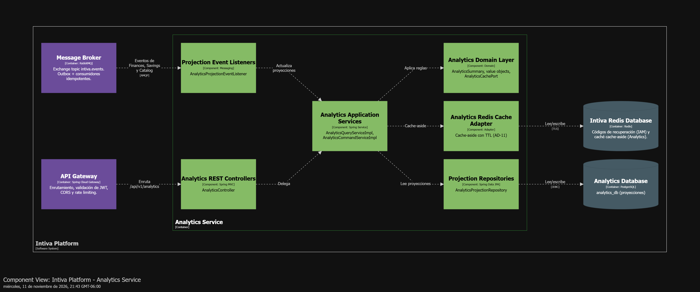

**Explicación del diagrama:**
Cuando la persona usuaria abre el *dashboard*, el API Gateway enruta la petición a **`Analytics REST Controllers`**, que invoca a **`Analytics Application Services`**. Siguiendo *cache-aside* (**AD-11**), el servicio consulta primero a **`Analytics Redis Cache Adapter`**; si no hay resumen vigente, agrega los datos desde **`Projection Repositories`** (`analytics_db`), calcula las métricas con **`Analytics Domain Layer`**, guarda el resultado con TTL y responde. En paralelo, **`Projection Event Listeners`** reciben los eventos de RabbitMQ, actualizan las proyecciones e invalidan la caché del titular afectado.

### 5.8.6. Bounded Context Software Architecture Code Level Diagrams

#### 5.8.6.1. Bounded Context Domain Layer Class Diagrams

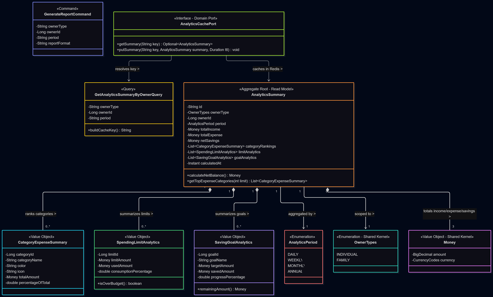

#### 5.8.6.2. Bounded Context Database Design Diagram

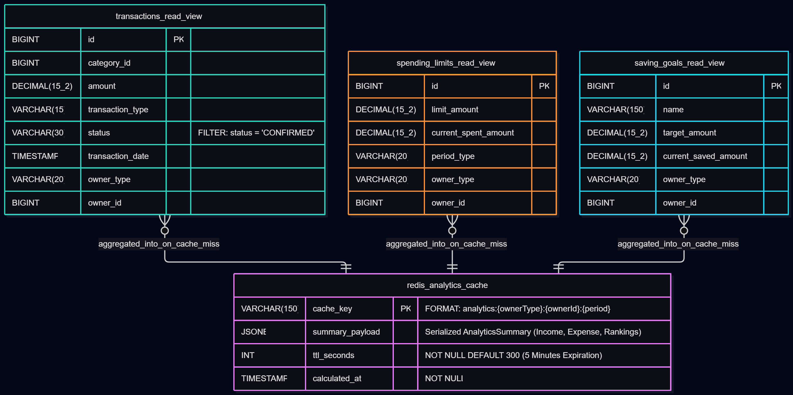

---

## 5.9. Bounded Context: AI Agent

Este contexto, desplegado como **`agent-service`**, incorpora la tecnología emergente de **inteligencia artificial agéntica (*Agentic AI*)**. Ofrece un asistente conversacional que no se limita a responder: **interpreta la intención de la persona usuaria en lenguaje natural y ejecuta acciones reales** sobre la plataforma (registrar un gasto, crear un límite, crear una meta o aportar a una existente), además de consultar información financiera para fundamentar sus respuestas. Es un contexto *downstream* puro: no es consumido por ningún otro servicio y no tiene acceso a las bases de datos de los demás; opera exclusivamente a través de sus APIs públicas, con el JWT de la persona usuaria (**AD-AG-03**).

El agente se apoya en **Gemini API (Google AI Studio, nivel gratuito)** mediante *function calling* (**AD-AG-01**). El modelo decide qué herramienta invocar; el servicio valida, ejecuta o propone la acción y devuelve el resultado al modelo (ciclo *ReAct*: razonar, actuar, observar).

### Casos de uso del agente

| Mensaje de la persona usuaria | Herramientas encadenadas | Resultado |
| :--- | :--- | :--- |
| «Gasté 45 en almuerzo con mi tarjeta» | `list_categories` → `list_financial_accounts` → `register_transaction` | Propuesta de gasto con categoría y cuenta resueltas; se ejecuta tras confirmar. |
| «Ponme un límite de 500 para comida este mes» | `list_categories` → `create_spending_limit` | Propuesta de límite mensual sobre la categoría; se ejecuta tras confirmar. |
| «Quiero ahorrar 3000 para una laptop hasta diciembre» | `create_saving_goal` | Propuesta de meta; si falta un dato obligatorio, el agente lo pregunta. |
| «Agrega 100 a mi meta de la laptop» | `list_saving_goals` → `contribute_to_saving_goal` | Propuesta de aporte a la meta identificada. |
| «¿En qué gasté más este mes?» | `get_spending_summary` | Respuesta de solo lectura, sin confirmación. |

### Catálogo de herramientas

| Herramienta | Tipo | Servicio destino | Operación destino | Parámetros (generados por el LLM) |
| :--- | :--- | :--- | :--- | :--- |
| `list_categories` | READ | `catalog-accounts-service` | `CategoriesController.getCategoriesByOwner` | `type` (`EXPENSE` / `INCOME`) |
| `list_financial_accounts` | READ | `catalog-accounts-service` | `FinancialAccountsController.getAccountsByOwner` | — |
| `get_spending_summary` | READ | `analytics-service` | `AnalyticsController.getSummaryByOwner` | `period` (`DAILY`, `WEEKLY`, `MONTHLY`, `ANNUAL`) |
| `list_spending_limits` | READ | `finances-service` | `SpendingLimitsController.getLimitsByOwner` | — |
| `list_saving_goals` | READ | `savings-service` | `SavingGoalsController.getGoalsByUser` | — |
| `register_transaction` | **WRITE** | `finances-service` | `TransactionsController.registerTransaction` | `accountId`, `categoryId`, `amount`, `type`, `description` |
| `create_spending_limit` | **WRITE** | `finances-service` | `SpendingLimitsController.createSpendingLimit` | `targetType`, `targetId`, `limitAmount`, `period` |
| `create_saving_goal` | **WRITE** | `savings-service` | `SavingGoalsController.createGoal` | `name`, `targetAmount`, `deadlineDate`, `modificationLimitDate` |
| `contribute_to_saving_goal` | **WRITE** | `savings-service` | `SavingGoalsController.addContribution` | `savingGoalId`, `amount` |

El `ownerType` y el `ownerId` **no figuran como parámetros**: los fija `ToolArgumentValidator` a partir del JWT.

### Salvaguardas del agente

| Riesgo | Mitigación |
| :--- | :--- |
| Alucinación de identificadores (cuenta, categoría, meta) | El *prompt* de sistema obliga a resolver identificadores con herramientas `list_*`; el servicio destino valida titularidad y existencia. |
| Acción financiera no deseada | **Human-in-the-loop** (AD-AG-02): toda herramienta WRITE exige confirmación explícita; la propuesta expira (`expiresAt`). |
| Inyección de *prompt* (instrucciones ocultas en descripciones o respuestas) | La lista de herramientas es cerrada (*allowlist*); los argumentos se validan por esquema; `ownerId` nunca se toma del LLM; el modelo no puede confirmar acciones. |
| Escalada de privilegios | El agente usa el JWT de la persona; no existe credencial propia con permisos ampliados. |
| Confirmación duplicada o reenvío | Una `PendingAction` solo transita `PROPOSED → CONFIRMED → EXECUTED/FAILED` una vez; la llamada a Finances usa la identidad de la acción como clave de idempotencia. |
| Bucle de herramientas | Máximo de iteraciones por mensaje (`maxIterations = 5`). |
| Agotamiento de cuota del nivel gratuito (AD-AG-04) | *Rate limiter* global, cuota diaria por usuario (`AgentUsage`), *retry* con *backoff* y *circuit breaker*; al degradarse se responde con un mensaje de contingencia y la persona puede usar los flujos manuales de la aplicación. |
| Fuga de datos al proveedor | Minimización: solo montos, descripciones y nombres de categoría; sin correos, nombres ni datos de terceros; desarrollo y demostración con datos sintéticos. |

### 5.9.1. Domain Layer

| Clase / Interfaz | Categoría Táctica | Propósito | Atributos | Métodos | Relaciones |
| :--- | :--- | :--- | :--- | :--- | :--- |
| **`ChatSession`** | Aggregate Root | Conversación de una persona usuaria con el agente; conserva el historial que se envía como contexto al modelo. | `- id: UUID` `- userId: UserId` `- title: String` `- status: ChatSessionStatus` `- messages: List<ChatMessage>` | `+ ChatSession(StartChatSessionCommand)` `+ addUserMessage(String): ChatMessage` `+ addAssistantMessage(String): ChatMessage` `+ addToolResult(String toolName, String summary): ChatMessage` `+ recentMessages(int limit): List<ChatMessage>` `+ close(): void` | Extiende `AuditableAbstractAggregate`; contiene `ChatMessage` (`0..*`) y `UserId` (Shared Kernel). |
| **`ChatMessage`** | Entity | Mensaje de la conversación, con su rol y, si corresponde, la herramienta asociada. | `- id: Long` `- role: MessageRole` `- content: String` `- toolName: String` `- createdAt: Instant` | `+ isFromUser(): boolean` | Pertenece a `ChatSession` (`1`). |
| **`PendingAction`** | Aggregate Root | Acción de escritura propuesta por el agente que espera la decisión de la persona usuaria. | `- id: UUID` `- sessionId: UUID` `- userId: UserId` `- toolName: String` `- arguments: ToolArguments` `- summary: String` `- status: ActionStatus` `- expiresAt: Instant` `- resultSummary: String` | `+ confirm(Instant now): void` `+ reject(): void` `+ markExecuted(String result): void` `+ markFailed(String reason): void` `+ isExpired(Instant now): boolean` `+ belongsTo(UserId): boolean` | Extiende `AuditableAbstractAggregate`; contiene `ToolArguments` (`1`) y `ActionStatus` (`1`). |
| **`ToolArguments`** | Value Object | Argumentos ya validados de una herramienta, sin datos de titularidad. | `- values: Map<String, Object>` | `+ get(String key): Object` `+ toJson(): String` | Composición dentro de `PendingAction` (`1`). |
| **`ToolDefinition`** | Value Object | Descripción de una herramienta expuesta al modelo. | `- name: String` `- description: String` `- parametersSchema: String` `- kind: ToolKind` `- targetService: String` | `+ isWrite(): boolean` | Listada por `ToolCatalog`. |
| **`ToolCall`** | Value Object | Invocación de herramienta solicitada por el modelo. | `- name: String` `- arguments: Map<String, Object>` | `+ name(): String` | Contenida en `LlmResponse`. |
| **`ToolResult`** | Value Object | Resultado reducido de una herramienta de lectura o de una acción ejecutada. | `- toolName: String` `- success: boolean` `- payload: String` `- errorMessage: String` | `+ isSuccess(): boolean` | Retornado por `ToolGatewayPort`. |
| **`LlmResponse`** | Value Object | Respuesta del modelo: texto final o solicitudes de herramientas. | `- text: String` `- toolCalls: List<ToolCall>` | `+ hasToolCalls(): boolean` | Retornado por `LlmPort`. |
| **`AgentReply`** | Value Object | Resultado de un turno: texto para la persona y acciones propuestas. | `- text: String` `- proposedActions: List<PendingAction>` `- degraded: boolean` | `+ hasProposals(): boolean` | Retornado por `AgentOrchestrator`. |
| **`AgentUsage`** | Entity | Contador diario de mensajes por usuario para proteger la cuota. | `- userId: UserId` `- usageDate: LocalDate` `- messageCount: int` | `+ increment(): void` `+ isLimitReached(int dailyLimit): boolean` | Consultada por `UserQuotaGuard`. |
| **`ToolKind`** | Enumeration | Clasifica la herramienta. | `READ` `WRITE` | `+ valueOf(String): ToolKind` | Utilizado por `ToolDefinition`. |
| **`ActionStatus`** | Enumeration | Estados de una acción propuesta. | `PROPOSED` `CONFIRMED` `EXECUTED` `REJECTED` `EXPIRED` `FAILED` | `+ valueOf(String): ActionStatus` | Utilizado por `PendingAction`. |
| **`MessageRole`** / **`ChatSessionStatus`** | Enumeration | Rol del mensaje y estado de la sesión. | `USER`, `ASSISTANT`, `TOOL` / `ACTIVE`, `CLOSED` | `+ valueOf(String)` | Utilizados por `ChatMessage` y `ChatSession`. |
| **`StartChatSessionCommand`** | Command | Abre una sesión de chat. | `- userId: Long` | `+ userId(): Long` | Consumido por `ChatCommandService`. |
| **`SendUserMessageCommand`** | Command | Entrega un mensaje de la persona al agente. | `- sessionId: UUID` `- userId: Long` `- text: String` | `+ sessionId(): UUID` `+ text(): String` | Consumido por `ChatCommandService`. |
| **`ConfirmPendingActionCommand`** | Command | Confirma y ejecuta una acción propuesta. | `- actionId: UUID` `- userId: Long` | `+ actionId(): UUID` | Consumido por `PendingActionCommandService`. |
| **`RejectPendingActionCommand`** | Command | Descarta una acción propuesta. | `- actionId: UUID` `- userId: Long` | `+ actionId(): UUID` | Consumido por `PendingActionCommandService`. |
| **`GetChatHistoryQuery`** | Query | Historial de mensajes de una sesión del usuario. | `- sessionId: UUID` `- userId: Long` | `+ sessionId(): UUID` | Consumido por `ChatQueryService`. |
| **`GetChatSessionsByUserIdQuery`** | Query | Sesiones de un usuario. | `- userId: Long` | `+ userId(): Long` | Consumido por `ChatQueryService`. |
| **`GetPendingActionsBySessionIdQuery`** | Query | Acciones propuestas de una sesión. | `- sessionId: UUID` `- userId: Long` | `+ sessionId(): UUID` | Consumido por `ChatQueryService`. |
| **`AgentActionExecutedEvent`** | Domain Event (auditoría) | Registra de forma interna que una acción propuesta fue ejecutada o falló. | `- actionId: UUID` `- userId: Long` `- toolName: String` `- success: boolean` `- occurredOn: Instant` | `+ getActionId(): UUID` | Publicado por `PendingAction`; registrado en el *log* de auditoría. |
| **`ChatCommandService`** | Domain Service (Interface) | Contrato de escritura de sesiones y mensajes. | *(Interface)* | `+ handle(StartChatSessionCommand): Optional<ChatSession>` `+ handle(SendUserMessageCommand): AgentReply` | Implementado por `ChatCommandServiceImpl`. |
| **`PendingActionCommandService`** | Domain Service (Interface) | Contrato de confirmación o rechazo de acciones. | *(Interface)* | `+ handle(ConfirmPendingActionCommand): Optional<PendingAction>` `+ handle(RejectPendingActionCommand): Optional<PendingAction>` | Implementado por `PendingActionCommandServiceImpl`. |
| **`ChatQueryService`** | Domain Service (Interface) | Contrato de consultas del chat. | *(Interface)* | `+ handle(GetChatHistoryQuery): List<ChatMessage>` `+ handle(GetChatSessionsByUserIdQuery): List<ChatSession>` `+ handle(GetPendingActionsBySessionIdQuery): List<PendingAction>` | Implementado por `ChatQueryServiceImpl`. |
| **`LlmPort`** | Domain Port (Interface) | Aísla al dominio del proveedor de IA (AD-AG-01). | *(Interface)* | `+ generate(List<ChatMessage> context, List<ToolDefinition> tools): LlmResponse` | Implementado por `GeminiLlmAdapter`. |
| **`ToolGatewayPort`** | Domain Port (Interface) | Ejecuta una herramienta contra el servicio destino en nombre de la persona usuaria. | *(Interface)* | `+ execute(ToolCall call, UserSecurityContext ctx): ToolResult` | Implementado por `ToolGatewayAdapter`. |
| **`ToolCatalog`** | Domain Service | Fuente única de las herramientas permitidas y de su clasificación `READ`/`WRITE`. | `- definitions: Map<String, ToolDefinition>` | `+ findByName(String): Optional<ToolDefinition>` `+ listAll(): List<ToolDefinition>` | Consultado por `AgentOrchestrator` y `ToolArgumentValidator`. |

### 5.9.2. Interface Layer

| Clase | Categoría Táctica | Propósito | Atributos | Métodos | Relaciones |
| :--- | :--- | :--- | :--- | :--- | :--- |
| **`AgentChatController`** | REST Controller | Expone `/api/v1/agent`: abrir sesión, enviar mensaje, consultar historial, listar acciones propuestas, confirmar y rechazar. El usuario siempre se obtiene del JWT. | `- chatCommandService: ChatCommandService` `- actionCommandService: PendingActionCommandService` `- chatQueryService: ChatQueryService` | `+ startSession(): ResponseEntity<ChatSessionResource>` `+ sendMessage(UUID sessionId, SendMessageResource): ResponseEntity<AgentReplyResource>` `+ getHistory(UUID sessionId): ResponseEntity<List<ChatMessageResource>>` `+ getPendingActions(UUID sessionId): ResponseEntity<List<PendingActionResource>>` `+ confirmAction(UUID actionId): ResponseEntity<PendingActionResource>` `+ rejectAction(UUID actionId): ResponseEntity<PendingActionResource>` | Invoca a los servicios de chat y de acciones. |
| **`AgentReplyResourceFromEntityAssembler`** | Assembler | Transforma `AgentReply` en el DTO con texto, acciones propuestas e indicador de degradación. | *(Clase utilitaria estática)* | `+ toResource(AgentReply): AgentReplyResource` | Utilizado por `AgentChatController`. |
| **`PendingActionResourceFromEntityAssembler`** | Assembler | Transforma `PendingAction` en el DTO que la aplicación muestra como tarjeta de confirmación (resumen legible, estado, vigencia). | *(Clase utilitaria estática)* | `+ toResource(PendingAction): PendingActionResource` | Utilizado por `AgentChatController`. |

### 5.9.3. Application Layer

| Clase | Categoría Táctica | Propósito | Atributos | Métodos | Relaciones |
| :--- | :--- | :--- | :--- | :--- | :--- |
| **`AgentOrchestrator`** | Application Service (Agent Loop) | Ejecuta el ciclo del agente: construye el contexto, invoca al modelo y procesa cada `ToolCall` (lectura: la ejecuta y devuelve el resultado al modelo; escritura: crea una `PendingAction` y detiene el ciclo). Termina cuando el modelo devuelve texto o se alcanza `maxIterations`. | `- llmPort: LlmPort` `- toolGatewayPort: ToolGatewayPort` `- toolCatalog: ToolCatalog` `- promptBuilder: PromptBuilder` `- argumentValidator: ToolArgumentValidator` `- pendingActionRepository: PendingActionRepository` `- maxIterations: int` | `+ run(ChatSession, UserSecurityContext): AgentReply` `- handleToolCall(ToolCall, ctx): ToolResult` | Utiliza los puertos de dominio. |
| **`ChatCommandServiceImpl`** | Command Handler | Abre sesiones, verifica la cuota diaria, registra el mensaje de la persona, delega en `AgentOrchestrator` y persiste la respuesta. Si el proveedor no está disponible, devuelve una respuesta degradada sin perder el mensaje. | `- chatSessionRepository: ChatSessionRepository` `- quotaGuard: UserQuotaGuard` `- orchestrator: AgentOrchestrator` | `+ handle(StartChatSessionCommand): Optional<ChatSession>` `+ handle(SendUserMessageCommand): AgentReply` | Implementa `ChatCommandService`. |
| **`PendingActionCommandServiceImpl`** | Command Handler | Confirma una acción (valida titularidad, estado `PROPOSED` y vigencia), la ejecuta con `ToolGatewayPort` usando el JWT de la persona, y registra `EXECUTED` o `FAILED`; o la rechaza. | `- pendingActionRepository: PendingActionRepository` `- toolGatewayPort: ToolGatewayPort` `- clock: Clock` | `+ handle(ConfirmPendingActionCommand): Optional<PendingAction>` `+ handle(RejectPendingActionCommand): Optional<PendingAction>` | Implementa `PendingActionCommandService`. |
| **`ChatQueryServiceImpl`** | Query Handler | Consultas de historial, sesiones y acciones propuestas, siempre filtradas por el usuario autenticado. | `- chatSessionRepository: ChatSessionRepository` `- pendingActionRepository: PendingActionRepository` | `+ handle(GetChatHistoryQuery): List<ChatMessage>` `+ handle(GetChatSessionsByUserIdQuery): List<ChatSession>` `+ handle(GetPendingActionsBySessionIdQuery): List<PendingAction>` | Implementa `ChatQueryService`. |
| **`PromptBuilder`** | Application Service | Construye el *prompt* de sistema: rol del asistente financiero, idioma de la persona, reglas (resolver identificadores con herramientas de lectura, preguntar por datos faltantes, no inventar montos, no ejecutar sin confirmación) y recorte del historial. | `- systemPromptTemplate: String` `- maxContextMessages: int` | `+ build(ChatSession): List<ChatMessage>` | Utilizado por `AgentOrchestrator`. |
| **`ToolArgumentValidator`** | Application Service | Valida los argumentos del modelo contra el esquema de la herramienta (tipos, enumeraciones, montos positivos, fechas) y descarta cualquier `ownerId`/`ownerType` recibido; los reemplaza por los del JWT. | `- toolCatalog: ToolCatalog` | `+ validate(ToolCall): ToolArguments` `+ applyOwner(ToolArguments, UserSecurityContext): ToolArguments` | Utilizado por `AgentOrchestrator`. |
| **`UserQuotaGuard`** | Application Service | Protege la cuota del nivel gratuito limitando los mensajes diarios por usuario. | `- agentUsageRepository: AgentUsageRepository` `- dailyLimit: int` | `+ checkAndConsume(UserId): void` | Utilizado por `ChatCommandServiceImpl`. |
| **`PendingActionExpirationScheduler`** | Application Scheduler | Marca como `EXPIRED` las acciones `PROPOSED` cuya vigencia terminó. | `- pendingActionRepository: PendingActionRepository` `- clock: Clock` | `+ expireStaleActions(): void` | Consulta `PendingActionRepository`. |

### 5.9.4. Infrastructure Layer

| Clase / Interfaz | Categoría Táctica | Propósito | Atributos | Métodos | Relaciones |
| :--- | :--- | :--- | :--- | :--- | :--- |
| **`ChatSessionRepository`** | Repository (JPA) | Persistencia de sesiones y mensajes en `agent_db`. | *(Interface JPA)* | `+ findByIdAndUserId(UUID, UserId): Optional<ChatSession>` `+ findByUserIdOrderByUpdatedAtDesc(UserId): List<ChatSession>` | Extiende `JpaRepository<ChatSession, UUID>`. |
| **`PendingActionRepository`** | Repository (JPA) | Persistencia de acciones propuestas y su auditoría. | *(Interface JPA)* | `+ findByIdAndUserId(UUID, UserId): Optional<PendingAction>` `+ findBySessionIdAndUserId(UUID, UserId): List<PendingAction>` `+ findByStatusAndExpiresAtBefore(ActionStatus, Instant): List<PendingAction>` | Extiende `JpaRepository<PendingAction, UUID>`. |
| **`AgentUsageRepository`** | Repository (JPA) | Contadores diarios por usuario. | *(Interface JPA)* | `+ findByUserIdAndUsageDate(UserId, LocalDate): Optional<AgentUsage>` | Extiende `JpaRepository<AgentUsage, Long>`. |
| **`GeminiLlmAdapter`** | Emerging Tech AI Adapter | Implementa `LlmPort` sobre la API REST de Gemini (`generateContent`): traduce `ToolDefinition` a `functionDeclarations`, mapea `functionCall`/`functionResponse` a `ToolCall`/`ToolResult`, aplica *timeout*, *rate limiter*, *retry* con *backoff* y *circuit breaker*, y traduce errores 429/5xx a `LlmQuotaExceededException` / `LlmUnavailableException` (AD-AG-04). | `- restClient: RestClient` `- baseUrl: String` `- apiKey: String` `- model: String` `- timeout: Duration` `- temperature: double` | `+ generate(List<ChatMessage>, List<ToolDefinition>): LlmResponse` `- toFunctionDeclarations(List<ToolDefinition>): List<Map>` `- mapError(HttpStatusCode): RuntimeException` | Implementa `LlmPort`; se comunica con `Gemini API (Google AI Studio)`. La clave y el modelo se inyectan por variables de entorno. |
| **`ToolGatewayAdapter`** | Outbound ACL (Dispatcher) | Implementa `ToolGatewayPort`: enruta cada herramienta al cliente HTTP del servicio destino y reduce la respuesta a los campos necesarios (minimización de datos). | `- clients: Map<String, ToolClient>` | `+ execute(ToolCall, UserSecurityContext): ToolResult` | Implementa `ToolGatewayPort`; usa los clientes siguientes. |
| **`CatalogToolClient`** | Outbound ACL Client | Invoca `list_categories` y `list_financial_accounts` en `catalog-accounts-service`. | `- restClient: RestClient` | `+ listCategories(ToolArguments, ctx): ToolResult` `+ listAccounts(ctx): ToolResult` | Consume `catalog-accounts-service`. |
| **`FinancesToolClient`** | Outbound ACL Client | Invoca `list_spending_limits`, `register_transaction` y `create_spending_limit` en `finances-service`. | `- restClient: RestClient` | `+ listLimits(ctx): ToolResult` `+ registerTransaction(ToolArguments, ctx): ToolResult` `+ createLimit(ToolArguments, ctx): ToolResult` | Consume `finances-service`. |
| **`SavingsToolClient`** | Outbound ACL Client | Invoca `list_saving_goals`, `create_saving_goal` y `contribute_to_saving_goal` en `savings-service`. | `- restClient: RestClient` | `+ listGoals(ctx): ToolResult` `+ createGoal(ToolArguments, ctx): ToolResult` `+ contribute(ToolArguments, ctx): ToolResult` | Consume `savings-service`. |
| **`AnalyticsToolClient`** | Outbound ACL Client | Invoca `get_spending_summary` en `analytics-service`. | `- restClient: RestClient` | `+ getSummary(ToolArguments, ctx): ToolResult` | Consume `analytics-service`. |
| **`TokenRelayInterceptor`** | HTTP Interceptor | Añade `Authorization` con el JWT de la persona y `X-Correlation-Id` a cada llamada saliente (AD-AG-03, AD-MS-07). | `- securityContextHolder: UserSecurityContextHolder` | `+ intercept(request, body, execution): ClientHttpResponse` | Registrado en los `RestClient` de las herramientas. |

### 5.9.5. Bounded Context Software Architecture Component Level Diagrams

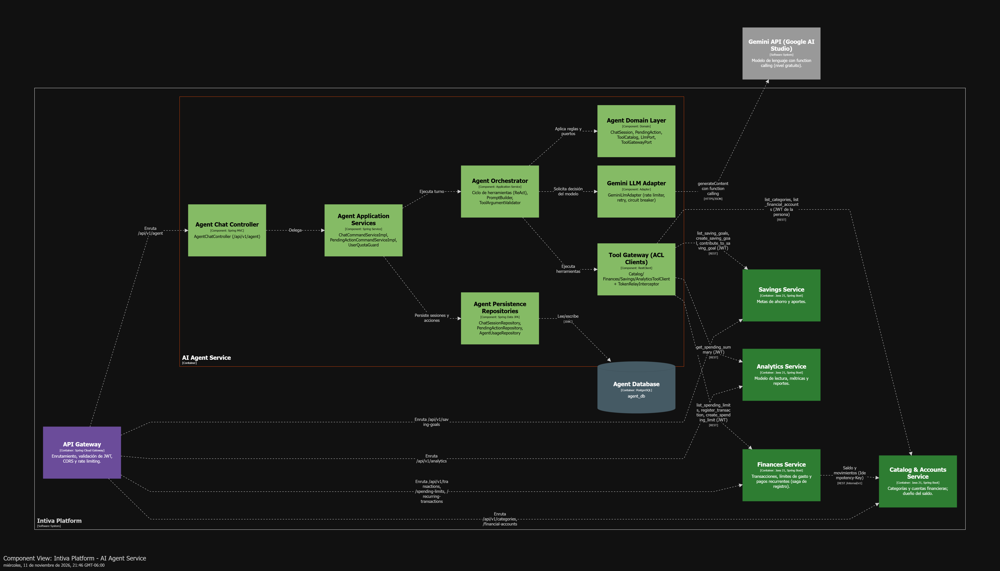

**Explicación del diagrama:**
**`Agent Chat Controller`** recibe desde el API Gateway los mensajes y las confirmaciones, y los delega en **`Agent Application Services`**. Estos verifican la cuota y entregan el turno a **`Agent Orchestrator`**, que ejecuta el ciclo de herramientas: invoca a **`Gemini LLM Adapter`** (que se comunica con la API de Gemini) y, para cada herramienta solicitada, a **`Tool Gateway (ACL Clients)`**, que llama con el JWT de la persona a los servicios de catálogo, finanzas, ahorro y analítica. Las acciones de escritura se guardan como `PendingAction` mediante **`Agent Persistence Repositories`** (PostgreSQL `agent_db`) y solo se ejecutan cuando la persona las confirma. **`Agent Domain Layer`** concentra las reglas de estado de las acciones y los puertos.

### 5.9.6. Bounded Context Software Architecture Code Level Diagrams

#### 5.9.6.1. Bounded Context Domain Layer Class Diagrams

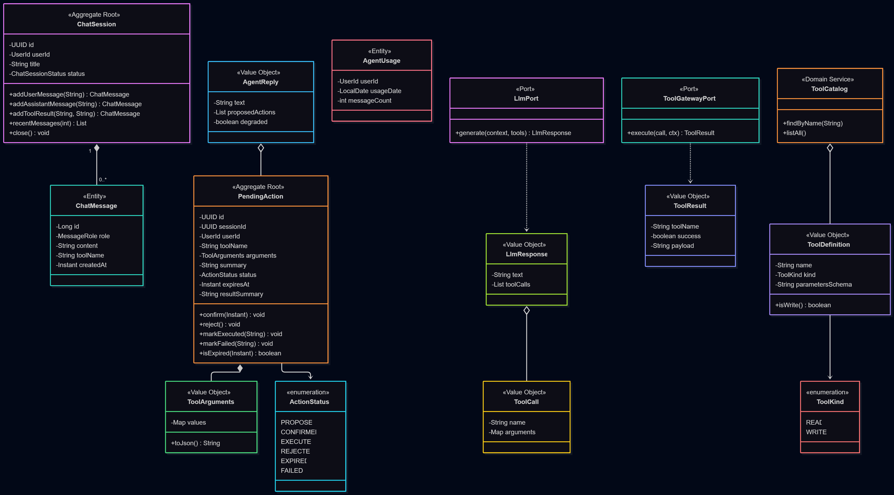

#### 5.9.6.2. Bounded Context Database Design Diagram

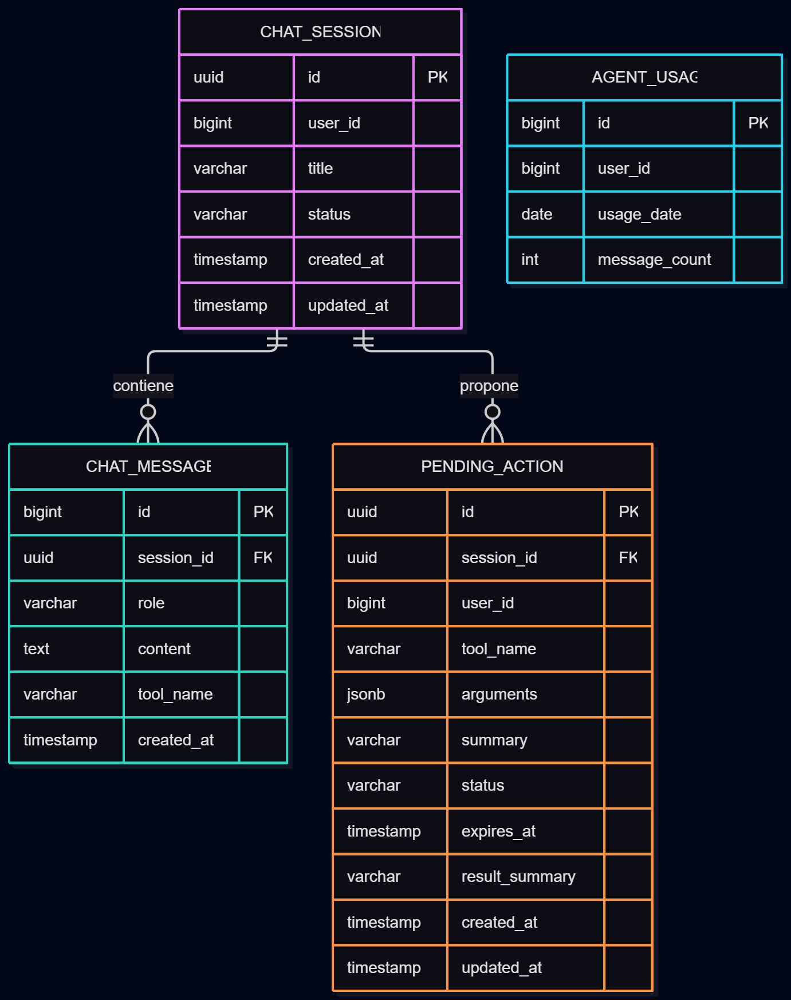

---
