# Capítulo VI: Solution UX Design

En este capítulo se desarrolla el diseño de la solución planteada para Intiva, la propuesta de Balanza para la gestión de ingresos, gastos y ahorros personales y familiares. Para ello, se definen las guías de estilo y la arquitectura de información que se seguirán en la landing page, la aplicación móvil y la aplicación web, para que el diseño sea coherente y fácil de usar para nuestros segmentos objetivo.

## 6.1. Style Guidelines

En esta sección se explican las guías de estilo para la landing page, la aplicación móvil y la aplicación web. Con ellas buscamos que los tres productos se vean coherentes entre sí y que los usuarios reconozcan el estilo de Intiva.

### 6.1.1. General Style Guidelines

**Branding**

*Brand Overview*

Intiva es una plataforma digital que ayudará a las personas y a las familias a registrar sus ingresos y gastos, controlar su presupuesto mediante límites de gasto y planificar metas de ahorro de forma individual o compartida. Nace de una problemática identificada en las entrevistas: la mayoría de usuarios lleva sus finanzas en hojas de Excel, notas del celular o revisando manualmente sus billeteras digitales (Yape, Plin, apps bancarias), lo que vuelve el registro tedioso y deja la información fragmentada entre los integrantes del hogar. Intiva busca centralizar esa información, presentarla de forma visual y acompañar al usuario con alertas y recordatorios para que tome mejores decisiones financieras. La IA sugerirá categorías a partir de la descripción ingresada y ofrecerá orientación sobre gastos hormiga y metas. El usuario revisará cada sugerencia antes de guardar o tomar una decisión. El agente propone un plan mensual que el usuario puede editar y aprobar. Su eslogan, "Controla tus finanzas, transforma tu vida", resume esa promesa, y en la landing page se comunica con el mensaje "Tus finanzas, con un plan hecho para ti".

*Brand Name*

El nombre "Intiva" se relaciona con la idea de manejar las finanzas de forma intuitiva, ya que buscamos que ahorrar y organizar las finanzas sea algo sencillo e intuitivo para cualquier persona, sin necesidad de conocimientos financieros previos. Por eso, el nombre representa una herramienta cercana que ayuda a controlar los gastos y alcanzar metas de ahorro. Además, es un nombre corto, moderno y fácil de recordar y de pronunciar tanto en español como en inglés, lo que permitirá usarlo sin cambios en las dos versiones de idioma de la landing page y como nombre de la aplicación en Google Play.

*Logo*

A continuación, se muestra el logo diseñado para Intiva:

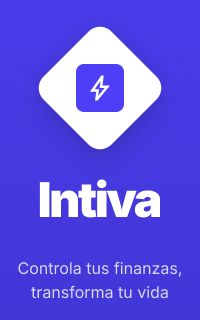

*Logo de Intiva. Fuente: elaboración propia.*

El logo de Intiva está compuesto por un isotipo y un logotipo. El isotipo es un rombo blanco de esquinas redondeadas que contiene un cuadrado índigo con un rayo, símbolo que representa la energía y la rapidez con la que la aplicación permitirá tomar el control del dinero: el registro y la consulta del presupuesto son tareas principales del producto. El tiempo de ejecución se evaluará mediante las pruebas de usabilidad definidas en QAS-01. El logotipo "Intiva" se escribe en una tipografía sans-serif de trazo grueso, que transmite solidez y confianza. Se presenta sobre el color índigo principal de la marca y se acompaña del eslogan. En espacios reducidos, como el favicon, la barra de navegación de la landing page o la barra lateral de la aplicación web, se usará una versión simplificada: un cuadrado índigo con la inicial de la marca.

**Typography**

Para la tipografía escogimos fuentes de Google Fonts, cada una para un tipo de texto distinto. Así es más fácil distinguir qué es más importante en cada pantalla.

Para los títulos y encabezados de la aplicación móvil y de la aplicación web usaremos Manrope (Headline). Es una fuente moderna y algo compacta, por lo que los títulos se ven bien sin ocupar mucho espacio en pantallas pequeñas.

En la landing page, los títulos usarán Plus Jakarta Sans. Tiene trazos más gruesos en sus pesos altos, por lo que funciona bien en titulares grandes, que son lo primero que ve un visitante.

Para los textos de cuerpo, descripciones, formularios y botones usaremos Inter (Body) en los tres productos. Esta fuente fue creada para pantallas y se lee bien incluso en tamaños pequeños, lo que ayuda en las listas de movimientos y en los mensajes de alerta.

Para las etiquetas y los montos de dinero usaremos Space Grotesk (Label). Escogimos una fuente aparte para los números porque los montos son el dato más importante en una aplicación de finanzas y queremos que el usuario los encuentre rápido.

| Estilo | Fuente | Uso | Tamaño (web / app) | Peso |
| --- | --- | --- | --- | --- |
| Display | Plus Jakarta Sans (landing) / Manrope (app y web) | Titular principal de la landing y saldo total | 64 px / 32 sp | ExtraBold / Bold |
| Headline | Plus Jakarta Sans (landing) / Manrope (app y web) | Títulos de sección y de pantalla | 36 a 48 px / 24 sp | Bold |
| Title | Manrope | Títulos de tarjetas y subsecciones | 20 a 24 px / 18 sp | Bold |
| Body | Inter | Textos descriptivos y contenido de formularios | 16 a 18 px / 16 sp | Regular |
| Body small | Inter | Textos secundarios, fechas y ayudas | 14 px / 12 a 13 sp | Regular |
| Button | Inter | Botones y llamadas a la acción | 16 px / 14 sp | SemiBold |
| Label | Space Grotesk | Etiquetas, chips y navegación | 12 a 14 px / 10 a 12 sp | Medium |
| Amount | Space Grotesk | Montos de dinero | 16 a 28 px / 16 a 28 sp | Medium / Bold |

**Colors**

Para escoger los colores pensamos en cómo queremos que se sientan los usuarios, ya que en las entrevistas muchos dijeron que manejar su dinero les genera estrés. Armamos la paleta con el sistema de color de Material Design 3, a partir de cuatro colores base.

El color primario es un índigo (`#534AB7`). Transmite confianza y seriedad, algo necesario en una aplicación que maneja el dinero de las familias, pero se ve más moderno y cercano que el azul que suelen usar los bancos. Lo usaremos en los botones principales, en la opción activa de la navegación y en la tarjeta de saldo.

El color secundario es un verde lima (`#CDEB45`), que se asocia con energía y crecimiento. Como contrasta mucho con el índigo, llama la atención, así que lo usaremos en las llamadas a la acción, en los botones de registro y en el progreso de las metas de ahorro. Sus tonos más oscuros (como `#556500`) servirán para mostrar los ingresos.

El color terciario es un tono cobrizo (`#8A4900`). Lo usaremos como acento en acciones de edición y en algunas categorías, para diferenciar elementos sin quitarle protagonismo a los colores principales.

El color neutro es un gris con un ligero tono violeta (`#78767E`). Con su escala de tonos lo usaremos en fondos, bordes y textos secundarios, y combina bien con el índigo.

Además, usaremos un rojo (`#BA1A1A`) para los gastos, los límites superados y la acción de eliminar. Cada color tiene una escala de tonos, de oscuro a claro, que nos permite crear fondos suaves, estados de botones y un modo oscuro. El contraste debe comprobarse para cada combinación de texto, fondo y estado; la existencia de una escala de tonos no garantiza por sí sola su legibilidad.

A continuación se presenta la guía de estilo de Intiva, que reúne la paleta de colores, las tipografías y algunos componentes base (botones, buscador, barras de progreso, barra de navegación y botones de íconos):

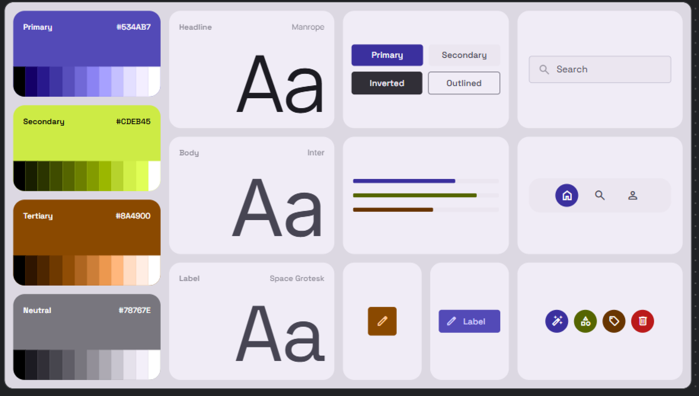

*Guía de estilo de Intiva: paleta de colores, tipografías y componentes base. Fuente: elaboración propia en Figma.*

También usaremos colores para indicar el estado de las finanzas, de modo que el usuario lo entienda sin leer el detalle: verde cuando un límite de gasto va bien, ámbar cuando está cerca de alcanzarse y rojo cuando se supera. Los borradores se mostrarán en tonos neutros para diferenciarlos del plan activo. Para no depender solo del color, cada estado irá acompañado de un texto, y los montos se mostrarán con signo ("+" para ingresos y "−" para gastos).

**Spacing**

El espaciado se basará en múltiplos de 4 y 8 para que la información se vea ordenada. Los valores cambian según el producto:

Para Landing Page y aplicación web:
- Button padding:
    - Vertical: 16px
    - Horizontal: 32px
- Input fields:
    - Altura: 48px
    - Espacio entre campos: 16px
- Ancho máximo del contenido: 1280px
- Margen lateral: 24px (móvil) a 32px (escritorio)
- Margin entre secciones de la landing: 96px (móvil) a 128px (escritorio)
- Espacio entre título y subtítulo de sección: 24px
- Espacio entre tarjetas del panel web: 24px

Para Android:
- Button padding:
    - Vertical: 12dp
    - Horizontal: 16dp
- Botón principal de pantalla completa: 56dp de altura
- Input fields:
    - Altura: 56dp
    - Espacio entre campos: 16dp
- Margin lateral de pantalla: 20dp
- Margin entre secciones:
    - Principales: 24dp
    - Internas: 16dp
- Spacing entre textos:
    - Título y subtítulo: 4dp
    - Párrafos: 12dp
- Área táctil mínima: 48dp

**Shapes**

Usaremos esquinas redondeadas para que la interfaz se vea amigable: 8 para inputs y botones pequeños, 12 para tarjetas y chips, 16 para tarjetas destacadas y paneles inferiores, y forma de píldora o círculo para botones de la landing page, avatares, filtros y el botón flotante.

**Tone of voice**

Usaremos un tono cercano y sencillo. En las entrevistas vimos que los términos financieros técnicos confunden a los usuarios, por lo que evitaremos la jerga y trataremos al usuario de "tú" (por ejemplo, "Aquí está el resumen de tus finanzas hoy"). Cuando el usuario logre algo, se lo haremos saber ("¡Cumpliste tu meta de ahorro!"), y las alertas solo informarán lo que pasó, sin regañar ("Has superado tu presupuesto en Entretenimiento"), junto con una opción para resolverlo. Al hablar de la planificación y de la IA seremos claros sobre lo que hacen y lo que no: por ejemplo, "El borrador todavía no modifica tu presupuesto" o "La categoría es una sugerencia; puedes cambiarla". Queremos que el usuario sienta que Intiva lo ayuda con sus gastos, que no lo juzga y que él mantiene el control de su información.

### 6.1.2. Web, Mobile & Devices Style Guidelines

Intiva contempla una landing informativa, una aplicación móvil Android para el registro diario y una aplicación web para consultar gráficos y reportes. Las entrevistas mencionan el uso de celulares y computadoras. La elección de Android también responde a TS 007 y a las notificaciones de seguimiento previstas en US 035; no se fundamenta en porcentajes de dispositivos cuya base de cálculo aún no está documentada.

**Landing Page**

- Diseño responsive con enfoque *mobile first*, para permitir el acceso desde el celular, por ejemplo al compartir el enlace por WhatsApp.
- Puntos de quiebre: móvil (< 768 px), tablet (768 a 1023 px) y escritorio (≥ 1024 px). En móvil, el contenido pasará a una sola columna y el menú superior se convertirá en un menú hamburguesa.
- Usará fondos claros con acentos índigo, y el botón principal será de color Secondary (lima) para que destaque; el botón secundario será transparente con borde.
- Estará disponible en español e inglés, con un selector de idioma en la barra de navegación.
- Todos los elementos interactivos tendrán un contorno visible al recibir foco con el teclado, y las imágenes tendrán texto alternativo.

**Aplicación móvil (Android)**

- Seguirá los lineamientos de Material Design 3, para que la aplicación se sienta natural para los usuarios de Android, utilizando sus componentes: barra superior, barra de navegación inferior, botón flotante, chips, paneles inferiores (*bottom sheets*) y diálogos.
- Las dimensiones se definirán en `dp` y los textos en `sp`, para respetar el tamaño de letra configurado por el usuario en su teléfono.
- Se diseñará sobre un ancho de referencia de 360 a 390 dp, como referencia de diseño adaptable; la distribución se verificará en distintos tamaños de pantalla.
- Los botones de acción principal ocuparán todo el ancho de la pantalla y estarán en la parte inferior, para alcanzarlos fácilmente con el pulgar.
- Para registrar montos se usará un teclado numérico propio con dígitos grandes, evitando abrir el teclado del sistema.
- La solicitud de categorización con IA explicará qué datos del formulario se usarán y ofrecerá selección manual. La aprobación mostrará los límites, aportes previstos y recordatorios antes de aplicar el plan.
- Se usarán los íconos de Material Symbols, con un ícono propio por cada categoría de gasto (por ejemplo, un carrito para supermercado o cubiertos para alimentación).

**Aplicación web**

- Estará pensada para laptops y computadoras de escritorio, con una barra lateral fija de navegación y un área de contenido organizada en tarjetas y gráficos.
- En pantallas menores a 768 px, la barra lateral se reemplazará por una barra de navegación inferior con íconos.
- Usará las mismas fuentes y colores de la aplicación móvil, para que el usuario reconozca la información al pasar de un dispositivo a otro. Los gráficos usarán el índigo y el lima como colores principales de sus series.
- Contará con modo claro y modo oscuro, y permitirá cambiar el idioma entre español e inglés.
- Se usarán los íconos de PrimeIcons, que acompañan a la librería de componentes PrimeVue.

## 6.2. Information Architecture

En esta parte del informe se presenta la arquitectura de información planeada para los productos de Intiva (landing page, aplicación móvil y aplicación web): la organización de la información, las etiquetas, el sistema de búsqueda, los meta tags y la forma de navegación. Con esto buscamos que la interfaz sea fácil de entender para nuestros segmentos objetivo.

### 6.2.1. Organization Systems

**Organización visual (jerárquica)**

Se utilizará una jerarquía visual para que el usuario siga el contenido en orden de importancia. Para ello, se usarán distintos tamaños y pesos de texto, de modo que los títulos y los montos sean lo primero que se lea, y las descripciones y fechas queden en un segundo plano. Por ejemplo, en la pantalla de inicio de la aplicación móvil se mostrará primero el saldo total, luego el estado del presupuesto y, finalmente, los movimientos recientes. En el panel de la aplicación web, los indicadores principales (balance total, ingresos, gastos y ahorro del mes) aparecerán arriba y los gráficos de detalle debajo. En la landing page, la propuesta de valor y el botón de descarga aparecerán antes que cualquier otra información.

**Organización secuencial**

Se aplicará en los procesos que tienen pasos definidos, para que el usuario sepa en todo momento en qué paso se encuentra:

- Registro e inicio: presentación de la aplicación (onboarding) → registro o inicio de sesión → configuración inicial.
- Registro manual de un movimiento: tipo (gasto o ingreso) → monto → categoría → cuenta → fecha → guardar. Este proceso se diseñará para completarse en cinco pasos o menos, tal como se definió en el escenario de usabilidad del Capítulo IV.
- Categorización IA: ingresar gasto → pedir sugerencia → aceptar o corregir → revisar y guardar.
- Creación de una meta de ahorro: nombre → monto objetivo → fecha límite → individual o familiar → confirmar.
- Recuperación de contraseña: ingresar correo → verificar código → nueva contraseña.
- Generación de un reporte en la aplicación web: tipo de reporte → período → integrantes incluidos → descargar.

En la landing page, las secciones también seguirán un orden pensado para convencer al visitante: propuesta de valor → problema que resolvemos → funcionalidades → cómo funciona → privacidad y control → equipo → planes → escenarios de uso → llamada a la acción final.

**Esquemas de categorización**

- Cronológico: el historial de movimientos, las notificaciones y los aportes a metas se mostrarán del más reciente al más antiguo, agrupados por día ("Hoy", "Ayer"). Los recordatorios de pago se ordenarán por la fecha de vencimiento más próxima.
- Por audiencia: se diferenciará la información según el tipo de usuario. El responsable de la economía familiar (administrador del grupo) podrá invitar integrantes, asignar roles y crear metas o límites familiares, mientras que un integrante solo verá y registrará movimientos del grupo. Además, la aplicación web estará orientada sobre todo al responsable de la economía familiar, que es quien revisa los reportes del hogar.
- Por estado: borrador, aplicando, activo, descartado o error. Si solo se aplican algunas acciones, se muestra cuáles siguen pendientes.
- Alfabético: se usará en listas de selección largas, como la lista de categorías (después de las más usadas) y la lista de integrantes del grupo familiar.

### 6.2.2. Labeling Systems

Para el sistema de etiquetas se usarán palabras cortas, en español y sin tecnicismos financieros, acompañadas de íconos que faciliten entender cada función a simple vista. Para la aplicación móvil se usarán los íconos de Material Symbols (https://fonts.google.com/icons), que siguen la guía de estilo de Android, y para la aplicación web, los de PrimeIcons.

En la landing page se usarán las siguientes etiquetas:
* "Inicio"
* "Funcionalidades"
* "Cómo funciona"
* "Equipo"
* "Planes"
* "Descargar en Google Play"
* "Ver cómo funciona"
* "Descargar app"
* "Términos de Servicio", "Privacidad" y "Ayuda" (pie de página)

En la aplicación móvil, la navegación principal tendrá las siguientes etiquetas:
* "Inicio"
* "Transacciones"
* "Metas"
* "Familia"
* "Perfil"

Asimismo, se usarán etiquetas de acción como:
* "Gasto" / "Ingreso"
* "Guardar"
* "Cancelar"
* "Aportar"
* "Invitar miembro"
* "Aplicar filtros"
* "Ajustar límite"
* "Cerrar sesión"

Para la planificación se usarán etiquetas como **Ver proyección**, **Revisar plan**, **Editar borrador**, **Aprobar plan** y **Consultar estado**. La categoría sugerida se puede aceptar o cambiar antes de guardar.

Por último, se usarán etiquetas de estado para que el usuario identifique rápidamente la situación de sus finanzas: "A buen ritmo", "¡Cerca del límite!" y "Límite alcanzado" (límites de gasto), "En progreso" y "Meta alcanzada" (metas de ahorro), "Borrador", "Aplicando", "Activo", "Descartado" y "Error" (plan mensual), y "Categoría sugerida por IA" (registro de gasto), y "Admin" y "Miembro" (roles del grupo familiar).

### 6.2.3. Searching Systems

En el caso de la landing page, no se contará con una barra de búsqueda, ya que su contenido es acotado. Solo tendrá disponibles secciones claras accesibles desde el menú superior y botones de llamada a la acción para llevar al usuario a la aplicación.

En el caso de la aplicación móvil, la búsqueda se usará principalmente en el historial de transacciones, que es donde la información crece con el uso:

* Búsqueda por texto: el usuario podrá escribir el nombre o una palabra clave del movimiento (por ejemplo, "supermercado" o "luz") y se mostrará la lista de coincidencias.
* Filtros rápidos: debajo del buscador habrá opciones para mostrar "Todos", solo "Ingresos" o solo "Gastos".
* Filtros avanzados: se podrá filtrar por rango de fechas ("Este mes", "Mes pasado", "Últimos 3 meses" o un rango personalizado), tipo de movimiento y una o varias categorías.

En otras secciones, como las metas de ahorro o las notificaciones, la información se filtrará mediante pestañas (por ejemplo, metas "Personales" y "Familiares"). Si una búsqueda no tiene resultados, se mostrará un mensaje claro con la opción de limpiar los filtros.

En la aplicación web no habrá búsqueda por texto, ya que muestra información resumida. En su lugar, el usuario podrá filtrar los gráficos por período (1 mes, 6 meses o 1 año) y configurar los reportes por tipo (general, ingresos, gastos o ahorros), período e integrantes del grupo familiar.

### 6.2.4. SEO Tags and Meta Tags

Los metadatos propuestos describen el contenido de la landing y configuran su presentación en buscadores y redes sociales. Su aplicación deberá verificarse en el sitio desplegado; no garantiza una posición determinada en los resultados de búsqueda.

**Landing Page:**

```html
<meta charset="UTF-8">
<meta name="viewport" content="width=device-width, initial-scale=1.0">
<title>Intiva - Tus finanzas, con un plan hecho para ti</title>
<meta name="description" content="Registra tus gastos con ayuda de las notificaciones de tus apps financieras, recibe sugerencias de categoría con IA y organiza las finanzas de tu familia con Intiva.">
<meta name="author" content="Balanza">
<meta name="robots" content="index, follow">

<!-- URLs de diseño: sustituir por las rutas definitivas verificadas al desplegar -->
<!-- Versiones de idioma -->
<link rel="alternate" hreflang="es" href="https://intiva.vercel.app/es/">
<link rel="alternate" hreflang="en" href="https://intiva.vercel.app/en/">

<!-- Vista previa al compartir el enlace (WhatsApp, Facebook, LinkedIn) -->
<meta property="og:title" content="Intiva - Tus finanzas, con un plan hecho para ti">
<meta property="og:description" content="Categorías, asistencia y planificación financiera con IA.">
<meta property="og:image" content="https://intiva.vercel.app/logo.png">
<meta property="og:url" content="https://intiva.vercel.app/">
<meta property="og:type" content="website">
```

El título y la descripción permiten comunicar el contenido de la página; Google puede utilizar la descripción en el fragmento de búsqueda. La etiqueta `keywords` no se incluye porque Google no la utiliza para indexación ni ranking. `hreflang` identifica las versiones de idioma y Open Graph define la vista previa al compartir. Las URL y la imagen del ejemplo deberán corresponder a recursos publicados antes de su uso. [Referencia: Google Search Central](https://developers.google.com/search/docs/crawling-indexing/special-tags).

**Aplicación web:**

La aplicación web contiene información financiera privada, por lo que no buscará aparecer en los buscadores. Solo la pantalla de inicio de sesión tendrá un título y una descripción, y las páginas a las que se entra con sesión iniciada usarán `<meta name="robots" content="noindex, nofollow">` como instrucción de indexación. La privacidad depende de la autenticación y autorización del backend; `noindex` no es un control de acceso. [Referencia: Google Search Central](https://developers.google.com/search/docs/fundamentals/get-started-developers).

**Aplicación Móvil (App Store Optimization):**

* App Title: Intiva - Finanzas en Familia
* Mensaje breve propuesto para la ficha de Google Play: Registra gastos más rápido, define límites y ahorra en familia
* Términos para redactar la ficha de Google Play: control de gastos, categorización de gastos con IA, categorías con IA, presupuesto, ahorro, finanzas familiares, metas de ahorro
* App Category: Finanzas
* App Description: "Intiva te ayuda a tomar el control de tu dinero. Detecta tus gastos a partir de las notificaciones de tus apps financieras y te sugiere su categoría, para que solo tengas que revisarlos y confirmarlos. Define límites de gasto y recibe alertas antes de superarlos. Crea metas de ahorro solo o con tu familia y revisa a dónde va tu dinero desde un solo lugar."

### 6.2.5. Navigation Systems

Para la landing page se usará una navegación jerárquica de una sola página, con un menú superior fijo cuyos enlaces ("Inicio", "Funcionalidades", "Cómo funciona", "Equipo" y "Planes") llevarán a cada sección. "Descargar en Google Play" será la principal llamada a la acción y se repetirá al final de la página para que el visitante pueda actuar desde cualquier punto. En pantallas pequeñas, el menú se agrupará en un menú hamburguesa.

Para la aplicación móvil se escogieron distintos patrones conocidos de Mobile UI. A continuación se explica cómo funcionará cada uno:

* "Sticky" Fixed Navigation: se usará una barra de navegación inferior fija con los botones "Inicio", "Transacciones", "Metas", "Familia" y "Perfil", siempre al alcance del pulgar.
* Content-based Navigation: al tocar un elemento del contenido se accederá a su detalle. Por ejemplo, al tocar un movimiento se verá su información completa; al tocar una meta, su progreso y aportes; al tocar un plan, su proyección, acciones y estado; y al tocar una notificación, la pantalla relacionada con ella (por ejemplo, el límite de gasto superado o el detalle de un recordatorio).
* Floating Action Button: se usará un botón flotante "+" para la acción más frecuente de cada sección, como crear una nueva meta o un nuevo límite de gasto.
* Vertical Navigation: se usará para que los usuarios recorran listas como el historial de movimientos, las propuestas pendientes de aprobación, las metas, los integrantes del grupo y las notificaciones.
* Tabs: se usarán pestañas para separar información relacionada dentro de una misma sección, como metas "Personales" y "Familiares".
* Swipe Navigation: en las pantallas de bienvenida (onboarding), el usuario avanzará deslizando hacia la izquierda.
* Bottom Sheets: se usarán paneles inferiores para acciones rápidas sin salir de la pantalla actual, como aplicar filtros al historial o elegir otra categoría para un gasto.
* Popovers: se usarán ventanas emergentes en distintos casos:
    * Confirmar la eliminación de un movimiento, una meta o una categoría.
    * Avisar que se superó un límite de gasto, con la opción de ajustarlo.
    * Pedir confirmación cuando la IA no esté segura de la categoría y proponga "Otros".
    * Confirmar si se descarta el borrador sin aplicar cambios.
    * Aceptar o rechazar una invitación a un grupo familiar.
    * Confirmar la salida de un grupo familiar o la eliminación de un integrante.

Para la aplicación web se usará una barra lateral fija con las secciones "Panel" y "Reportes" y la opción "Cerrar sesión". En la barra superior estarán el título de la página, el acceso a las notificaciones, el cambio de idioma y el cambio entre modo claro y oscuro.

## 6.3. Landing Page UI Design

La landing presenta categorización, asistencia y planificación financiera con IA. El flujo mensual cubre US 032 y TS 023; US 035 corresponde a la segunda etapa. [Abrir la página Prototipo de Figma](https://www.figma.com/design/wV6U6QQC4MEYfj8PQArde5/Intiva-Platform-Application-Emergentes?node-id=2045-2348).

### 6.3.1. Landing Page Wireframe

La propuesta **“Tus finanzas, con un plan hecho para ti”** organiza la landing en navegación, hero, llamada a la acción, categorización, asistencia para el ahorro, planificación mensual y control del usuario. El escritorio de 1440 px presenta una lectura vertical y la versión móvil de 390 px conserva el orden de los bloques en una columna.

| Bloque | Mensaje y propósito | Requisito |
| --- | --- | --- |
| Hero y navegación | Presentar Intiva y llevar al visitante a la explicación de beneficios. | US 001, US 002 |
| IA para gastos | Ingresar datos y aceptar o corregir la categoría antes de guardar. | US 033 |
| Asistente para el ahorro | Consultar gastos hormiga y ajustes orientativos para una meta. | US 034 |
| Plan mensual | Proyectar gastos, comparar riesgos y aprobar un borrador editable. | US 032 |
| Control y privacidad | Consultar datos autorizados y aplicar solo la versión aprobada. | TS 023, TS 024 |
| Equipo y planes | Identificar Balanza y reservar las condiciones de publicación y suscripción. | US 001, US 008 |

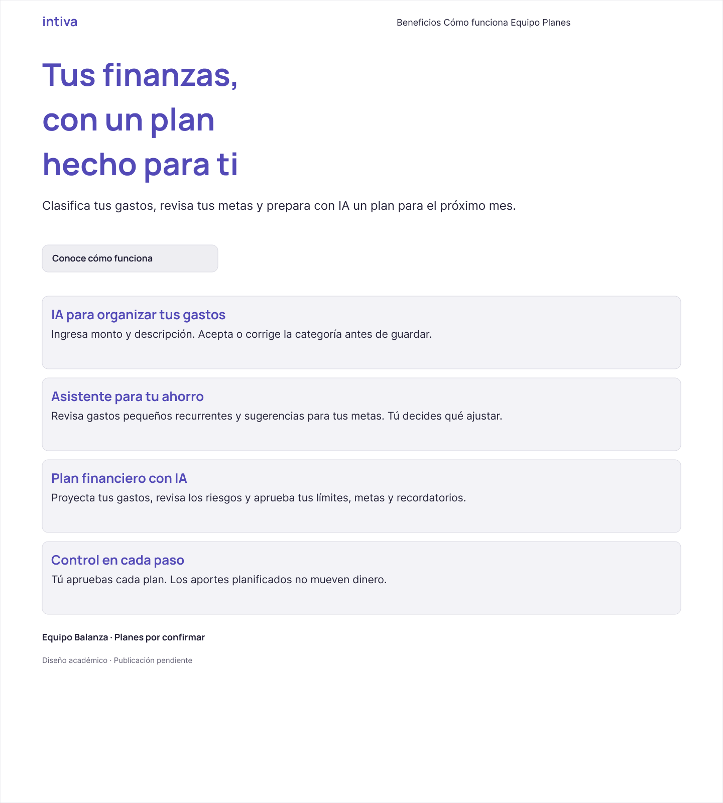

*Figura 6.3.1-A · Wireframe desktop. [Abrir diseño en Figma](https://www.figma.com/design/wV6U6QQC4MEYfj8PQArde5/Intiva-Platform-Application-Emergentes?node-id=2051-3866).*


*Figura 6.3.1-B · Wireframe móvil. [Abrir diseño en Figma](https://www.figma.com/design/wV6U6QQC4MEYfj8PQArde5/Intiva-Platform-Application-Emergentes?node-id=2051-3893).*

### 6.3.2. Landing Page Mock-up

El mock-up aplica la paleta índigo y lima de Intiva. Comunica tres beneficios: registrar y revisar, consultar gastos y metas, y proyectar y aprobar el plan del próximo mes.

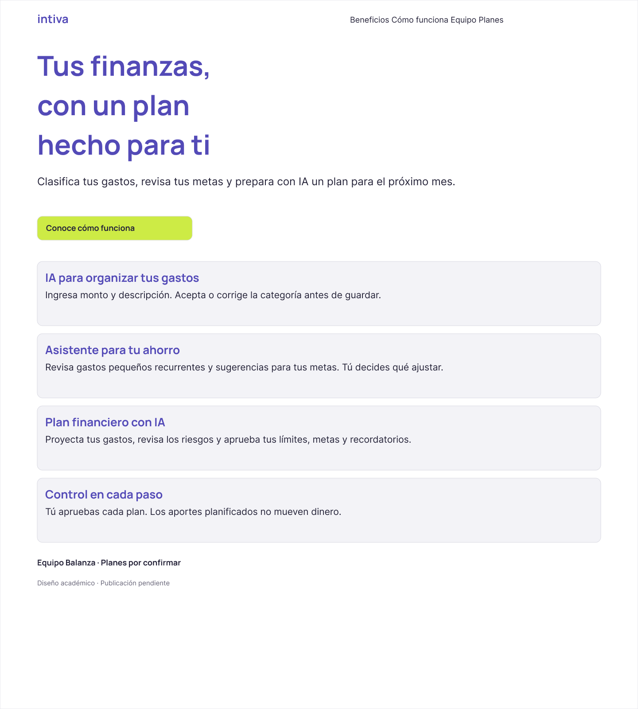

*Figura 6.3.2-A · Mock-up de landing. [Abrir diseño en Figma](https://www.figma.com/design/wV6U6QQC4MEYfj8PQArde5/Intiva-Platform-Application-Emergentes?node-id=2051-3928).*

Las pantallas representan un diseño. Los importes son ilustrativos y aprobar un aporte previsto no mueve dinero.

## 6.4. Applications UX/UI Design

### 6.4.1. Applications Wireframes

Los doce wireframes cubren la categorización, la consulta al asistente y el plan mensual. El usuario revisa y aprueba el plan antes de que se apliquen sus acciones.

| ID | Pantalla | Acción o estado | Requisito |
| --- | --- | --- | --- |
| WF01 | Registrar gasto | Introducir monto, descripción y cuenta; pedir categoría IA o elegir manualmente. | US 033 |
| WF02 | Categoría sugerida | Aceptar o corregir la propuesta de IA sin guardar todavía. | US 033 |
| WF03 | Elegir categoría | Aplicar la elección del usuario. | US 033 |
| WF04 | Revisar y guardar | Verificar datos y actualizar el saldo tras guardar correctamente. | US 033 |
| WF05 | Asistente financiero | Elegir período y consultar movimientos autorizados. | US 034 |
| WF06 | Gastos hormiga | Revisar gastos pequeños recurrentes y abrir los movimientos del análisis. | US 034 |
| WF07 | Plan para mi meta | Consultar ajustes orientativos sin modificar automáticamente la meta. | US 034 |
| WF08 | Ayuda no disponible | Conservar datos; continuar manualmente o reintentar. | TS 024 |
| WF09 | Solicitar plan | Seleccionar el próximo mes y consultar historial autorizado. | US 032 |
| WF10 | Proyección de gastos | Comparar el gasto esperado con ingresos, metas y límites vigentes. | US 032 |
| WF11 | Editar y aprobar | Revisar límites, aportes previstos y recordatorios; aprobar la versión elegida. | US 032, TS 023 |
| WF12 | Estado del plan | Distinguir aplicación, plan activo, descarte y error. | TS 023 |

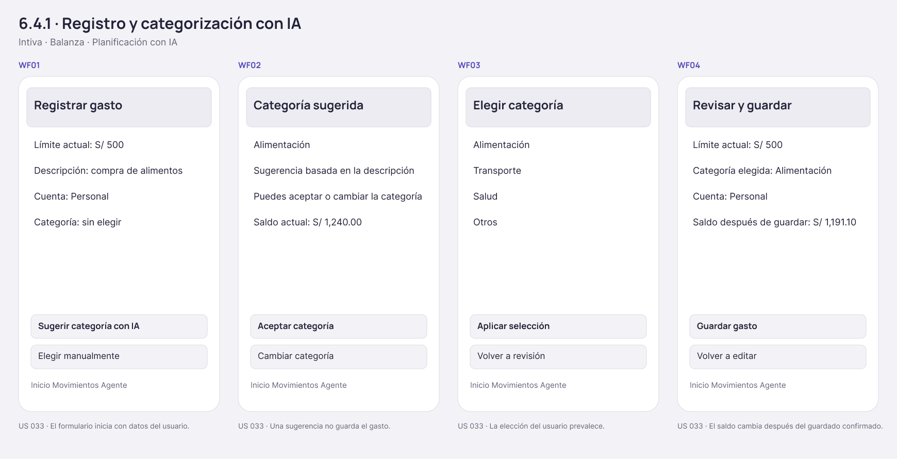

*Figura 6.4.1-A · WF01 a WF04 · Categorización IA. [Abrir diseño en Figma](https://www.figma.com/design/wV6U6QQC4MEYfj8PQArde5/Intiva-Platform-Application-Emergentes?node-id=2051-3384).*
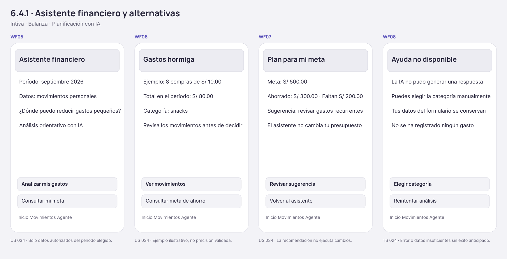

*Figura 6.4.1-B · WF05 a WF08 · Asistente IA. [Abrir diseño en Figma](https://www.figma.com/design/wV6U6QQC4MEYfj8PQArde5/Intiva-Platform-Application-Emergentes?node-id=2051-3445).*
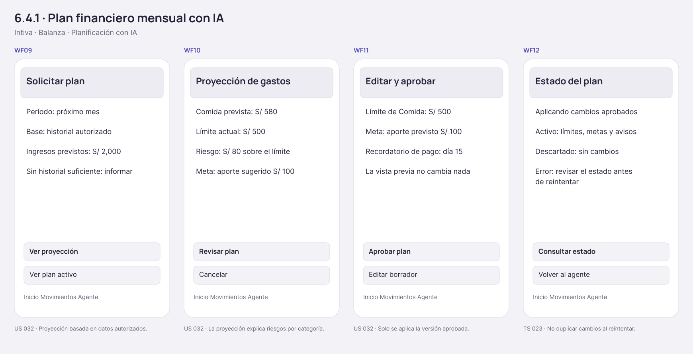

*Figura 6.4.1-C · WF09 a WF12 · Plan financiero mensual. [Abrir diseño en Figma](https://www.figma.com/design/wV6U6QQC4MEYfj8PQArde5/Intiva-Platform-Application-Emergentes?node-id=2051-3506).*

Ejemplo: para Comida, S/ 580 proyectados frente a un límite de S/ 500 muestran un riesgo de S/ 80. El aporte sugerido de S/ 100 queda programado en el plan y no mueve dinero.

### 6.4.2. Applications Wireflow Diagrams

**F01 · Categorización y registro.** WF01 → WF02 → WF04 → confirmación de guardado. Cambiar categoría abre WF03 y vuelve a revisión. Ante sugerencia inválida o fallo de IA se ofrece WF08 y elección manual. Un error al guardar mantiene el formulario y el saldo previo.

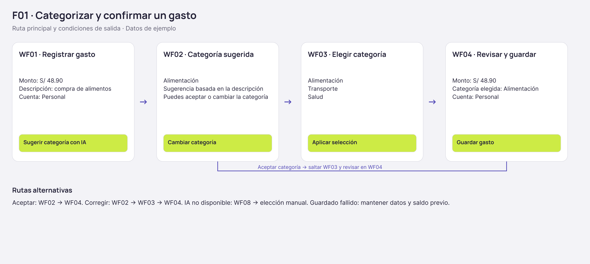

*Figura 6.4.2-A · F01 · Categorización IA. [Abrir diseño en Figma](https://www.figma.com/design/wV6U6QQC4MEYfj8PQArde5/Intiva-Platform-Application-Emergentes?node-id=2051-4574).*

**F02 · Asistente y ahorro.** WF05 → WF06 → consulta de movimientos o WF07 → regreso al asistente. El período y la información utilizada acompañan el análisis. Sin datos suficientes o respuesta válida se muestra WF08. Revisar una recomendación no cambia el presupuesto ni ejecuta una transacción.

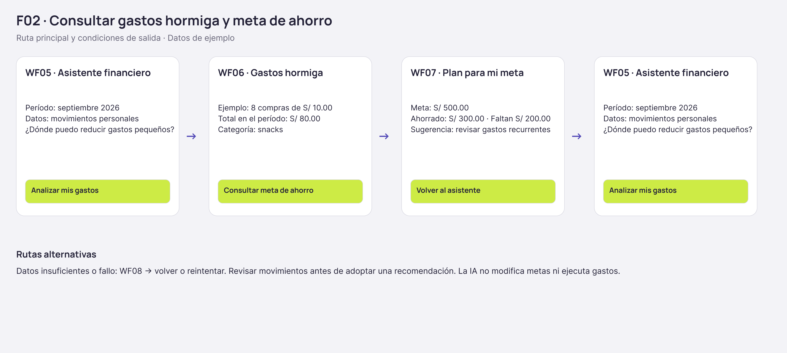

*Figura 6.4.2-B · F02 · Asistente financiero. [Abrir diseño en Figma](https://www.figma.com/design/wV6U6QQC4MEYfj8PQArde5/Intiva-Platform-Application-Emergentes?node-id=2051-4614).*

**F03 · Plan financiero mensual.** WF09 → WF10 → WF11 → WF12. Se solicita la proyección, se revisa el riesgo y se ajusta el borrador. Aprobar habilita la aplicación de la versión elegida. Si faltan datos, se explica qué falta; si se descarta, no se aplica; ante un error se consulta el estado y se reintentan solo las acciones pendientes.

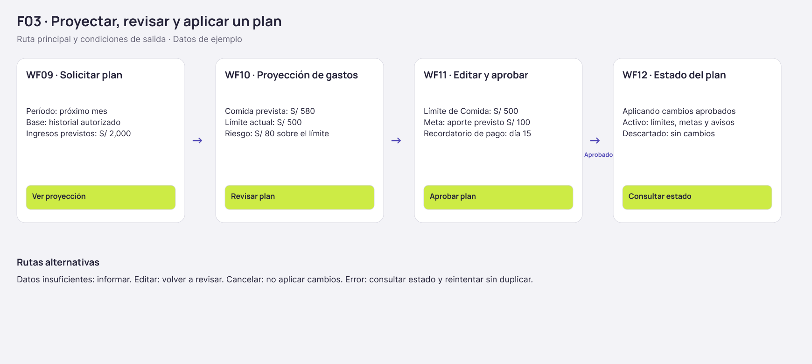

*Figura 6.4.2-C · F03 · Plan financiero mensual. [Abrir diseño en Figma](https://www.figma.com/design/wV6U6QQC4MEYfj8PQArde5/Intiva-Platform-Application-Emergentes?node-id=2051-4652).*

| Condición | Resultado |
| --- | --- |
| Categoría aceptada o corregida | Se conserva la decisión y se vuelve a revisión antes de guardar. |
| IA indisponible o análisis sin base suficiente | Mensaje claro y continuidad manual. |
| Borrador editado | Volver a revisar antes de aprobar. |
| Plan descartado | No aplicar cambios. |
| Error parcial | Mostrar el estado y reintentar solo acciones pendientes. |

### 6.4.3. Applications Mock-ups

Esta sección presenta los mock-ups de la aplicación móvil (Android) y de la aplicación web. En cada pantalla se aplican los principios de diseño, los elementos visuales, el diseño inclusivo y la arquitectura de información definidos en los apartados [6.1](#61-style-guidelines) y [6.2](#62-information-architecture), así como el Design System de Intiva. Los mock-ups se elaboran en Figma, en el mismo archivo de los wireframes y wireflows. Las pantallas base de la aplicación se toman de Page 1, y las pantallas nuevas (WF01 a WF12) de la página **Prototipo**.

**Aplicación de la paleta por función.** Cada color cumple un rol fijo en todas las pantallas:

| Rol | Color | Uso en los mock-ups |
| --- | --- | --- |
| Primario | Índigo `#534AB7` | Botones principales, pestaña activa de la navegación inferior y tarjeta de saldo total. |
| Secundario | Lima `#CDEB45` | Llamadas a la acción de registro (Guardar, Confirmar gasto) y progreso de metas de ahorro. Sobre el lima se usa texto oscuro para mantener el contraste. |
| Terciario | Cobre `#8A4900` | Acciones de edición y algunas categorías. |
| Neutro | Gris violeta `#78767E` | Fondos, bordes, divisores y textos secundarios. |
| Error | Rojo `#BA1A1A` | Gastos, límites superados y acción de eliminar. |
| Estados de límite | Verde (a buen ritmo) y ámbar (cerca del límite) | Siempre acompañados de un texto. Las propuestas pendientes de aprobación se muestran en tonos neutros. |

**Tipografía e iconografía.** Manrope en títulos, Inter en textos y botones, y Space Grotesk en montos, que se muestran con signo ("+" para ingresos y "−" para gastos). Los íconos son Material Symbols en la aplicación móvil y PrimeIcons en la aplicación web.

**Principios de diseño inclusivo aplicados.**
- Contraste verificado para cada combinación de texto, fondo y estado.
- Ningún estado depende solo del color: cada uno incluye un texto.
- Áreas táctiles de al menos 48 dp en Android, y botones principales a todo el ancho en la parte inferior de la pantalla.
- Dimensiones en dp y textos en sp, para respetar el tamaño de letra configurado en el teléfono.
- Contorno de foco visible en la aplicación web, para la navegación con teclado.

**Mock-ups de la aplicación móvil**

**Inicio.** Muestra primero el saldo total, después el estado del presupuesto y al final los movimientos recientes, según la jerarquía visual de [6.2.1](#621-organization-systems).

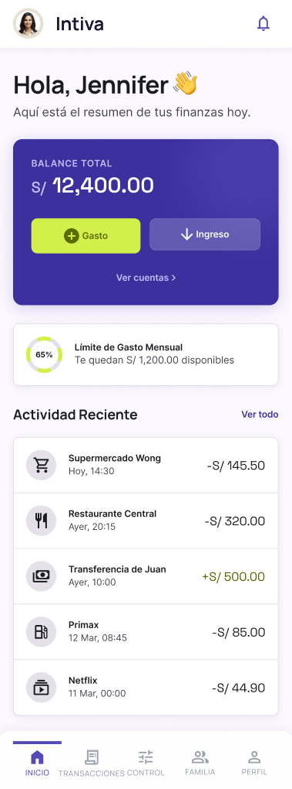

*Figura 6.4.3-A. Mock-up de la pantalla Inicio. [Abrir Mockup editable](https://www.figma.com/design/wV6U6QQC4MEYfj8PQArde5/Intiva-Platform-Application-Emergentes?node-id=0-1).*.*

**Registro manual de un movimiento.** Muestra los cinco pasos del registro (tipo, monto, categoría, cuenta y fecha) con teclado numérico propio y botón de guardado en la parte inferior. Corresponde al formulario base de WF01.

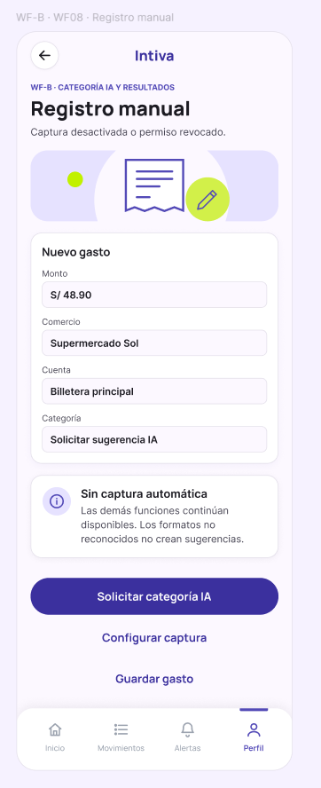

*Figura 6.4.3-B. Mock-up del registro manual de un movimiento.[Abrir Mockup editable](https://www.figma.com/design/wV6U6QQC4MEYfj8PQArde5/Intiva-Platform-Application-Emergentes?node-id=2045-2348).*

**Planificación financiera con IA.** Los mock-ups muestran solicitud, proyección, aprobación y aplicación del plan. El seguimiento mensual y los avisos propuestos pertenecen a US 035, segunda etapa.

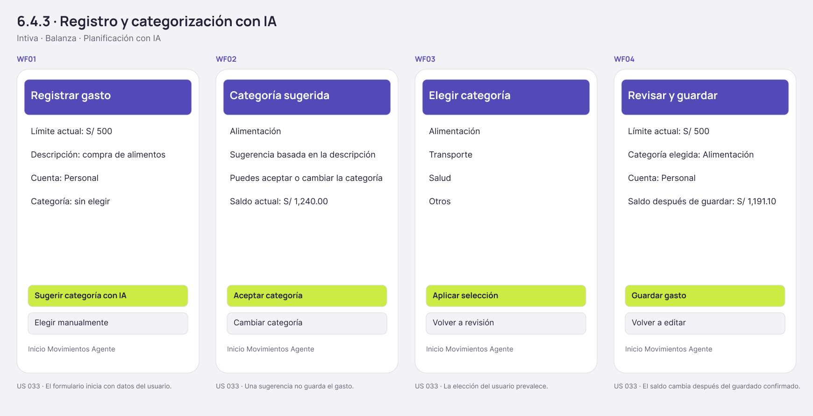

*Figura 6.4.3-C · Mock-ups de categorización IA. [Abrir diseño en Figma](https://www.figma.com/design/wV6U6QQC4MEYfj8PQArde5/Intiva-Platform-Application-Emergentes?node-id=2051-3568).*
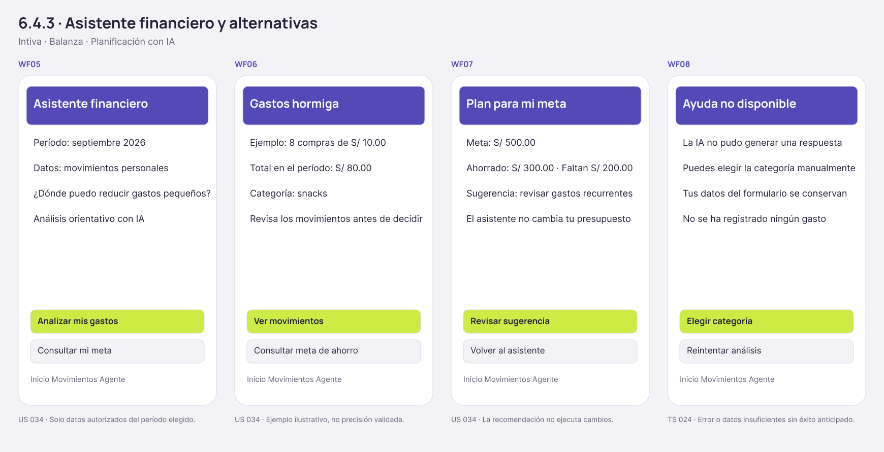

*Figura 6.4.3-D · Mock-ups del asistente IA. [Abrir diseño en Figma](https://www.figma.com/design/wV6U6QQC4MEYfj8PQArde5/Intiva-Platform-Application-Emergentes?node-id=2051-3629).*
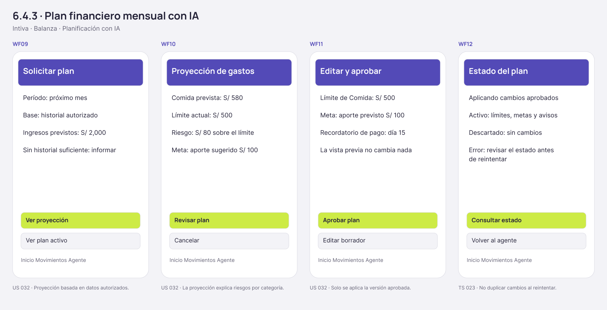

*Figura 6.4.3-E · Mock-ups de planificación con IA. [Abrir diseño en Figma](https://www.figma.com/design/wV6U6QQC4MEYfj8PQArde5/Intiva-Platform-Application-Emergentes?node-id=2051-3690).*

Las pantallas de los tres flujos, junto con la pantalla de inicio con el agente (HOME) y la lista de movimientos (MOV), se agrupan en la sección *6.4.2 · Mock-ups* de la página **Prototipo** del archivo de Figma. Esa agrupación es la base de los User Flows de [6.4.4](#644-applications-user-flow-diagrams) y del prototipo de [6.5](#65-applications-prototyping). [Abrir sección de mock-ups en Figma](https://www.figma.com/design/wV6U6QQC4MEYfj8PQArde5/Intiva-Platform-Application-Emergentes?node-id=2082-763).

**Mock-ups de la aplicación web**

**Panel.** Ubica los indicadores principales (balance total, ingresos, gastos y ahorro del mes) en la parte superior y los gráficos de detalle debajo, con la barra lateral fija y el filtro de período (1 mes, 6 meses o 1 año). Los gráficos usan índigo y lima como colores de sus series.

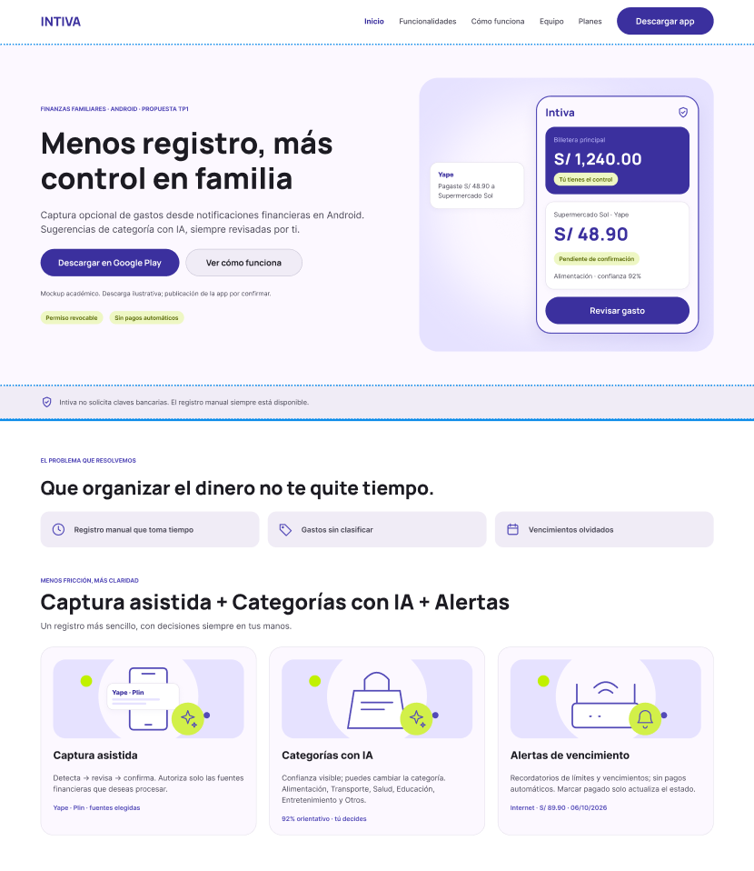

*Figura 6.4.3-G. Mock-up del Panel de la aplicación web. [Abrir Mockup editable](https://www.figma.com/design/wV6U6QQC4MEYfj8PQArde5/Intiva-Platform-Application-Emergentes?node-id=0-1).*

**Reportes.** Muestra la configuración del reporte por tipo (general, ingresos, gastos o ahorros), período e integrantes, y la acción de descarga.

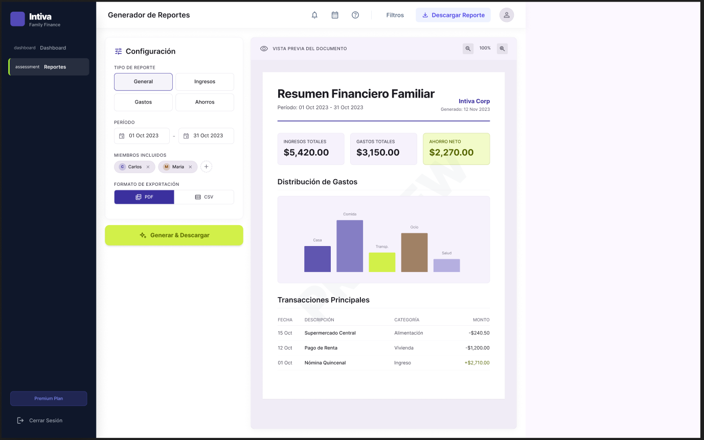

*Figura 6.4.3-G. Mock-up del Panel de la aplicación web. [Abrir Mockup editable](https://www.figma.com/design/wV6U6QQC4MEYfj8PQArde5/Intiva-Platform-Application-Emergentes?node-id=0-1).*

### 6.4.4. Applications User Flow Diagrams

Esta sección presenta los User Flows de las aplicaciones de la solución. Están en la sección **Applications User Flow Diagrams** de la página [Mockup - User flow - Prototyping](https://www.figma.com/design/wV6U6QQC4MEYfj8PQArde5/Intiva-Platform-Application-Emergentes?node-id=2045-2348). Hay un User Flow por cada user goal, identificado con el código UF y el código G del objetivo. Cada flujo se deriva de un wireflow de [6.4.2](#642-applications-wireflow-diagrams) (F01, F02 o F03), o es una subruta de uno de ellos cuando el flujo es secundario.

Los actores corresponden a las audiencias de [6.2.1](#621-organization-systems): el **usuario de Intiva** (individual o integrante del grupo), y el **visitante web**. Para los flujos principales se describe además un escenario académico con dos personas de ejemplo: Carlos y María.

Cada diagrama incluye la ruta esperada (**happy path**, línea continua en el diagrama) y las rutas alternativas (**unhappy paths**, línea discontinua). Las condiciones se marcan con un rombo. Las pantallas se citan con su código de wireframe.

**Aplicación Android**

**UF01 · Registrar un gasto con categoría IA (F01).** El usuario ingresa los datos (WF01), solicita una sugerencia (WF02), acepta o elige otra categoría (WF03), revisa y guarda (WF04). Si la IA falla, WF08 mantiene la alternativa manual. Un fallo al guardar conserva datos y saldo anterior.

**UF02 · Consultar gastos hormiga (F02).** El usuario abre WF05, elige período y obtiene WF06 con movimientos verificables. Sin datos suficientes, WF08 informa que el análisis no puede fundamentarse. Consultar no registra gastos.

**UF03 · Consultar una meta de ahorro (F02).** Desde WF05 o WF06 se abre WF07. El usuario revisa la recomendación y decide si ajusta su planificación en las funciones habituales. La respuesta del asistente no cambia la meta por sí sola.

**UF04 · Proyectar el próximo mes (F03).** El usuario solicita un plan, revisa la proyección por categoría y compara el riesgo con sus límites y metas.

**UF05 · Revisar y aprobar el plan (F03).** El usuario ajusta las acciones del borrador y aprueba una versión. Si la descarta no hay cambios; si falla la aplicación, consulta el estado antes de reintentar.

Los diagramas F01, F02 y F03 muestran categorización, asistencia y planificación.

**Diagramas User Flow en Figma**

Los siguientes diagramas incluyen los mock-ups de cada pantalla (HOME, WF01 a WF12 y MOV), las acciones que conectan una pantalla con otra y las rutas alternativas. Todos parten de la pantalla de inicio de la aplicación, que es el punto de entrada real del usuario. Se encuentran en la página **Prototipo** del archivo de Figma, en la sección *6.4.3 · User Flow Diagrams*.

**User Flow 1 · Registro y categorización con IA (UF01, US 033)**

- **User goal:** "Quiero registrar un gasto sin tener que elegir la categoría a mano, pero sin perder el control de lo que se guarda."
- **Persona:** usuario individual de Intiva, que lleva sus gastos del día a día desde el celular.
- **Happy path (línea continua):** HOME → toca «+ Gasto» → WF01 Registrar gasto → «Sugerir categoría con IA» → WF02 Categoría sugerida → «Aceptar categoría» → WF04 Revisar y guardar → «Guardar gasto» → WF04b Gasto guardado → «Ver movimientos» → MOV Movimientos. El saldo cambia de S/ 1,240.00 a S/ 1,191.10 solo después de guardar.
- **Unhappy paths:** desde WF01, si la IA no está disponible (TS 024) se muestra WF08 Ayuda no disponible, que conserva los datos del formulario y permite elegir la categoría manualmente (WF03). Desde WF02, «Cambiar categoría» abre WF03 Elegir categoría, y al «Aplicar selección» se vuelve a WF04 para revisar antes de guardar.
- **Condiciones:** la sugerencia nunca guarda por sí sola; el usuario siempre revisa y confirma. Un fallo al guardar mantiene los datos y el saldo anterior.

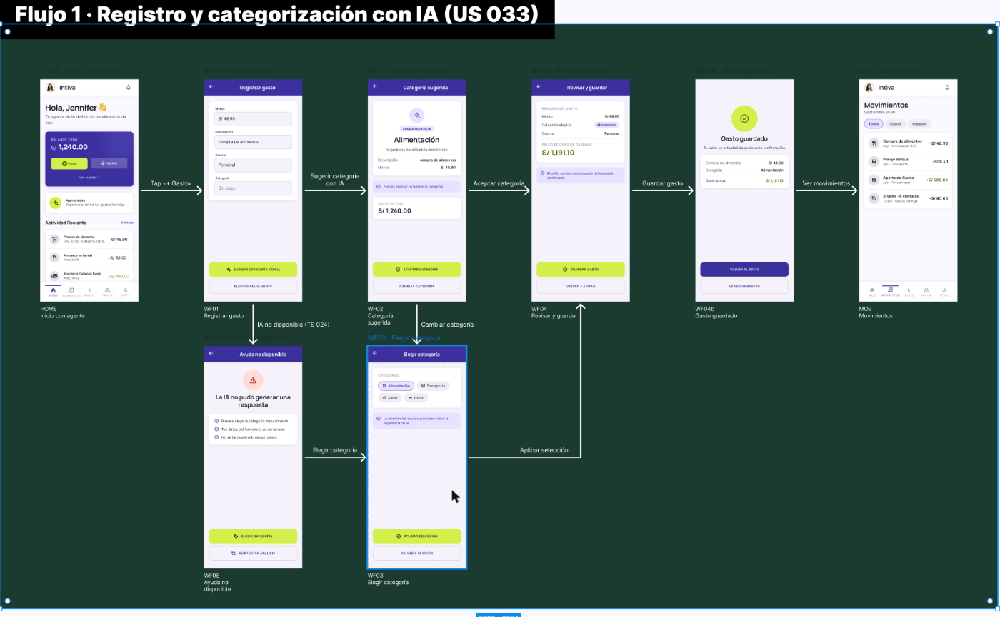

*Figura 6.4.4-A · User Flow 1 · Registro y categorización con IA. [Abrir diagrama en Figma](https://www.figma.com/design/wV6U6QQC4MEYfj8PQArde5/Intiva-Platform-Application-Emergentes?node-id=2082-1831).*

**User Flow 2 · Asistente financiero (UF02 y UF03, US 034)**

- **User goal:** "Quiero saber dónde se me va el dinero en gastos pequeños y cuánto me falta para mi meta de ahorro, sin que nada cambie solo."
- **Persona:** usuario individual que quiere reducir gastos hormiga y cumplir una meta de ahorro.
- **Happy path:** HOME → pestaña «Agente» → WF05 Asistente financiero (período y datos autorizados) → «Analizar mis gastos» → WF06 Gastos hormiga (8 compras de S/ 10.00 = S/ 80.00) → «Consultar meta de ahorro» → WF07 Plan para mi meta (S/ 300.00 ahorrados, faltan S/ 200.00) → «Volver al asistente» → WF05.
- **Rutas alternativas:** desde WF06, «Ver movimientos» lleva a MOV para verificar los movimientos en los que se basa el análisis. Si no hay datos suficientes o la IA no responde, se muestra WF08 con la opción de continuar manualmente o reintentar.
- **Condiciones:** el asistente solo orienta. Revisar una sugerencia no modifica el presupuesto ni ejecuta una transacción, y los montos son ilustrativos.

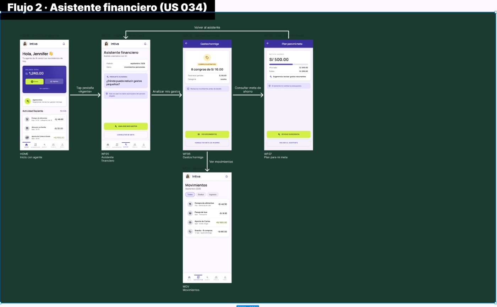

*Figura 6.4.4-B · User Flow 2 · Asistente financiero. [Abrir diagrama en Figma](https://www.figma.com/design/wV6U6QQC4MEYfj8PQArde5/Intiva-Platform-Application-Emergentes?node-id=2082-2301).*

**User Flow 3 · Plan mensual (UF04 y UF05, US 032 y TS 023)**

Solicitar → proyectar → revisar y editar → aprobar → consultar estado. Solo cuando se confirman las acciones requeridas el plan pasa a activo.

[Abrir los user flows editables en Figma](https://www.figma.com/design/wV6U6QQC4MEYfj8PQArde5/Intiva-Platform-Application-Emergentes?node-id=2082-1830).

Los tres User Flows se relacionan con los wireflows F01, F02 y F03 de [6.4.2](#642-applications-wireflow-diagrams): mantienen los mismos códigos de pantalla, y los mismos estados y mensajes, y añaden la pantalla de inicio como punto de partida.


**Diagramas de decisión de los recorridos vigentes**

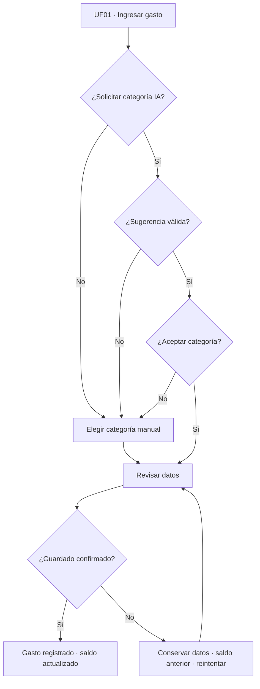

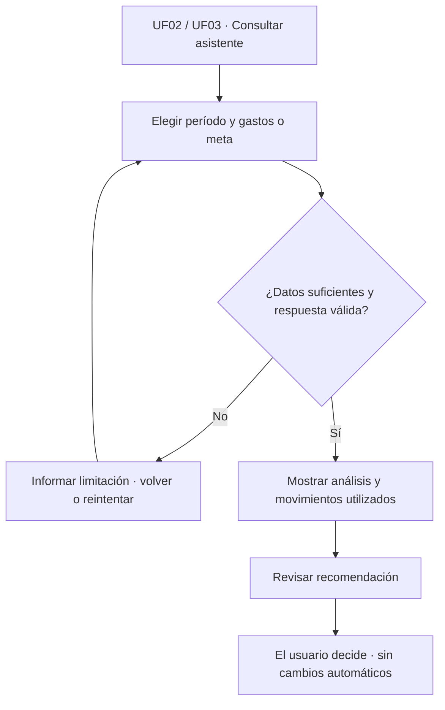

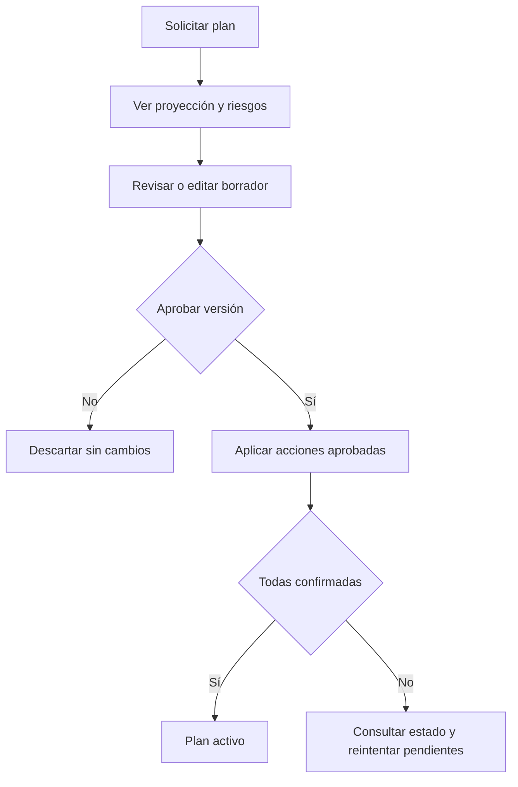

**Sitio web**

**UF06. Evaluar Intiva desde la landing**

- **User goal:** "Quiero comprender la propuesta de Intiva y decidir si me interesa usarla."
- **Actor y escenario:** visitante web que busca entender la utilidad de la categorización y asistencia con IA, el plan mensual y las condiciones de privacidad.
- **Happy path:** landing → beneficios, control y privacidad → decisión de evaluar → CTA "Descargar app" (ilustrativo).
- **Unhappy path:** la información del equipo y los planes aún no está confirmada → la landing lo indica como pendiente y el visitante sigue consultando otras secciones.
- **Límite:** el CTA es ilustrativo. No se dibuja una descarga completada ni una creación de cuenta, y la publicación en Google Play sigue pendiente.

UF06 es una meta web y no deriva de F01, F02 ni F03.


*Figura 6.4.4-F. User Flow UF06. [Abrir diagrama editable](https://www.figma.com/design/wV6U6QQC4MEYfj8PQArde5/Intiva-Platform-Application-Emergentes?node-id=2045-2348).*
Las composiciones TP1 se importaron como elementos vectoriales y textos editables. Las imágenes del informe son exportaciones PNG de los mismos frames. La interacción de estos recorridos se simula en el prototipo de [6.5](#65-applications-prototyping); las pruebas con usuarios se validarán en la siguiente etapa.

## 6.5. Applications Prototyping

La [sección de prototipo en Figma](https://www.figma.com/design/wV6U6QQC4MEYfj8PQArde5/Intiva-Platform-Application-Emergentes?node-id=2082-3151) conserva los recorridos de categorización y consulta financiera, y sustituye el tercero por el plan mensual. Los estados WF12a–WF12d representan aplicación en curso, plan activo, descarte y error. Esta evidencia documenta las pantallas y sus rutas previstas; no acredita la integración con servicios reales.

| Flujo | Recorrido de demostración |
| --- | --- |
| Categorización | WF01 → WF02 → WF04 → confirmación de guardado. |
| Asistente | WF05 → WF06 → WF07 → volver al asistente. |
| Plan mensual | WF09 → WF10 → WF11 → WF12a → WF12b. WF12c muestra descarte y WF12d muestra error. |

Los mock-ups de [6.4.3](#643-applications-mock-ups) muestran el nuevo flujo. La edición de valores y la conexión con los servicios se verifican en la implementación.
